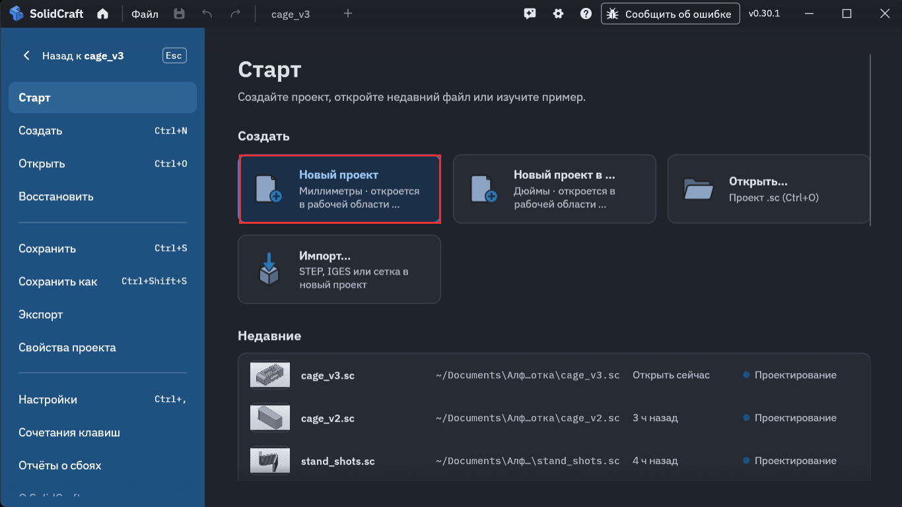
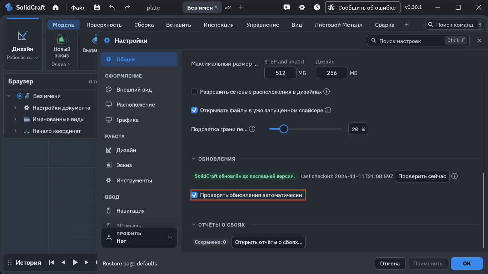

<section class="theory" markdown="1">

## Теоретические сведения
{: .section__title}

[SolidCraft](https://github.com/tangency-labs/solidcraft) — бесплатная программа параметрического трехмерного моделирования с открытым исходным кодом (лицензия MIT или Apache-2.0 на выбор). Она работает на вашем компьютере без учетной записи и регистрации, сохраняет модель в файл проекта `.sc`, а для печати экспортирует сетку STL. На занятии вся группа работает в одной версии — 0.30.1.

Версия зафиксирована по двум причинам. Разработчики описывают состояние программы как раннее, но пригодное для простых деталей; между версиями меняются кнопки и диалоги, а скриншоты и видео этой практики сняты в 0.30.1. Формат файла проекта тоже меняется: проекты, сохраненные в 0.30.1, не открываются в версии 0.30.0 и более старых, и по той же причине проект из более новой версии может не открыться у преподавателя.
{: .th-full}

Интернет программе нужен только для проверки обновлений: при запуске и раз в сутки она отправляет один запрос на `api.github.com` и не передает ни версию, ни сведения о пользователе (документация, раздел Updates and privacy). На этой странице вы эту проверку отключите.
{: .th-full}

</section>

<section class="goal" markdown="1">

## 🎯 Цель работы
{: .section__title}

- скачать установщик версии 0.30.1 с официальной страницы выпуска;
- установить SolidCraft на Windows или macOS;
- создать пустой проект в миллиметрах и отключить проверку обновлений.

</section>

<aside class="callout callout--important" markdown="1">

⏱ Время и место выполнения
{: .callout__title}

Установите программу до первой практики: разделы 1–4 выполняются самостоятельно, около 15 минут. На занятии на эту страницу отведено 10 минут: проверка запуска и вопросы по установке. Если программа не установилась, сообщите преподавателю до занятия.

</aside>

<!-- ===================== 1 ===================== -->

<section class="subsection" id="s1" markdown="1">

## 1. Где взять установщик
{: .subsection__title}

Установщик берется только с официальной страницы выпуска 0.30.1 в репозитории проекта: [github.com/tangency-labs/solidcraft/releases/tag/v0.30.1](https://github.com/tangency-labs/solidcraft/releases/tag/v0.30.1).

1. Откройте страницу выпуска и разверните список Assets внизу.
1. Скачайте один файл для своей системы: для Windows — `solidcraft-windows-x64.msi` (около 80 МБ), для macOS — `solidcraft-macos-universal.dmg` (около 220 МБ; подходит и для процессоров Apple, и для Intel). В списке есть те же файлы с номером версии в имени, например `solidcraft-0.30.1-windows-x64.msi`: подойдет любой из двух.
{: .steps}

<aside class="callout callout--warning" markdown="1">

Проверьте номер версии
{: .callout__title}

Кнопка загрузки на главной странице проекта и раздел Latest ведут на самую новую версию. Если это не 0.30.1, не берите ее: в адресе страницы, с которой вы скачиваете файл, должно стоять `v0.30.1`. Не скачивайте программу с других сайтов.

</aside>

Имена и размеры файлов сверены со страницей выпуска 12.11.2026. В том же списке лежит файл `SHA256SUMS.txt` с контрольными суммами. Сумму скачанного файла показывает команда `certutil -hashfile имя_файла SHA256` в Windows или `shasum -a 256 имя_файла` в macOS: она должна совпасть со строкой этого файла.
{: .th-full}

</section>

<!-- ===================== 2 ===================== -->

<section class="subsection" id="s2" markdown="1">

## 2. Установка на Windows
{: .subsection__title}

1. Запустите скачанный файл `.msi` двойным нажатием ЛКМ.
1. Windows может показать синее окно «Система Windows защитила ваш компьютер» (фильтр SmartScreen): по описанию проекта, файлы загрузки пока не подписаны цифровой подписью. Нажмите «Подробнее» (More info), затем «Выполнить в любом случае» (Run anyway). Так поступают только с файлом, скачанным с официальной страницы из раздела 1.
1. Пройдите шаги установщика, не меняя папку установки. Программа ставится в папку `Program Files`, поэтому Windows попросит разрешение на изменения: подтвердите его (нужны права администратора).
1. Запустите SolidCraft из меню «Пуск».
{: .steps}

</section>

<!-- ===================== 3 ===================== -->

<section class="subsection" id="s3" markdown="1">

## 3. Установка на macOS
{: .subsection__title}

1. Откройте скачанный файл `.dmg` и перетащите `SolidCraft.app` в папку «Программы» (Applications).
1. Запустите SolidCraft из папки «Программы». Если программа открылась, переходите к разделу 4.
1. Если macOS сообщает, что не может проверить программу, закройте сообщение, нажмите по SolidCraft правой кнопкой мыши, ПКМ (или ЛКМ с клавишей Control) и выберите «Открыть» (Open), затем подтвердите.
1. Если и это не помогло, откройте «Системные настройки» → «Конфиденциальность и безопасность» (Privacy & Security), найдите внизу строку о заблокированной программе SolidCraft и нажмите «Все равно открыть» (Open Anyway). Подтвердите паролем и запустите программу снова.
{: .steps}

Шаги 3 и 4 нужны не всегда. Описание проекта говорит, что файлы загрузки не подписаны, а документация — что образ для macOS подписан и открывается обычным образом; какой из двух случаев встретится в версии 0.30.1, зависит от сборки. Сообщите преподавателю, какой шаг понадобился вам.
{: .th-full}

<aside class="callout callout--warning" markdown="1">

Что проверено на курсе
{: .callout__title}

Все построения практики проверены в Windows 11. В macOS и Linux установка и построения на курсе не проверялись. Сборки для Linux (AppImage, пакеты `.deb` и `.rpm`) лежат на той же странице выпуска, шаги установки — в документации, раздел Getting started. Если на вашем компьютере программа не запускается, сообщите преподавателю до занятия: запасной вариант — компьютер аудитории с Windows.

</aside>

</section>

<!-- ===================== 4 ===================== -->

<section class="subsection" id="s4" markdown="1">

## 4. Первый запуск
{: .subsection__title}

1. На стартовом экране нажмите «Новый проект». Единицы проекта — миллиметры.
1. Убедитесь, что открылось окно с лентой вкладок сверху («Модель» и другие), панелью «Браузер» слева и полосой «История» внизу. Эти области разобраны на [task 4-1](task_4-1.html).
1. Отключите проверку обновлений: «Файл» → «Настройки…» (или Ctrl+,, или значок шестеренки в заголовке окна) → раздел «Общие» → блок «Обновления». Снимите флажок «Проверять обновления автоматически» и нажмите OK.
1. Если программа все же предложит обновиться, откажитесь.
1. Закройте программу, проект не сохраняйте.
{: .steps}

<figure class="figure-src">

<figcaption class="figure-src__caption">Стартовый экран. Рамкой выделена карточка «Новый проект»: единицы — миллиметры.</figcaption>
</figure>

<figure class="figure-src">

<figcaption class="figure-src__caption">«Файл» → «Настройки…» → «Общие» → блок «Обновления». Снимите флажок, выделенный рамкой, и нажмите OK.</figcaption>
</figure>

Номер версии написан в правом верхнем углу окна, рядом с кнопками управления окном: `v0.30.1`.

Интерфейс программы русский, но часть строк осталась на английском: например, пункты меню «Export STL…» и «Insert Mesh» и некоторые подсказки инструментов. На страницах практики названия приведены так, как они написаны в программе.
{: .th-full}

</section>

Проверьте себя
{: .check__title}

Установка завершена, если выполнены все три условия. Проверка ничего не меняет в программе.

| Показатель | Должно быть | Если не совпало |
|---|---|---|
| Номер версии в правом верхнем углу окна | `v0.30.1` | установлена другая версия: удалите программу и установите 0.30.1 со страницы выпуска |
| Новый проект | открывается, единицы — миллиметры | программа не запускается: смотрите шаги о предупреждении системы в разделах 2 и 3 |
| Проверка обновлений | флажок снят | программа предложит обновиться: откажитесь и снимите флажок |

<section class="subsection" id="video" markdown="1">

## 5. Видео
{: .subsection__title}

Если шаг не получился, посмотрите его в записи. Области окна в ролике обведены желтой рамкой. Скорость выбирается в панели под роликом. Ролик без звука, шаги подписаны титрами под кадром. Номера шагов в титрах идут по порядку ролика и не совпадают с номерами списков страницы. Сохранение проекта в записи не показано. В ролике настройки открыты значком шестеренки в заголовке окна: в небольшом окне пункт «Настройки…» уходит за нижний край меню «Файл». Кнопка «Обновить» в заголовке появляется, пока флажок обновлений включен; нажимать ее не нужно.

<figure class="figure-src figure-video">
<video controls preload="none" playsinline width="1368" height="832" poster="../assets/video/task_4/4-0.jpg" aria-label="Видео: Первый запуск: новый проект, области окна, настройки обновлений">
<source src="../assets/video/task_4/4-0.mp4" type="video/mp4">
Браузер не показывает видео. <a href="../assets/video/task_4/4-0.mp4">Скачайте файл</a>.
</video>
<figcaption class="figure-src__caption">Первый запуск: новый проект, области окна, настройки обновлений. Длительность 45 с, файл 1,1 МБ: загрузка начнется после нажатия кнопки воспроизведения.</figcaption>
</figure>

</section>

<section class="then" markdown="1">

## Затем
{: .then__title}

1. Создайте папку `cad_4` для файлов этого занятия.
1. Перейдите к [task 4-1](task_4-1.html): интерфейс и первая деталь.
{: .steps}

</section>

<section class="section sources" markdown="1">

## Источники
{: .section__title}

1. SolidCraft: описание проекта (README), [github.com/tangency-labs/solidcraft](https://github.com/tangency-labs/solidcraft) — назначение программы, лицензия, файлы загрузки для Windows и macOS, предупреждения SmartScreen и macOS, состояние проекта.
1. SolidCraft: страница выпуска 0.30.1, [github.com/tangency-labs/solidcraft/releases/tag/v0.30.1](https://github.com/tangency-labs/solidcraft/releases/tag/v0.30.1) — совместимость формата проекта между версиями.
1. SolidCraft: документация, разделы [Getting started](https://docs.solidcraft.io/guide/getting-started.html) (установка на macOS) и [Updates and privacy](https://docs.solidcraft.io/guide/updates.html) (проверка обновлений и ее отключение).
1. SolidCraft 0.30.1, проверено на программе: стартовый экран, единицы проекта, области окна, английские строки интерфейса.
{: .sources__list}

</section>
