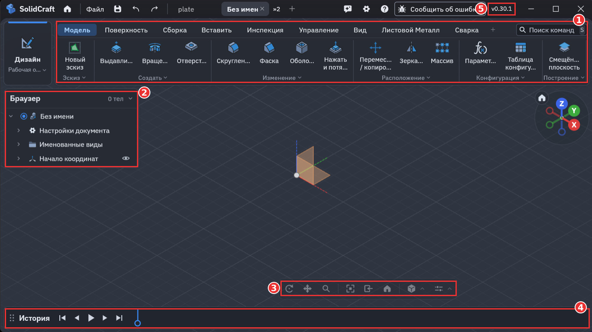
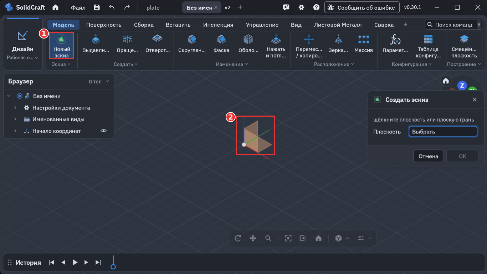
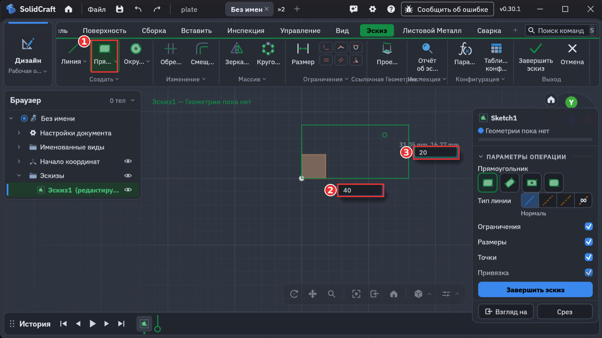
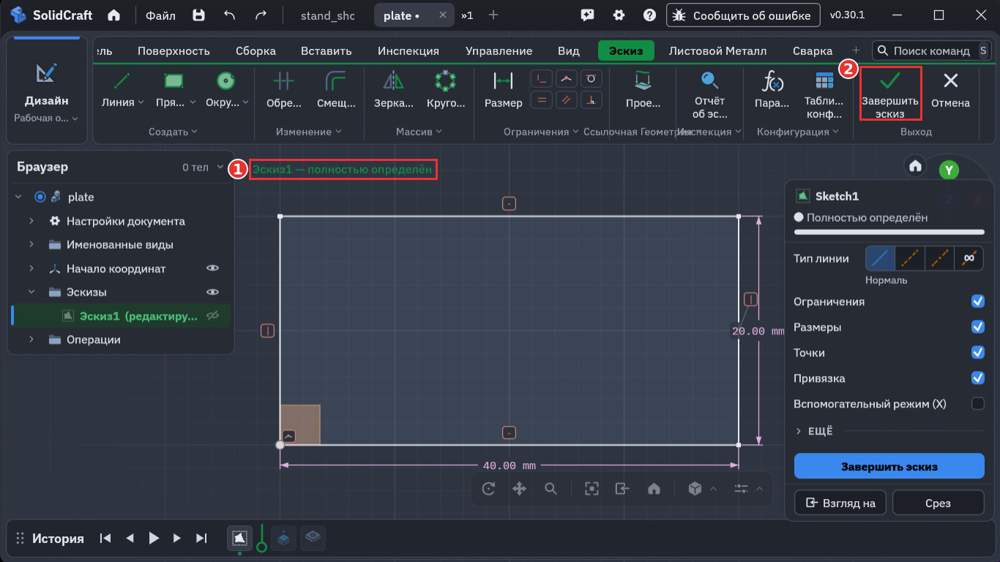
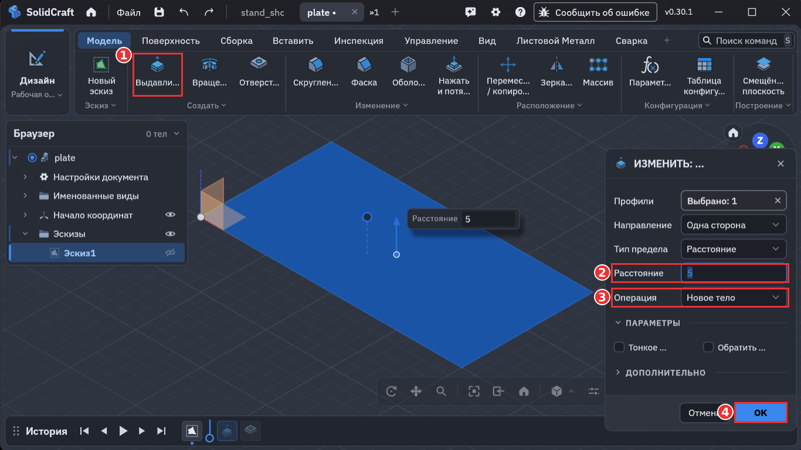
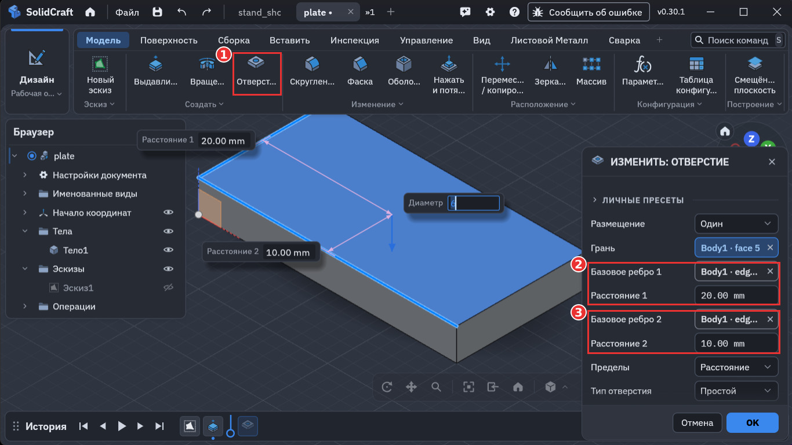
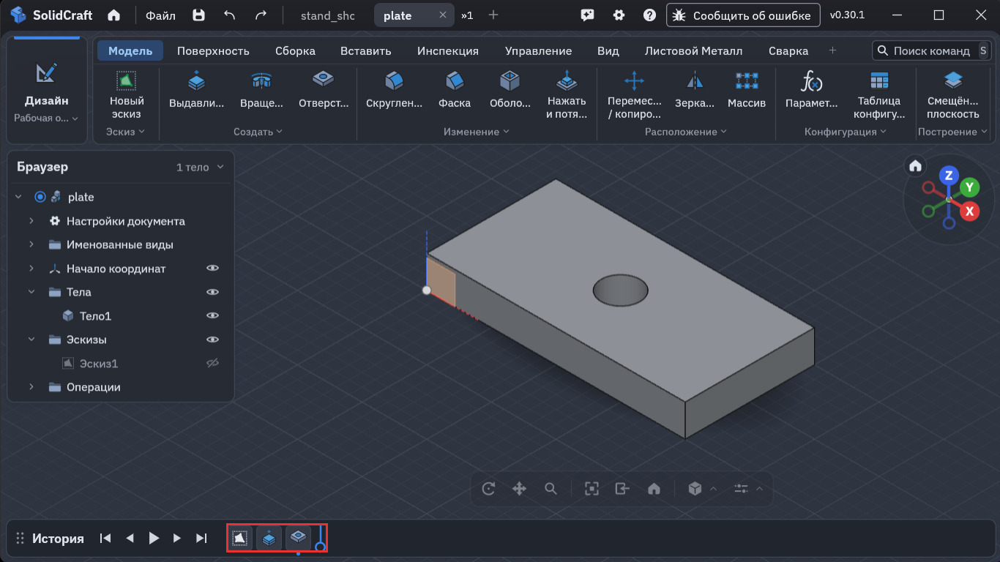

<section class="theory" markdown="1">

## Теоретические сведения
{: .section__title}

Деталь в SolidCraft строится повторением одного цикла: на плоскости рисуют эскиз — плоский контур с размерами, затем операция превращает эскиз в объем или вырезает его из уже построенного тела. В истории подставки для телефона четыре значка (эскиз и три операции), в истории кейджа — тринадцать. На этой странице вы пройдете цикл на самой простой детали: пластине 40 × 20 × 5 мм с отверстием.

Программа запоминает не форму, а порядок построения: эскизы, размеры и операции. Этот порядок виден в полосе «История» внизу окна. Если изменить размер в эскизе, программа заново выполнит все операции после него. Поэтому размеры задают числами: число можно найти и исправить, а положение точки, поставленной нажатием ЛКМ, — нет.
{: .th-full}

</section>

<section class="goal" markdown="1">

## 🎯 Цель работы
{: .section__title}

- находить в окне программы ленту, браузер модели и историю операций;
- создавать эскиз на плоскости и задавать размеры с клавиатуры;
- доводить эскиз до состояния «полностью определен»;
- выполнять операции «Выдавливание» и «Отверстие»;
- сохранять проект в файл `.sc`.

</section>

<aside class="callout callout--important" markdown="1">

⏱ Время и место выполнения
{: .callout__title}

Страница выполняется на первой практике по данной теме, около 15 минут. Пластина — разминка: она не сдается, но ее приемы нужны на всех следующих страницах.

</aside>

<!-- ===================== 1 ===================== -->

<section class="subsection" id="s1" markdown="1">

## <span class="subsection__num">1.</span> Окно программы
{: .subsection__title}

| № на снимке | Область | Где | Что в ней |
|---|---|---|---|
| 1 | Лента | сверху | вкладки с инструментами: «Модель» (операции над телом), «Эскиз» (линии, прямоугольники, размеры) и другие |
| 2 | Браузер | слева | дерево модели: начало координат с базовыми плоскостями, эскизы, тела; значок глаза показывает и скрывает элемент |
| 3 | Кнопки вида | внизу рабочего поля | «Главная» (шестая слева) возвращает изометрию, «Вписать» показывает модель целиком |
| 4 | История | снизу | операции в порядке построения; двойное нажатие ЛКМ по значку открывает операцию для правки |
| 5 | Номер версии | справа вверху | версия программы: на занятии это 0.30.1 |
| — | Рабочее поле | в центре | модель |
| — | Строка состояния эскиза | сверху слева, пока открыт эскиз | «полностью определен» или «степеней свободы: N» |

Области без номера на снимке не выделены: рабочее поле занимает центр окна, а строка состояния появляется, когда открыт эскиз.
{: .muted}

**Обозначения.** ЛКМ — левая кнопка мыши, ПКМ — правая. «Нажмите ЛКМ по грани» означает: наведите указатель на грань и один раз нажмите левую кнопку. Кнопки на ленте и в диалогах тоже нажимают ЛКМ.

<figure class="figure-src">
<a href="../assets/img/task_4/4-1-1.jpg" target="_blank" rel="noopener" aria-label="Открыть снимок в полном размере"></a>
<figcaption class="figure-src__caption">Окно с пустым проектом: 1 — лента; 2 — браузер; 3 — кнопки вида, шестая слева — «Главная»; 4 — история; 5 — номер версии программы.</figcaption>
</figure>

**Управление видом.** Модель вращают, сдвигают и приближают мышью; на детали это не влияет, меняется только точка зрения.

| Действие | Мышь | Сенсорная панель macOS |
|---|---|---|
| Вращать | движение с нажатой правой кнопкой; или Ctrl (на macOS Cmd) и левая кнопка на пустом месте | Cmd и движение с нажатием на пустом месте |
| Сдвигать | движение с нажатой средней кнопкой (колесом) | движение двумя пальцами |
| Приближать | колесо; масштаб меняется к точке под указателем | щипок |
| Вернуть исходный вид | двойное нажатие средней кнопки мыши или кнопка «Главная» | кнопка «Главная» |
| Показать модель целиком | F6 или кнопка «Вписать» | F6 |
{: .table-mid}

Таблица описывает управление по умолчанию (документация, раздел «A tour of the window»). В настройках программы есть другие наборы, в том числе Touchpad для работы без мыши.
{: .th-full}

Клавиши, которые понадобятся на занятии:

| Клавиша | Действие |
|---|---|
| L | линия |
| R | прямоугольник |
| D | размер |
| F | скругление |
| E | выдавливание |
| H | отверстие |
| Ctrl+Z | отменить действие |
| Ctrl+Y | вернуть отмененное действие |
{: .table-mid}

<div class="definition" markdown="1">

<span class="definition__term">Степень свободы</span> эскиза — движение, которое контуру еще разрешено: сдвиг точки, изменение длины или угла. У полностью определенного эскиза степеней свободы нет: каждую точку удерживает размер или привязка.

</div>

</section>

<!-- ===================== 2 ===================== -->

<section class="subsection" id="s2" markdown="1">

## <span class="subsection__num">2.</span> Эскиз пластины
{: .subsection__title}

На входе — пустой проект в миллиметрах ([task 4-0](task_4-0.html), раздел 4): запустите SolidCraft и нажмите «Новый проект». На выходе — прямоугольник 40 × 20 мм, привязанный к началу координат.

1. На ленте нажмите «Новый эскиз».
1. Нажмите ЛКМ по горизонтальной базовой плоскости XY в рабочем поле. Эскиз откроется сразу: вид повернется к плоскости, лента переключится на инструменты эскиза.
1. Выберите инструмент «Прямоугольник».
1. Нажмите ЛКМ точно в начале координат: курсор «прилипает» к нему.
1. Не трогая мышь, наберите на клавиатуре `40`, нажмите Tab, наберите `20`, нажмите Enter.
1. Посмотрите на строку состояния: должно быть «Эскиз1 — полностью определен».
1. Нажмите «Завершить эскиз».
{: .steps}

<figure class="figure-src">
<a href="../assets/img/task_4/4-1-1b.jpg" target="_blank" rel="noopener" aria-label="Открыть снимок в полном размере"></a>
<figcaption class="figure-src__caption">1 — кнопка «Новый эскиз»; 2 — базовые плоскости. Нажмите ЛКМ по горизонтальной плоскости XY: эскиз откроется сразу.</figcaption>
</figure>

<figure class="figure-src">
<a href="../assets/img/task_4/4-1-2.jpg" target="_blank" rel="noopener" aria-label="Открыть снимок в полном размере"></a>
<figcaption class="figure-src__caption">1 — инструмент «Прямоугольник»; 2 и 3 — поля ширины и высоты у курсора: 40, Tab, 20, затем Enter.</figcaption>
</figure>

<figure class="figure-src">
<a href="../assets/img/task_4/4-1-3.jpg" target="_blank" rel="noopener" aria-label="Открыть снимок в полном размере"></a>
<figcaption class="figure-src__caption">1 — строка состояния: «Эскиз1 — полностью определен»; 2 — кнопка «Завершить эскиз».</figcaption>
</figure>

<aside class="callout callout--hint" markdown="1">

Почему эскиз сразу определен
{: .callout__title}

Первый угол прямоугольника совпал с началом координат, а два числа с клавиатуры стали размерами. Положение задано привязкой, форма — размерами, свободных движений не осталось. Если бы первое нажатие ЛКМ попало мимо начала координат, статус был бы «степеней свободы: 2»: прямоугольник нужного размера, но его можно двигать.

</aside>

<aside class="callout callout--warning" markdown="1">

Клавиша Esc
{: .callout__title}

Одно нажатие клавиши Esc завершает текущий инструмент. Два нажатия подряд закрывают эскиз целиком. Если эскиз закрылся раньше времени, откройте его двойным нажатием ЛКМ по строке «Эскиз1» в браузере.

</aside>

</section>

<!-- ===================== 3 ===================== -->

<section class="subsection" id="s3" markdown="1">

## <span class="subsection__num">3.</span> Выдавливание
{: .subsection__title}

На входе — завершенный эскиз. На выходе — тело 40 × 20 × 5 мм.

1. На ленте, на вкладке «Модель», нажмите «Выдавливание».
1. Нажмите ЛКМ внутри прямоугольника: контур выделится как профиль.
1. В поле расстояния введите `5`. Надежный способ заменить значение в поле: нажатие ЛКМ в поле, Ctrl+A (на macOS Cmd+A), число.
1. Проверьте, что в списке «Операция» стоит «Новое тело», и нажмите OK.
{: .steps}

<figure class="figure-src">
<a href="../assets/img/task_4/4-1-4.jpg" target="_blank" rel="noopener" aria-label="Открыть снимок в полном размере"></a>
<figcaption class="figure-src__caption">1 — кнопка «Выдавливание»; 2 — расстояние 5; 3 — операция «Новое тело»; 4 — OK.</figcaption>
</figure>

В браузере появилось тело, в истории — два значка: эскиз и выдавливание. Список «Операция» в этом диалоге на следующих страницах понадобится в двух других положениях: «Объединить» добавляет материал к телу, «Вырезать» убирает.
{: .th-full}

</section>

<!-- ===================== 4 ===================== -->

<section class="subsection" id="s4" markdown="1">

## <span class="subsection__num">4.</span> Отверстие
{: .subsection__title}

На входе — пластина. На выходе — сквозное отверстие диаметром 6 мм в центре верхней грани.

1. На ленте нажмите «Отверстие».
1. Нажмите ЛКМ по верхней грани пластины 40 × 20 мм.
1. Привяжите отверстие к двум ребрам грани. Поле в диалоге и ребро на модели выбирайте ЛКМ:
   - «Базовое ребро 1» — короткое ребро грани, «Расстояние 1» — `20`;
   - «Базовое ребро 2» — длинное ребро грани, «Расстояние 2» — `10`.
1. В поле «Глубина» введите `5`, в поле «Диаметр» — `6`. Значение в каждом поле заменяйте так: нажатие ЛКМ в поле, Ctrl+A, число.
1. Проверьте предпросмотр: отверстие в центре грани и проходит пластину насквозь. Нажмите OK.
{: .steps}

<figure class="figure-src">
<a href="../assets/img/task_4/4-1-5.jpg" target="_blank" rel="noopener" aria-label="Открыть снимок в полном размере"></a>
<figcaption class="figure-src__caption">1 — кнопка «Отверстие»; 2 — базовое ребро 1 и расстояние 20; 3 — базовое ребро 2 и расстояние 10. Поля «Глубина» и «Диаметр» расположены ниже в том же диалоге: прокрутите его колесом мыши.</figcaption>
</figure>

<figure class="figure-src">
<a href="../assets/img/task_4/4-1-6.jpg" target="_blank" rel="noopener" aria-label="Открыть снимок в полном размере"></a>
<figcaption class="figure-src__caption">Готовая пластина. В рамке — три значка истории: эскиз, выдавливание, отверстие.</figcaption>
</figure>

Два расстояния от ребер ставят отверстие точно: 20 мм — половина длины 40, 10 мм — половина ширины 20. Тем же приемом на [task 4-7](task_4-7.html) вы поставите отверстие в центр заднего торца кейджа.

После выбора ребра курсор сам в поле расстояния не переходит: если начать печатать сразу, число попадет в предыдущее поле.

</section>

<!-- ===================== 5 ===================== -->

<section class="subsection" id="s5" markdown="1">

## <span class="subsection__num">5.</span> Сохранение
{: .subsection__title}

1. Нажмите Ctrl+S (на macOS Cmd+S).
1. Выберите папку `cad_4`, введите имя `plate` и сохраните. Программа создаст файл `plate.sc`.
{: .steps}

Рядом с проектом программа держит служебные файлы с расширениями `.bak` и `.~lock`. Не удаляйте и не переименовывайте их, пока проект открыт.
{: .th-full}

<div class="check" markdown="1">

Проверьте себя
{: .check__title}

Сверка показывает, что цикл «эскиз — операция» пройден полностью. Она ничего не меняет в модели.

| Показатель | Должно быть | Если не совпало |
|---|---|---|
| Значков в «Истории» | 3: эскиз, выдавливание, отверстие | лишний значок — операция выполнена дважды: отмените Ctrl+Z |
| Статус эскиза (двойное нажатие ЛКМ по «Эскиз1») | полностью определен | первый угол не в начале координат: перетащите его туда или постройте эскиз заново |
| Отверстие | в центре грани, насквозь | перепутаны расстояния 20 и 10 или глубина меньше 5: двойное нажатие ЛКМ по значку отверстия в «Истории» |

</div>

</section>

<!-- ===================== 6 ===================== -->

<section class="subsection" id="s6" markdown="1">

## <span class="subsection__num">6.</span> Мини-тест
{: .subsection__title}

<div class="theory" markdown="1">

Теория к вопросам
{: .analysis__title}

**Механизм.** Эскиз хранит контур, привязки и размеры; операция хранит ссылку на эскиз и свои параметры; история хранит порядок. Из этого следуют три правила работы.

| Правило | Причина | Пример на пластине |
|---|---|---|
| Первую точку ставят в начало координат | привязка убирает две степени свободы — сдвиги по двум осям | прямоугольник сразу «полностью определен» |
| Размеры вводят числами | число становится размером эскиза, его можно найти и изменить | 40, Tab, 20, Enter |
| Ранние размеры проверяют сразу | после правки эскиза программа выполняет заново все операции за ним; то, что построено на гранях, может потерять привязки | статус и числа 40 и 20 проверены до выдавливания |

Изменить размер можно и позже: откройте эскиз двойным нажатием ЛКМ в браузере, дважды нажмите ЛКМ по числу размера и введите новое. Чем больше операций построено после эскиза, тем выше риск, что часть из них придется поправлять.

</div>

<div class="quiz" data-file="task_4-1_test.txt" data-comment="#">
<p class="quiz__title">Вопросы к странице</p>
<p class="quiz__intro">Ответьте на вопросы. Текст результата сохранять не нужно: тест этой страницы не сдается.</p>
<div class="quiz__q">
<p>1. Прямоугольник 40 × 20 построен вводом чисел, но первое нажатие ЛКМ попало мимо начала координат. Что покажет строка состояния?</p>
<label><input type="radio" data-ok> «Степеней свободы: 2»: форма задана, но прямоугольник можно сдвигать по двум осям.</label>
<label><input type="radio"> «Полностью определен»: оба размера введены.<span class="quiz__why" hidden>Размеры задают форму, но не положение. Без привязки к началу координат контур можно двигать.</span></label>
<label><input type="radio"> «Степеней свободы: 4»: не определены четыре угла.<span class="quiz__why" hidden>Углы связаны размерами 40 и 20 и прямыми углами. Свободны только два сдвига всего прямоугольника.</span></label>
<p class="quiz__exp" hidden>Размеры 40 и 20 фиксируют форму. Положение фиксирует привязка первого угла к началу координат; без нее остаются два сдвига.</p>
</div>
<div class="quiz__q">
<p>2. Длина пластины должна быть ровно 40 мм. Чем ввод числа 40 с клавиатуры отличается от нажатия ЛКМ на отметке 40 мм?</p>
<label><input type="radio"> Ничем: в обоих случаях длина равна 40 мм.<span class="quiz__why" hidden>Нажатие ЛКМ ставит точку там, куда попал указатель, например на 39,8 мм, и размер в эскизе не появляется.</span></label>
<label><input type="radio" data-ok> Число становится размером эскиза: оно точное, видно на эскизе и его можно изменить.</label>
<label><input type="radio"> Нажатие ЛКМ точнее: указатель привязывается к сетке.<span class="quiz__why" hidden>Привязка к сетке не создает размер. Статус останется «степеней свободы», а длину нельзя будет исправить числом.</span></label>
<p class="quiz__exp" hidden>Введенное число программа хранит как размер. Точка, поставленная нажатием ЛКМ, размером не закреплена и остается степенью свободы.</p>
</div>
<div class="quiz__q">
<p>3. Вы рисуете контур и дважды подряд нажали Esc. Что произошло?</p>
<label><input type="radio"> Отменились два последних отрезка.<span class="quiz__why" hidden>Отмену делает Ctrl+Z. Esc завершает инструмент, а второй Esc закрывает эскиз.</span></label>
<label><input type="radio"> Программа вернулась на стартовый экран.<span class="quiz__why" hidden>Проект остается открытым. Закрылся только эскиз, он есть в браузере.</span></label>
<label><input type="radio" data-ok> Первый Esc завершил инструмент, второй закрыл эскиз; эскиз открывается двойным нажатием ЛКМ в браузере.</label>
<p class="quiz__exp" hidden>Один Esc завершает инструмент, два — эскиз. Нарисованное не пропадает: эскиз открывается из браузера.</p>
</div>
<div class="quiz__bar"><button type="button" class="tool-btn tool-btn--main quiz__check">Проверить</button><span class="quiz__status"></span></div>
<div class="quiz__result" hidden><p>Ответы:</p><pre class="quiz__comment"></pre><div class="quiz__bar"><button type="button" class="tool-btn quiz__copy">Скопировать</button><span class="quiz__copied"></span></div></div>
</div>

</section>

<section class="subsection" id="video" markdown="1">

## <span class="subsection__num">7.</span> Видео
{: .subsection__title}

Если шаг не получился, посмотрите его в записи. Скорость выбирается в панели под роликом. Ролик без звука, шаги подписаны титрами под кадром. Номера шагов в титрах идут по порядку ролика и не совпадают с номерами списков страницы. Сохранение проекта в записи не показано.

<figure class="figure-src figure-video">
<video controls preload="none" playsinline width="1368" height="832" poster="../assets/video/task_4/4-1.jpg" aria-label="Видео: Пластина: эскиз, выдавливание, отверстие">
<source src="../assets/video/task_4/4-1.mp4" type="video/mp4">
Браузер не показывает видео. <a href="../assets/video/task_4/4-1.mp4">Скачайте файл</a>.
</video>
<figcaption class="figure-src__caption">Пластина: эскиз, выдавливание, отверстие. Длительность 1 мин 36 с, файл 3,3 МБ: загрузка начнется после нажатия кнопки воспроизведения.</figcaption>
</figure>

</section>

<section class="then" markdown="1">

## Затем
{: .then__title}

1. Проверьте, что в папке `cad_4` лежит файл `plate.sc`. Он не сдается.
1. Перейдите к [task 4-2](task_4-2.html): профиль подставки. Новый проект создается там первым шагом.
{: .steps}

```text
cad_4/
└── @@plate.sc@@
```
{: .folder-tree}

</section>

<section class="section sources" markdown="1">

## Источники
{: .section__title}

1. SolidCraft 0.30.1, проверено на программе: эскиз прямоугольника с вводом размеров, статус эскиза, «Выдавливание», «Отверстие» с двумя базовыми ребрами, сохранение проекта.
1. SolidCraft: документация, разделы [A tour of the window](https://docs.solidcraft.io/guide/ui-tour.html) (области окна, управление видом), [Sketching and constraints](https://docs.solidcraft.io/guide/sketching.html) (ввод размеров, степени свободы), [Keyboard shortcuts](https://docs.solidcraft.io/guide/shortcuts.html).
{: .sources__list}

</section>
