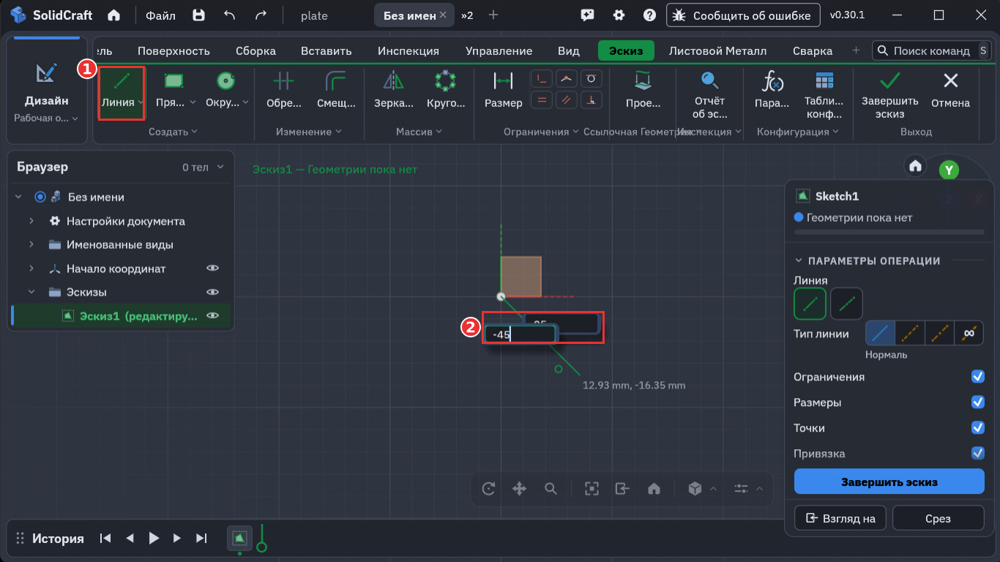
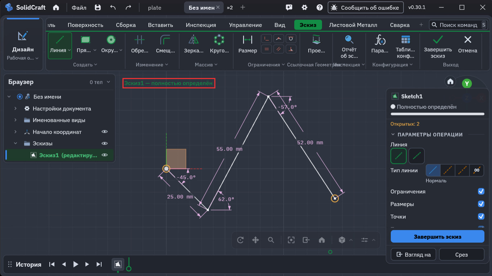
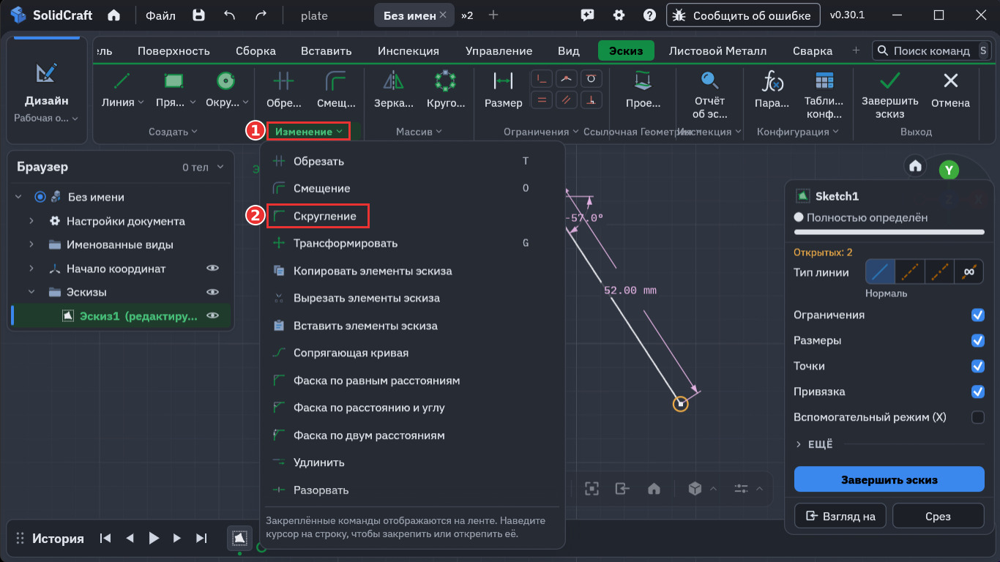
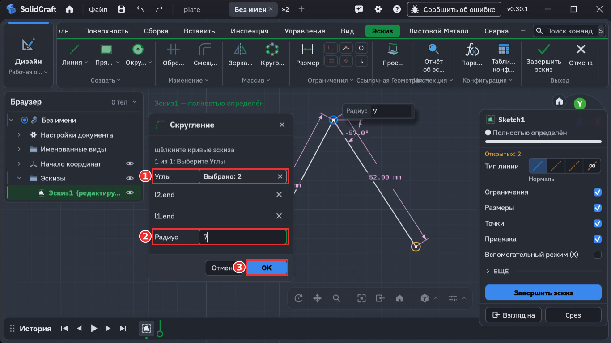
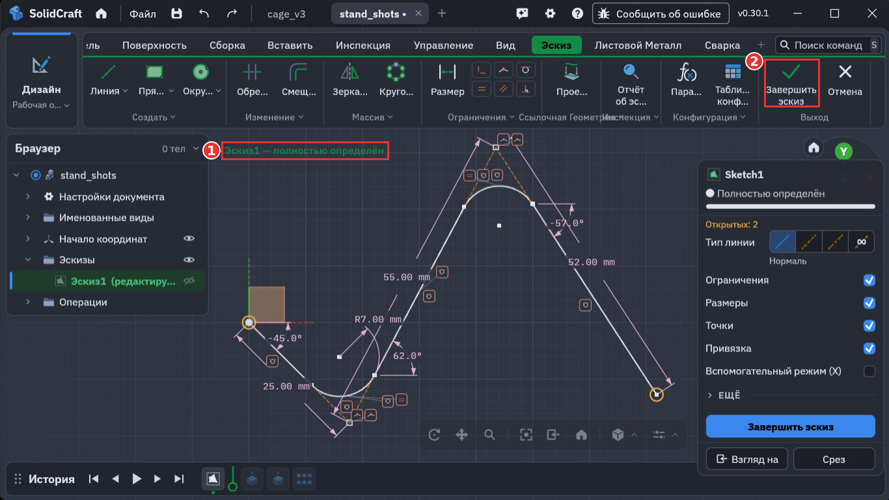

<section class="theory" markdown="1">

## Теоретические сведения
{: .section__title}

Подставка для телефона — это полоса постоянной толщины, согнутая в двух местах. Такую деталь строят от профиля: рисуют одну ломаную линию — вид полосы сбоку, а толщину и ширину добавляют операцией на следующей странице. Вся форма подставки задана шестью числами: тремя длинами и тремя углами.

Каждый отрезок профиля вводится парой «длина, угол». Угол отсчитывается от горизонтальной оси, направленной вправо, против часовой стрелки; отрицательный угол ведет отрезок вниз. Угол абсолютный: он не зависит от направления предыдущего отрезка.
{: .th-full}

Образец формы — модель Compact Phone Stand автора yekta с сайта MakerWorld. На занятии вы строите собственный профиль того же типа, а не копию образца.
{: .th-full}

</section>

<section class="goal" markdown="1">

## 🎯 Цель работы
{: .section__title}

- рисовать цепочку отрезков вводом длины и угла с клавиатуры;
- отличать абсолютный угол от угла между отрезками;
- скруглять углы эскиза;
- проверять эскиз по строке состояния.

</section>

<aside class="callout callout--important" markdown="1">

⏱ Время и место выполнения
{: .callout__title}

Страница выполняется на первой практике по данной теме, около 20 минут. Результат — эскиз из пяти кривых в новом проекте; тело появится на [task 4-3](task_4-3.html).

</aside>

<!-- ===================== 1 ===================== -->

<section class="subsection" id="s1" markdown="1">

## <span class="subsection__num">1.</span> Профиль подставки
{: .subsection__title}

<figure class="diagram">
<svg role="img" viewBox="0 0 660 270">
<title>Профиль подставки: от начала координат отрезок 25 мм идет вправо вниз под углом минус 45 градусов, затем отрезок 55 мм поднимается под углом 62 градуса, затем отрезок 52 мм опускается под углом минус 57 градусов. Два внутренних угла скруглены радиусом 7 мм.</title>
<path class="d-arrow" d="M150,150 L520,150" style="stroke-dasharray: 3 5; stroke-width: 1"></path>
<path class="d-box d-box--object" style="fill: none; stroke-width: 4; stroke-linejoin: round" d="M180,150 L250.7,220.7 L354,26.5 L467.3,200.9"></path>
<circle cx="180" cy="150" r="5" style="fill: var(--c-text)"></circle>
<text class="d-text d-text--small" x="172" y="138" text-anchor="end">начало координат</text>
<text class="d-text" x="200" y="212" text-anchor="end">бортик: 25, −45°</text>
<text class="d-text" x="296" y="100" text-anchor="end">спинка: 55, 62°</text>
<text class="d-text" x="420" y="100">задняя ножка: 52, −57°</text>
<text class="d-text d-text--small" x="262" y="240">R7</text>
<text class="d-text d-text--small" x="366" y="24">R7</text>
<text class="d-text d-text--small" x="528" y="154">0°</text>
</svg>
<figcaption class="diagram__caption">Профиль подставки, вид сбоку. У каждого отрезка подписаны длина в миллиметрах и абсолютный угол. Пунктир — горизонтальная ось, от которой отсчитываются углы. Скругления R7 в двух углах показаны условно.</figcaption>
</figure>

| Отрезок | Длина, мм | Угол | Конец отрезка (x; y), мм |
|---|---|---|---|
| бортик | 25 | −45° | 17,68; −17,68 |
| спинка | 55 | 62° | 43,50; 30,88 |
| задняя ножка | 52 | −57° | 71,82; −12,73 |
{: .table-mid}

Координаты концов получены из длин и углов: *x* = *x*₀ + *L* · cos α, *y* = *y*₀ + *L* · sin α. Вводить их не нужно: они пригодятся для проверки, если контур выглядит не так, как на схеме.
{: .th-full}

<aside class="callout callout--warning" markdown="1">

Знак угла
{: .callout__title}

Углы 62 и −62 дают отрезки, зеркальные относительно горизонтали. Если спинка пошла вниз, а не вверх, перепутан знак: отмените отрезок (Ctrl+Z) и введите его заново.

</aside>

</section>

<!-- ===================== 2 ===================== -->

<section class="subsection" id="s2" markdown="1">

## <span class="subsection__num">2.</span> Три отрезка
{: .subsection__title}

На входе — новый пустой проект в миллиметрах. На выходе — ломаная из трех отрезков, привязанная к началу координат.

1. Создайте новый проект (Ctrl+N) и нажмите «Новый эскиз». Нажмите ЛКМ по горизонтальной базовой плоскости XY: эскиз откроется сразу.
1. Выберите инструмент «Линия» (клавиша L).
1. Нажмите ЛКМ точно в начале координат.
1. Наберите `25`, нажмите Tab, наберите `-45`, нажмите Enter. Появится бортик.
1. Цепочка продолжается от конца отрезка. Наберите `55`, Tab, `62`, Enter. Появится спинка.
1. Наберите `52`, Tab, `-57`, Enter. Появится задняя ножка.
1. Нажмите Esc один раз: инструмент «Линия» завершится, эскиз останется открытым.
1. Если часть профиля ушла за край окна или под панель справа, нажмите кнопку вида «Вписать» (клавиша F6) внизу окна.
1. Проверьте строку состояния: «полностью определен». Размеры длин и углов программа поставила сама.
{: .steps}

<figure class="figure-src">
<a href="../assets/img/task_4/4-2-1.jpg" target="_blank" rel="noopener" aria-label="Открыть снимок в полном размере"></a>
<figcaption class="figure-src__caption">1 — инструмент «Линия»; 2 — поля длины и угла у курсора: 25, Tab, −45, затем Enter.</figcaption>
</figure>

<figure class="figure-src">
<a href="../assets/img/task_4/4-2-2.jpg" target="_blank" rel="noopener" aria-label="Открыть снимок в полном размере"></a>
<figcaption class="figure-src__caption">Три отрезка: размеры 25, 55, 52 мм и углы программа поставила сама. В рамке — статус эскиза.</figcaption>
</figure>

Числа набираются по одному: число, отдельное нажатие Tab, число, отдельное нажатие Enter. Раскладка клавиатуры — английская, дробная часть отделяется точкой.

</section>

<!-- ===================== 3 ===================== -->

<section class="subsection" id="s3" markdown="1">

## <span class="subsection__num">3.</span> Скругления
{: .subsection__title}

На входе — ломаная из трех отрезков. На выходе — тот же контур с двумя дугами радиусом 7 мм.

1. На ленте эскиза выберите «Скругление».
1. Нажмите ЛКМ по углу между бортиком и спинкой, затем по углу между спинкой и задней ножкой. В поле «Углы» должно быть «Выбрано: 2».
1. В поле «Радиус» введите `7` (нажатие ЛКМ в поле, Ctrl+A, число): на эскизе появится предпросмотр двух дуг.
1. Нажмите OK.
1. Проверьте строку состояния: «полностью определен».
1. Нажмите «Завершить эскиз» и сохраните проект: Ctrl+S, имя `stand`, папка `cad_4`.
{: .steps}

<figure class="figure-src">
<a href="../assets/img/task_4/4-2-3a.jpg" target="_blank" rel="noopener" aria-label="Открыть снимок в полном размере"></a>
<figcaption class="figure-src__caption">В окне шириной с экран ноутбука кнопка «Скругление» на ленте не помещается. 1 — нажмите ЛКМ по названию группы «Изменение»; 2 — выберите «Скругление».</figcaption>
</figure>

<figure class="figure-src">
<a href="../assets/img/task_4/4-2-3.jpg" target="_blank" rel="noopener" aria-label="Открыть снимок в полном размере"></a>
<figcaption class="figure-src__caption">1 — выбраны оба угла; 2 — радиус 7; 3 — OK.</figcaption>
</figure>

<figure class="figure-src">
<a href="../assets/img/task_4/4-2-4.jpg" target="_blank" rel="noopener" aria-label="Открыть снимок в полном размере"></a>
<figcaption class="figure-src__caption">Готовый профиль из пяти кривых. 1 — статус эскиза; 2 — «Завершить эскиз».</figcaption>
</figure>

После скругления контур состоит из пяти кривых: трех отрезков и двух дуг. Это число понадобится на следующей странице: при выдавливании нужно выбрать все пять.

<div class="check" markdown="1">

Проверьте себя
{: .check__title}

Сверка подтверждает, что профиль готов к выдавливанию. Она ничего не меняет в эскизе.

| Показатель | Должно быть | Если не совпало |
|---|---|---|
| Кривых в эскизе | 5: три отрезка и две дуги | 3 — не сделаны скругления; 4 — пропущено одно |
| Статус эскиза | полностью определен | первое нажатие ЛКМ мимо начала координат: перетащите начало бортика в начало координат |
| Форма | как на схеме раздела 1: бортик вниз, спинка вверх, ножка вниз | отрезок зеркален — перепутан знак угла |
| Файл | `stand.sc` в папке `cad_4` | проект не сохранен: Ctrl+S |

</div>

</section>

<!-- ===================== 4 ===================== -->

<section class="subsection" id="s4" markdown="1">

## <span class="subsection__num">4.</span> Мини-тест
{: .subsection__title}

<div class="theory" markdown="1">

Теория к вопросам
{: .analysis__title}

**Механизм.** Угол отрезка в поле ввода — это направление отрезка относительно горизонтальной оси, а не поворот от предыдущего отрезка.

| Отрезок | Абсолютный угол | Что было бы при относительном отсчете |
|---|---|---|
| бортик | −45° | то же: предыдущего отрезка нет |
| спинка | 62° | поворот от бортика: 62 − (−45) = 107° |
| задняя ножка | −57° | поворот от спинки: −57 − 62 = −119° |

Угол между спинкой и бортиком в вершине равен 180 − 107 = 73°, между спинкой и ножкой — 180 − 119 = 61°. Эти углы на эскизе не вводятся: они получаются из абсолютных.

Конец спинки: *x* = 17,68 + 55 · cos 62° = 17,68 + 25,82 = 43,50 мм; *y* = −17,68 + 55 · sin 62° = −17,68 + 48,56 = 30,88 мм.

</div>

<div class="quiz" data-file="task_4-2_test.txt" data-comment="#">
<p class="quiz__title">Вопросы к странице</p>
<p class="quiz__intro">Ответьте на вопросы. Текст результата сохранять не нужно: тест этой страницы не сдается.</p>
<div class="quiz__q">
<p>1. Для спинки введено «55, Tab, 62». От чего отсчитан угол 62°?</p>
<label><input type="radio"> От бортика: спинка повернута на 62° относительно предыдущего отрезка.<span class="quiz__why" hidden>От бортика спинка повернута на 62 − (−45) = 107°. В поле вводится направление относительно горизонтали.</span></label>
<label><input type="radio" data-ok> От горизонтальной оси, направленной вправо, против часовой стрелки.</label>
<label><input type="radio"> От вертикальной оси, по часовой стрелке.<span class="quiz__why" hidden>При таком отсчете отрезок с углом 62° шел бы почти горизонтально. На схеме спинка поднимается под большим углом.</span></label>
<p class="quiz__exp" hidden>Угол абсолютный: 0° — вправо, 90° — вверх, отрицательные углы — вниз.</p>
</div>
<div class="quiz__q">
<p>2. Студент ввел для задней ножки «52, Tab, 57» без минуса. Куда пойдет отрезок?</p>
<label><input type="radio" data-ok> Вправо вверх: ножка продолжит подниматься за спинкой.</label>
<label><input type="radio"> Влево вниз: знак меняет направление на противоположное.<span class="quiz__why" hidden>Противоположное направление — это угол −57 + 180 = 123°. Потеря минуса отражает отрезок относительно горизонтали.</span></label>
<label><input type="radio"> Никуда: программа не примет положительный угол после отрицательного.<span class="quiz__why" hidden>Программа принимает любой угол. Ошибку видно только по форме контура.</span></label>
<p class="quiz__exp" hidden>Угол 57° направлен вправо вверх, −57° — вправо вниз. Ошибку исправляют отменой отрезка или правкой размера угла.</p>
</div>
<div class="quiz__q">
<p>3. Сколько кривых в готовом эскизе и почему это важно?</p>
<label><input type="radio"> Три: скругления не считаются отдельными кривыми.<span class="quiz__why" hidden>Каждая дуга скругления — отдельная кривая. Если выбрать только отрезки, тело получится с разрывами в углах.</span></label>
<label><input type="radio"> Одна: цепочка отрезков — единый контур.<span class="quiz__why" hidden>Программа хранит цепочку как отдельные кривые. При выдавливании их выбирают по одной.</span></label>
<label><input type="radio" data-ok> Пять: три отрезка и две дуги; при тонком выдавливании выбирают все пять.</label>
<p class="quiz__exp" hidden>Три отрезка и две дуги. На task 4-3 тонкое выдавливание строит стенку вдоль всех выбранных кривых.</p>
</div>
<div class="quiz__bar"><button type="button" class="tool-btn tool-btn--main quiz__check">Проверить</button><span class="quiz__status"></span></div>
<div class="quiz__result" hidden><p>Ответы:</p><pre class="quiz__comment"></pre><div class="quiz__bar"><button type="button" class="tool-btn quiz__copy">Скопировать</button><span class="quiz__copied"></span></div></div>
</div>

</section>

<section class="subsection" id="video" markdown="1">

## <span class="subsection__num">5.</span> Видео
{: .subsection__title}

Если шаг не получился, посмотрите его в записи. Скорость выбирается в панели под роликом. Ролик без звука, шаги подписаны титрами под кадром. Номера шагов в титрах идут по порядку ролика и не совпадают с номерами списков страницы. Сохранение проекта в записи не показано.

<figure class="figure-src figure-video">
<video controls preload="none" playsinline width="1368" height="832" poster="../assets/video/task_4/4-2.jpg" aria-label="Видео: Профиль подставки: три отрезка и два скругления">
<source src="../assets/video/task_4/4-2.mp4" type="video/mp4">
Браузер не показывает видео. <a href="../assets/video/task_4/4-2.mp4">Скачайте файл</a>.
</video>
<figcaption class="figure-src__caption">Профиль подставки: три отрезка и два скругления. Длительность 1 мин 19 с, файл 3,1 МБ: загрузка начнется после нажатия кнопки воспроизведения.</figcaption>
</figure>

</section>

<section class="then" markdown="1">

## Затем
{: .then__title}

1. Проверьте, что проект сохранен в `cad_4` под именем `stand.sc`.
1. Не закрывая проект, перейдите к [task 4-3](task_4-3.html).
{: .steps}

```text
cad_4/
├── plate.sc
└── @@stand.sc@@
```
{: .folder-tree}

</section>

<section class="section sources" markdown="1">

## Источники
{: .section__title}

1. SolidCraft: документация, раздел [Sketching and constraints](https://docs.solidcraft.io/guide/sketching.html) — ввод значений с клавиатуры (Tab и Enter), введенное значение становится размером, скругление нескольких углов эскиза.
1. SolidCraft 0.30.1, проверено на программе: цепочка отрезков «длина, Tab, угол, Enter», абсолютный угол, статус эскиза, скругление R7.
1. Compact Phone Stand, автор yekta, MakerWorld — образец формы подставки.
{: .sources__list}

</section>
