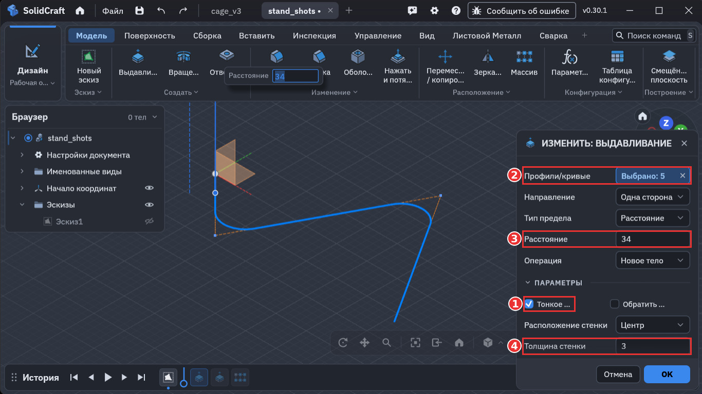
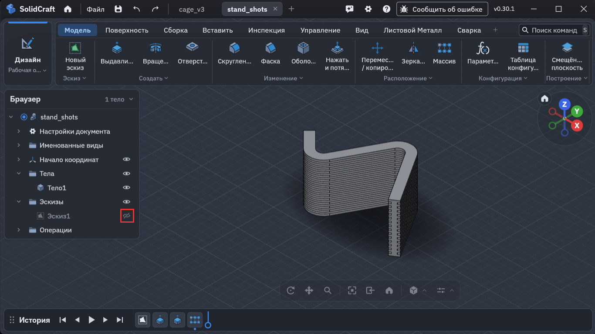
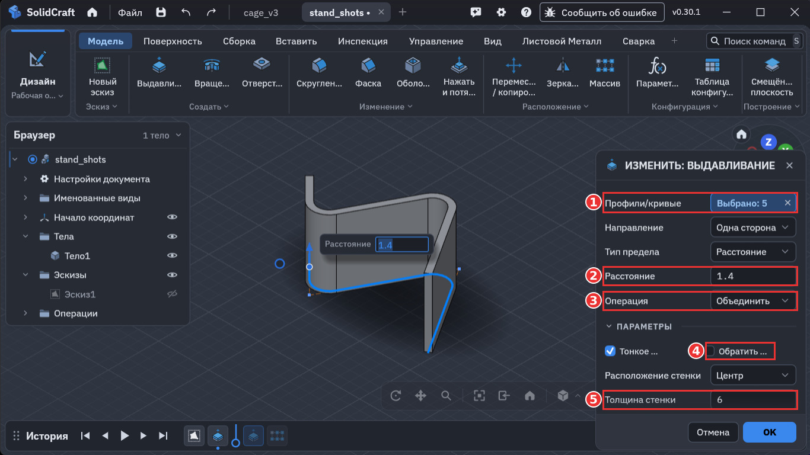
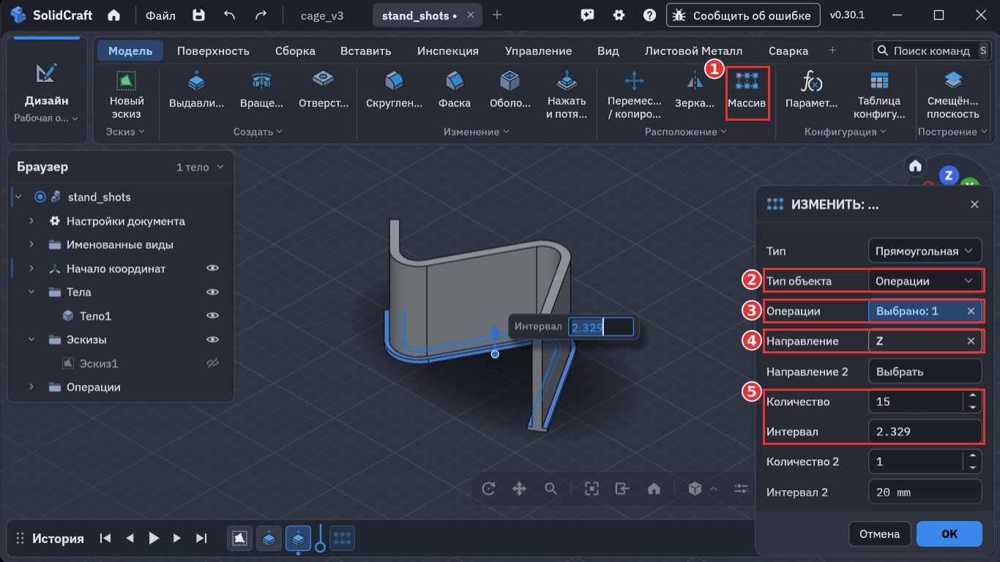
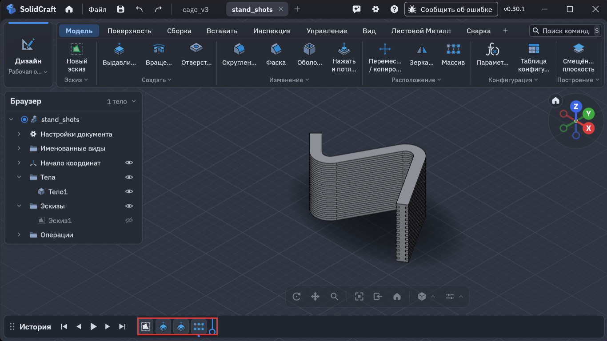

<section class="theory" markdown="1">

## Теоретические сведения
{: .section__title}

Профиль подставки — незамкнутая линия, у нее нет площади. Обычное выдавливание требует замкнутого контура, поэтому здесь используется тонкое выдавливание: программа строит вдоль выбранных кривых стенку заданной толщины и вытягивает ее на заданное расстояние. Одной операцией получается полоса толщиной 3 мм и шириной 34 мм.

Рифление на полосе — 15 одинаковых ребер. Строить 15 эскизов не нужно: одно ребро получается вторым тонким выдавливанием по тому же профилю, а остальные 14 создает массив — операция, которая повторяет выбранную операцию с заданным шагом.
{: .th-full}

</section>

<section class="goal" markdown="1">

## 🎯 Цель работы
{: .section__title}

- строить тело тонким выдавливанием по незамкнутому профилю;
- повторно использовать эскиз во второй операции;
- проверять операцию и направление выдавливания по предпросмотру;
- рассчитывать шаг массива и строить массив операций.

</section>

<aside class="callout callout--important" markdown="1">

⏱ Время и место выполнения
{: .callout__title}

Страница выполняется на первой практике по данной теме, около 25 минут. На входе — проект `stand.sc` с готовым профилем ([task 4-2](task_4-2.html)).

</aside>

<!-- ===================== 1 ===================== -->

<section class="subsection" id="s1" markdown="1">

## 1. Полоса: тонкое выдавливание
{: .subsection__title}

На входе — завершенный эскиз из пяти кривых. На выходе — согнутая полоса 3 × 34 мм.

1. На ленте нажмите «Выдавливание» (клавиша E).
1. Поставьте галочку «Тонкое».
1. Диалог стал шире и может закрыть часть профиля: нажмите кнопку вида «Вписать» внизу окна.
1. Нажмите ЛКМ по очереди по всем пяти кривым профиля: трем отрезкам и двум дугам.
1. В поле расстояния введите `34`.
1. В поле толщины стенки введите `3`, расположение стенки — «Центр».
1. Проверьте предпросмотр: полоса идет вдоль всего профиля без разрывов в углах. Нажмите OK.
{: .steps}

<figure class="figure-src">

<figcaption class="figure-src__caption">1 — галочка «Тонкое»; 2 — выбрано 5 кривых; 3 — расстояние 34; 4 — толщина стенки 3. Синим показаны выбранные кривые профиля.</figcaption>
</figure>

Расположение «Центр» кладет стенку по обе стороны от линии профиля, по 1,5 мм. Поэтому габариты детали больше габаритов профиля на толщину стенки.
{: .th-full}

</section>

<!-- ===================== 2 ===================== -->

<section class="subsection" id="s2" markdown="1">

## 2. Одно ребро
{: .subsection__title}

На входе — полоса. На выходе — на краю полосы появляется ребро шириной 1,4 мм, которое выступает над поверхностью на 1,5 мм с каждой стороны.

Ребро строится по тому же эскизу, но после первой операции эскиз скрыт. Его нужно показать.

1. В браузере слева найдите строку «Эскиз1» и нажмите ЛКМ по значку глаза справа от нее.
1. Нажмите Ctrl+6: вид повернется снизу, и линия профиля будет видна посередине полосы. Сверху эскиз закрыт телом.
1. Нажмите «Выдавливание» и поставьте галочку «Тонкое».
1. Нажмите ЛКМ по очереди по всем пяти кривым профиля, точно по белой линии. В поле «Профили/кривые» должно быть «Выбрано: 5». Если счетчик не вырос, нажмите ЛКМ в это поле и повторите нажатие ЛКМ по кривой.
1. Расстояние — `1.4`, толщина стенки — `6`, расположение — «Центр».
1. В списке «Операция» должно стоять «Объединить». Программа выбирает операцию сама и может поставить «Вырезать»: тогда вместо ребра получится паз.
1. Нажмите кнопку вида «Главная» и посмотрите на предпросмотр: ребро должно лежать внутри полосы, у ее края. Программа часто сама ставит галочку «Обратить», и тогда ребро уходит наружу, за край полосы: снимите эту галочку. Если ребро выступает за край без галочки, поставьте ее.
1. Нажмите OK и скройте эскиз тем же значком глаза.
{: .steps}

<figure class="figure-src">

<figcaption class="figure-src__caption">В рамке — значок глаза в строке «Эскиз1»: он показывает и скрывает эскиз.</figcaption>
</figure>

<figure class="figure-src">

<figcaption class="figure-src__caption">1 — выбрано 5 кривых; 2 — расстояние 1.4; 3 — операция «Объединить»; 4 — галочка «Обратить» снята; 5 — толщина стенки 6. Синим показано будущее ребро у нижнего края полосы.</figcaption>
</figure>

Стенка 6 мм при полосе 3 мм: ребро выступает на (6 − 3) / 2 = 1,5 мм с лицевой и с обратной стороны полосы.

<aside class="callout callout--warning" markdown="1">

Кривые не выбираются
{: .callout__title}

Эскиз лежит в плоскости нижнего края полосы, и сверху его закрывает тело. Вид снизу (Ctrl+6) открывает линию профиля. Нажимать ЛКМ нужно точно по линии: нажатие ЛКМ рядом попадает в грань тела и кривую не выбирает.

</aside>

</section>

<!-- ===================== 3 ===================== -->

<section class="subsection" id="s3" markdown="1">

## 3. Массив из 15 ребер
{: .subsection__title}

На входе — полоса с одним ребром. На выходе — 15 ребер по всей ширине полосы.

Шаг массива считается так, чтобы первое ребро стояло у одного края полосы, а последнее — у другого:

<i>s</i> = (<i>B</i> − <i>b</i>) / (<i>n</i> − 1) = (34 − 1,4) / 14 = 2,329 мм

<dl class="where">

<dt>где <i>s</i></dt><dd>шаг массива (в программе — «Интервал»), мм</dd>

<dt><i>B</i></dt><dd>ширина полосы, 34 мм (раздел 1)</dd>

<dt><i>b</i></dt><dd>ширина ребра, 1,4 мм (раздел 2)</dd>

<dt><i>n</i></dt><dd>число ребер, 15</dd>

</dl>

1. На ленте нажмите «Массив».
1. «Тип объекта» — «Операции».
1. В поле «Операции» нажмите ЛКМ по значку второго выдавливания (ребра) в полосе «История» внизу.
1. Нажмите ЛКМ в поле «Направление», затем по любому прямому ребру тела (линии, где сходятся две грани), которое идет вдоль ширины полосы: например, по ребру тела на конце бортика.
1. «Количество» — `15`, «Интервал» — `2.329`.
1. Дождитесь предпросмотра: он строится до 40 секунд. Ребра должны идти внутрь полосы, от первого ребра к другому краю. Если они уходят наружу, поставьте перед интервалом минус: `-2.329`.
1. Нажмите OK и подождите: массив применяется до 40 секунд, на слабом компьютере дольше. Не нажимайте кнопки мыши, пока программа считает.
1. Сохраните проект: Ctrl+S.
{: .steps}

<figure class="figure-src">

<figcaption class="figure-src__caption">1 — кнопка «Массив»; 2 — тип объекта «Операции»; 3 — операция ребра; 4 — направление; 5 — количество 15 и интервал 2.329.</figcaption>
</figure>

<figure class="figure-src">

<figcaption class="figure-src__caption">Готовая подставка. В рамке — четыре значка истории: эскиз, два выдавливания, массив.</figcaption>
</figure>

Знак интервала задает сторону, в которую идет массив от исходного ребра, и зависит от того, какое ребро выбрано направлением. Ориентируйтесь на предпросмотр.

Проверьте себя
{: .check__title}

Сверка подтверждает, что модель готова к экспорту. Она ничего не меняет в модели.

| Показатель | Должно быть | Если не совпало |
|---|---|---|
| Значков в «Истории» | 4: эскиз, выдавливание полосы, выдавливание ребра, массив | 3 — массив не применен: дождитесь окончания расчета или повторите |
| Ребер | 15, крайние стоят у краев полосы | ребра вышли за край — неверный знак интервала; ребер меньше — проверьте «Количество» |
| Ребро | выступает над полосой | вместо ребер пазы — во втором выдавливании осталось «Вырезать» |
| Полоса | без разрывов в углах | при выдавливании выбраны не все пять кривых |

</section>

<!-- ===================== 4 ===================== -->

<section class="subsection" id="s4" markdown="1">

## 4. Мини-тест
{: .subsection__title}

Теория к вопросам
{: .analysis__title}

**Механизм.** Массив ставит *n* копий с шагом *s*. Между первой и последней копией *n* − 1 промежутков, поэтому от начала первого ребра до начала последнего (*n* − 1) · *s*, а до конца последнего — еще ширина ребра *b*.

| Число ребер *n* | Шаг *s* = (34 − 1,4) / (*n* − 1), мм | Занятая ширина (*n* − 1) · *s* + 1,4, мм |
|---|---|---|
| 15 | 2,329 | 34,0 |
| 8 | 4,657 | 34,0 |

Типичная ошибка — делить ширину на число ребер: 34 / 15 = 2,267 мм. Тогда 15 ребер займут 14 · 2,267 + 1,4 = 33,1 мм, и последнее ребро не дойдет до края на 0,9 мм.

Тонкое выдавливание работает по незамкнутым кривым, обычное — только по замкнутому контуру. Операция «Объединить» добавляет новый объем к телу, «Вырезать» вычитает его.

Вопросы к странице

Ответьте на вопросы. Текст результата сохранять не нужно: тест этой страницы не сдается.

1. Почему шаг массива равен (34 − 1,4) / 14, а не 34 / 15?

<label><input type="radio" data-ok> Между 15 ребрами 14 промежутков, а последнее ребро само занимает 1,4 мм.</label>
<label><input type="radio"> Потому что программа округляет шаг до трех знаков.Округление меняет шаг на тысячные доли. Разница между 2,329 и 2,267 мм — следствие формулы, а не округления.</label>
<label><input type="radio"> Потому что первое ребро в массив не входит.Исходное ребро входит в количество 15. Промежутков между 15 ребрами на один меньше, чем ребер.</label>

Шаг — расстояние между началами соседних ребер. 14 шагов по 2,329 мм дают 32,6 мм, плюс ширина последнего ребра 1,4 мм — ровно 34 мм.

2. Во втором выдавливании в списке «Операция» оказалось «Вырезать», и студент этого не заметил. Что получится?

<label><input type="radio"> Ребро: стенка шире полосы, поэтому материал добавится.Операция «Вырезать» только убирает материал, какой бы ширины ни была стенка.</label>
<label><input type="radio" data-ok> Паз шириной 1,4 мм поперек полосы: стенка вычитается из тела.</label>
<label><input type="radio"> Второе отдельное тело поверх полосы.Отдельное тело дала бы операция «Новое тело». «Вырезать» меняет существующее тело.</label>

«Вырезать» вычитает объем стенки из полосы и разрезает ее. Для ребра нужна операция «Объединить»; программа выбирает операцию сама, поэтому список проверяют перед OK.

3. Почему полосу нельзя получить обычным выдавливанием этого эскиза?

<label><input type="radio"> Потому что в эскизе есть дуги.Дуги выдавливанию не мешают. Мешает то, что линия не замкнута и не ограничивает площадь.</label>
<label><input type="radio"> Потому что эскиз не полностью определен.Эскиз определен полностью: все длины и углы заданы. Дело в том, что контур не замкнут.</label>
<label><input type="radio" data-ok> Профиль — незамкнутая линия без площади; толщину ей дает параметр стенки тонкого выдавливания.</label>

Обычное выдавливание вытягивает площадь внутри замкнутого контура. Тонкое строит стенку вдоль кривых, поэтому работает и по незамкнутой линии.

<button type="button" class="tool-btn tool-btn--main quiz__check">Проверить</button>

Ответы:
<pre class="quiz__comment"></pre>
<button type="button" class="tool-btn quiz__copy">Скопировать</button>

</section>

<section class="subsection" id="video" markdown="1">

## 5. Видео
{: .subsection__title}

Если шаг не получился, посмотрите его в записи. Скорость выбирается в панели под роликом. Ролик без звука, шаги подписаны титрами под кадром. Номера шагов в титрах идут по порядку ролика и не совпадают с номерами списков страницы. Сохранение проекта в записи не показано.

<figure class="figure-src figure-video">
<video controls preload="none" playsinline width="1368" height="832" poster="../assets/video/task_4/4-3.jpg" aria-label="Видео: Полоса, одно ребро и массив из 15 ребер">
<source src="../assets/video/task_4/4-3.mp4" type="video/mp4">
Браузер не показывает видео. <a href="../assets/video/task_4/4-3.mp4">Скачайте файл</a>.
</video>
<figcaption class="figure-src__caption">Полоса, одно ребро и массив из 15 ребер. Длительность 2 мин 12 с, файл 5,3 МБ: загрузка начнется после нажатия кнопки воспроизведения.</figcaption>
</figure>

</section>

<section class="then" markdown="1">

## Затем
{: .then__title}

1. Проверьте, что проект `stand.sc` сохранен после массива.
1. Не закрывая проект, перейдите к [task 4-4](task_4-4.html): экспорт и проверка STL.
{: .steps}

</section>

<section class="section sources" markdown="1">

## Источники
{: .section__title}

1. SolidCraft: документация, раздел [Solid features](https://docs.solidcraft.io/guide/features.html) — выдавливание и его операции (новое тело, объединение, вырез), тонкое выдавливание, массивы операций.
1. SolidCraft 0.30.1, проверено на программе: тонкое выдавливание по пяти кривым (34, стенка 3, «Центр»), повторный выбор кривых скрытого эскиза, операция «Объединить», вид снизу для выбора кривых, галочка «Обратить», массив 15 ребер с интервалом 2.329, время расчета массива.
{: .sources__list}

</section>
