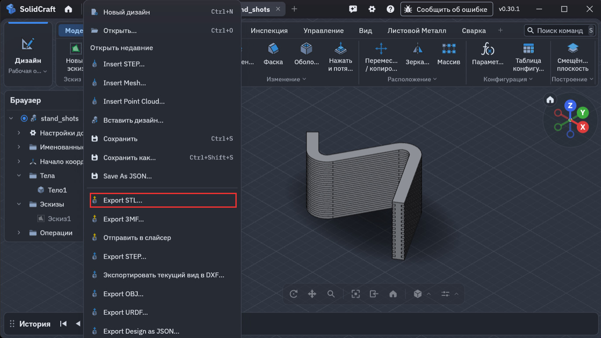
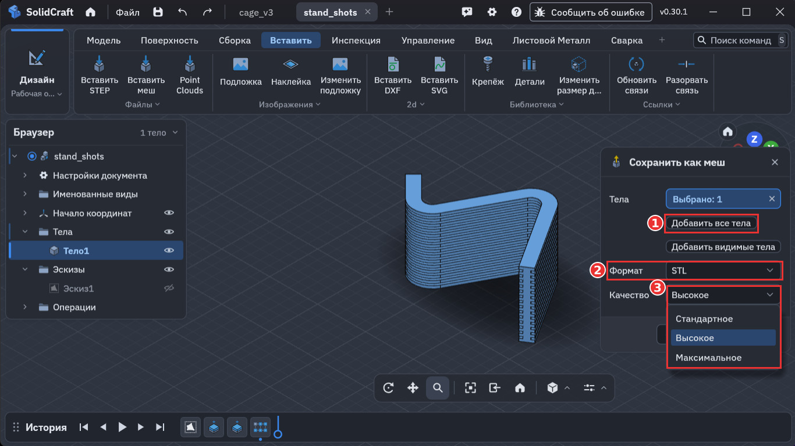
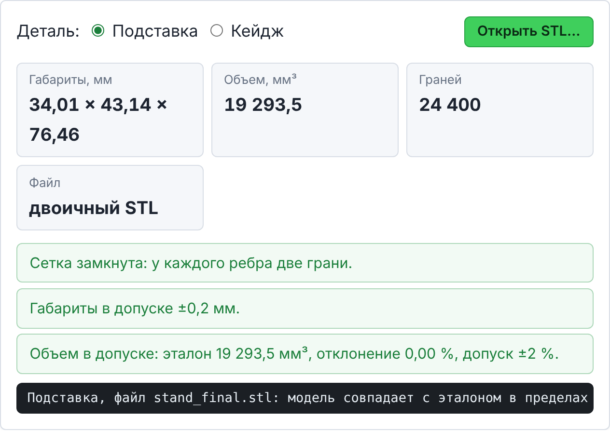
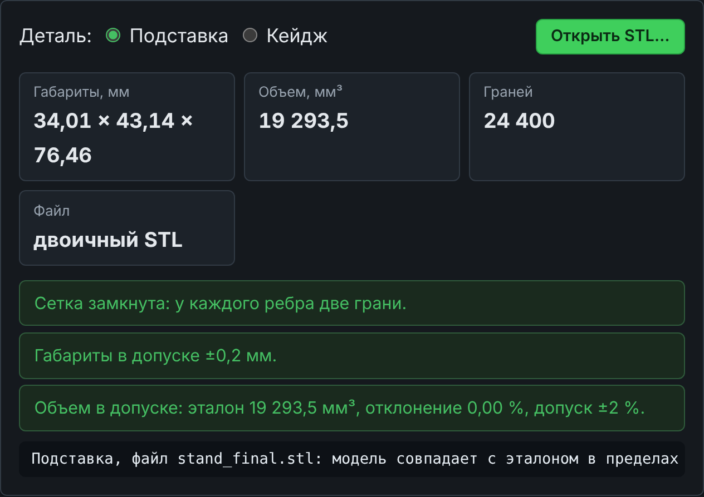

<section class="theory" markdown="1">

## Теоретические сведения
{: .section__title}

У модели два файла с разным содержанием. Проект `.sc` хранит историю построения: эскизы, размеры и операции; его открывает только SolidCraft. Сетка `.stl` хранит только поверхность, разбитую на треугольники; ее читают слайсеры и проверка на сайте, но изменить по ней размер уже нельзя. Проект нужен, чтобы править модель, сетка — чтобы печатать.

При экспорте программа заменяет гладкие поверхности плоскими треугольниками. Дуги скруглений становятся ломаными, и объем сетки немного отличается от объема точной модели: чем выше качество экспорта, тем больше треугольников и тем меньше отличие. Устройство файла STL и проверки сетки разобраны в практике 2 ([task 2-1](../task_2/task_2-1.html)).
{: .th-full}

</section>

<section class="goal" markdown="1">

## 🎯 Цель работы
{: .section__title}

- объяснять, чем файл проекта отличается от файла сетки;
- экспортировать тело в двоичный STL;
- проверять сетку по габаритам, объему и замкнутости;
- находить причину расхождения с эталоном.

</section>

<aside class="callout callout--important" markdown="1">

⏱ Время и место выполнения
{: .callout__title}

Страница выполняется в конце первой практики по данной теме, около 15 минут. На входе — проект `stand.sc` с готовой подставкой ([task 4-3](task_4-3.html)).

</aside>

<!-- ===================== 1 ===================== -->

<section class="subsection" id="s1" markdown="1">

## <span class="subsection__num">1.</span> Сохранение проекта
{: .subsection__title}

1. Нажмите Ctrl+S (на macOS Cmd+S). Проект уже называется `stand.sc`, поэтому программа сохранит его без вопросов.
1. Откройте папку `cad_4` в проводнике и убедитесь, что время изменения файла `stand.sc` — текущее.
{: .steps}

При каждом сохранении прежняя версия файла остается рядом под именем `stand.sc.bak`. Если проект испорчен неудачной правкой, уберите у этого файла окончание `.bak` и откройте его. Несохраненные изменения программа также складывает в папку восстановления и при следующем запуске предлагает их вернуть.
{: .th-full}

</section>

<!-- ===================== 2 ===================== -->

<section class="subsection" id="s2" markdown="1">

## <span class="subsection__num">2.</span> Экспорт STL
{: .subsection__title}

На входе — открытый проект с одним телом. На выходе — файл `stand.stl`.

1. Откройте меню «Файл» и выберите пункт «Export STL…».
1. В окне «Сохранить как меш» нажмите «Добавить все тела».
1. Проверьте, что формат — STL.
1. В списке «Качество» выберите «Высокое».
1. Нажмите «Сохранить», выберите папку `cad_4`, введите имя `stand` и подтвердите.
{: .steps}

<figure class="figure-src">
<a href="../assets/img/task_4/4-4-1.jpg" target="_blank" rel="noopener" aria-label="Открыть снимок в полном размере"></a>
<figcaption class="figure-src__caption">Меню «Файл». В рамке — пункт «Export STL…».</figcaption>
</figure>

<figure class="figure-src">
<a href="../assets/img/task_4/4-4-2.jpg" target="_blank" rel="noopener" aria-label="Открыть снимок в полном размере"></a>
<figcaption class="figure-src__caption">1 — «Добавить все тела»; 2 — формат STL; 3 — список «Качество»: «Стандартное», «Высокое», «Максимальное».</figcaption>
</figure>

В списке «Качество» три значения: «Стандартное», «Высокое» и «Максимальное». Числового допуска в окне нет. По документации (раздел Getting started, параметр `--quality` со значениями standard, fine и finest) трем ступеням соответствует наибольшая стрела прогиба дуги 0,02 %, 0,005 % и 0,001 % размера тела, но не меньше 1 мкм. Для подставки длиной 76 мм это около 0,015, 0,004 и 0,001 мм. Для печати соплом 0,4 мм хватает любой из трех ступеней: неровность ломаной в десятки раз меньше ширины дорожки. Файл получается двоичным; вид STL в окне не выбирается.
{: .th-full}

Эталон подставки экспортирован с качеством «Высокое»: 24 400 граней, объем 19 293,5 мм³. Та же модель с качеством «Стандартное» дает 10 236 граней и 19 290,5 мм³: отличие 0,016 % лежит в допуске, но число граней будет другим.

В меню «Файл» есть и пункт «Отправить в слайсер». На этом занятии он не используется: слайсер появится в практике 5.
{: .th-full}

</section>

<!-- ===================== 3 ===================== -->

<section class="subsection" id="s3" markdown="1">

## <span class="subsection__num">3.</span> Проверка модели
{: .subsection__title}

На входе — файл `stand.stl`. На выходе — заключение: модель совпадает с эталоном в пределах допуска или названа причина расхождения. Проверка ничего не меняет в файле.

1. Откройте инструмент [«Проверка STL»](../stl-check.html#stand).
1. Выберите деталь «Подставка» и откройте файл `stand.stl`.
1. Сравните три показателя с таблицей ниже.
{: .steps}

<div class="check" markdown="1">

Проверьте себя
{: .check__title}

Совпадение габаритов подтверждает размеры эскиза и расстояния выдавливания, совпадение объема — что на месте все 15 ребер, замкнутость — что сетку можно печатать.

| Показатель | Значение | Если не совпало |
|---|---|---|
| Габариты, мм | 76,46 × 34,01 × 43,14, допуск ±0,2 | отличается 34,01 — расстояние выдавливания или шаг массива; отличаются два других — длина или угол отрезка профиля, радиус скругления |
| Объем, мм³ | 19 293,5, допуск ±2 % (от 18 907,6 до 19 679,4) | меньше на 38 % — нет ребер или вместо них пазы; меньше на 2,5 % за каждое ребро — ребер меньше 15 |
| Замкнутость | у каждого ребра сетки две грани | экспортировано не то тело или экспорт прерван: повторите раздел 2 |
| Число граней | 24 400 при качестве «Высокое» | 10 236 — выбрано «Стандартное»; на зачет не влияет |

</div>

Порядок трех габаритов зависит от того, как деталь повернута относительно осей, поэтому инструмент сравнивает их по величине, а не по именам осей.

<figure class="figure-src">
<a class="shot--light" href="../assets/img/task_4/4-4-3.png" target="_blank" rel="noopener" aria-label="Открыть снимок в полном размере"></a>
<a class="shot--dark" href="../assets/img/task_4/4-4-3_dark.png" target="_blank" rel="noopener" aria-label="Открыть снимок в полном размере"></a>
<figcaption class="figure-src__caption">Результат проверки эталонной подставки: все три показателя в допуске.</figcaption>
</figure>

</section>

<!-- ===================== 4 ===================== -->

<section class="subsection" id="s4" markdown="1">

## <span class="subsection__num">4.</span> Мини-тест
{: .subsection__title}

<div class="theory" markdown="1">

Теория к вопросам
{: .analysis__title}

**Механизм.** Проверка сравнивает сетку с эталоном по трем независимым признакам, и каждый ловит свои ошибки.

| Признак | Что ловит | Чего не видит |
|---|---|---|
| Габариты | неверную длину, угол, расстояние выдавливания | ошибки внутри габаритов: пропущенное ребро, паз вместо ребра |
| Объем | недостающий или лишний материал | две ошибки, которые случайно уравновесили друг друга |
| Замкнутость | дыры в сетке, незавершенный экспорт | неверные размеры |

Объем подставки без ребер — около 11 930 мм³: длина профиля со скруглениями около 117 мм, умноженная на сечение 3 × 34 мм. Одно ребро добавляет 117 · 1,4 · (6 − 3) ≈ 490 мм³, все 15 — около 7 370 мм³, то есть 38 % объема готовой детали. Допуск ±2 % (около 386 мм³) меньше объема одного ребра, поэтому проверка замечает даже одно пропущенное ребро, но пропускает разницу из-за качества экспорта.

Сетка STL не хранит размеров и операций. Изменить в ней радиус или число ребер нельзя: правят проект `.sc` и экспортируют заново.

</div>

<div class="quiz" data-file="task_4-4_test.txt" data-comment="#">
<p class="quiz__title">Вопросы к странице</p>
<p class="quiz__intro">Ответьте на вопросы. Текст результата сохранять не нужно: тест этой страницы не сдается.</p>
<div class="quiz__q">
<p>1. После экспорта вы заметили, что радиус скругления должен быть 7 мм, а в модели 5 мм. Что делать?</p>
<label><input type="radio"> Открыть <code>stand.stl</code> в SolidCraft и изменить радиус.<span class="quiz__why" hidden>В сетке нет радиусов, только треугольники. Размер хранится в эскизе проекта.</span></label>
<label><input type="radio" data-ok> Открыть <code>stand.sc</code>, изменить размер в эскизе и экспортировать STL заново.</label>
<label><input type="radio"> Увеличить качество экспорта.<span class="quiz__why" hidden>Качество меняет число треугольников на дуге, но не ее радиус.</span></label>
<p class="quiz__exp" hidden>Размеры хранит только проект. Сетка — результат экспорта, ее получают заново после каждой правки.</p>
</div>
<div class="quiz__q">
<p>2. Габариты модели совпали с эталоном, а объем меньше на 38 %. Какая ошибка вероятнее всего?</p>
<label><input type="radio"> Неверный угол спинки.<span class="quiz__why" hidden>Неверный угол изменил бы габариты. Здесь габариты совпали, значит профиль верен.</span></label>
<label><input type="radio"> Сетка не замкнута.<span class="quiz__why" hidden>Незамкнутость проверяется отдельно и сама по себе не уменьшает объем на 38 %.</span></label>
<label><input type="radio" data-ok> Нет ребер: массив не применен или вместо ребер вырезаны пазы.</label>
<p class="quiz__exp" hidden>Ребра дают 38 % объема и почти не меняют габариты: крайние ребра стоят у краев полосы.</p>
</div>
<div class="quiz__q">
<p>3. Объем вашей сетки 19 280 мм³ при эталоне 19 293,5 мм³. Зачтена ли модель и откуда разница?</p>
<label><input type="radio" data-ok> Зачтена: отличие 0,07 % лежит в допуске ±2 %; дуги заменены ломаными, и результат зависит от качества экспорта.</label>
<label><input type="radio"> Не зачтена: объем должен совпасть до десятых.<span class="quiz__why" hidden>Допуск по объему ±2 %, то есть от 18 907,6 до 19 679,4 мм³. Значение 19 280 в него попадает.</span></label>
<label><input type="radio"> Зачтена, но разница означает, что одного ребра нет.<span class="quiz__why" hidden>Одно ребро — около 490 мм³. Разница 13,5 мм³ в 36 раз меньше и объясняется разбиением дуг на отрезки.</span></label>
<p class="quiz__exp" hidden>(19 293,5 − 19 280) / 19 293,5 = 0,07 %. Такое отличие дает замена дуг ломаными при другом качестве экспорта.</p>
</div>
<div class="quiz__bar"><button type="button" class="tool-btn tool-btn--main quiz__check">Проверить</button><span class="quiz__status"></span></div>
<div class="quiz__result" hidden><p>Ответы:</p><pre class="quiz__comment"></pre><div class="quiz__bar"><button type="button" class="tool-btn quiz__copy">Скопировать</button><span class="quiz__copied"></span></div></div>
</div>

</section>

<section class="subsection" id="video" markdown="1">

## <span class="subsection__num">5.</span> Видео
{: .subsection__title}

Если шаг не получился, посмотрите его в записи. Скорость выбирается в панели под роликом. Ролик без звука, шаги подписаны титрами под кадром. Номера шагов в титрах идут по порядку ролика и не совпадают с номерами списков страницы. Сохранение проекта в записи не показано. Окно сохранения Windows в ролике частично размыто: в нем видны папки компьютера, на котором велась запись.

<figure class="figure-src figure-video">
<video controls preload="none" playsinline width="1368" height="832" poster="../assets/video/task_4/4-4.jpg" aria-label="Видео: Экспорт STL и страница Проверка STL">
<source src="../assets/video/task_4/4-4.mp4" type="video/mp4">
Браузер не показывает видео. <a href="../assets/video/task_4/4-4.mp4">Скачайте файл</a>.
</video>
<figcaption class="figure-src__caption">Экспорт STL и страница «Проверка STL». Длительность 40 с, файл 1,3 МБ: загрузка начнется после нажатия кнопки воспроизведения.</figcaption>
</figure>

</section>

<section class="then" markdown="1">

## Затем
{: .then__title}

1. Проверьте, что в папке `cad_4` лежат `stand.sc` и `stand.stl`. Оба файла сдаются.
1. До второй практики по данной теме прочитайте разделы 1–6 страницы [task 4-5](task_4-5.html) и пройдите мини-тест.
{: .steps}

```text
cad_4/
├── plate.sc
├── stand.sc
└── @@stand.stl@@
```
{: .folder-tree}

</section>

<section class="section sources" markdown="1">

## Источники
{: .section__title}

1. SolidCraft: документация, раздел [Import and export](https://docs.solidcraft.io/guide/files.html) — формат проекта, файл `.bak`, восстановление несохраненных изменений, экспорт STL и ступени качества, отправка в слайсер; раздел [Getting started](https://docs.solidcraft.io/guide/getting-started.html) — допуск ступеней качества (параметр `--quality`).
1. SolidCraft 0.30.1, проверено на программе: окно «Сохранить как меш», «Добавить все тела», список «Качество»; число граней и объем подставки при качестве «Стандартное» и «Высокое»; файл STL двоичный.
1. Эталон практики `stand_final.stl`: габариты, объем, число граней и замкнутость получены скриптом проверки сетки.
1. Gibson I., Rosen D., Stucker B., Khorasani M. Additive Manufacturing Technologies. 3rd ed. Springer, 2021 — п. 17.2.1.1, p. 494–495: формат STL.
{: .sources__list}

</section>
