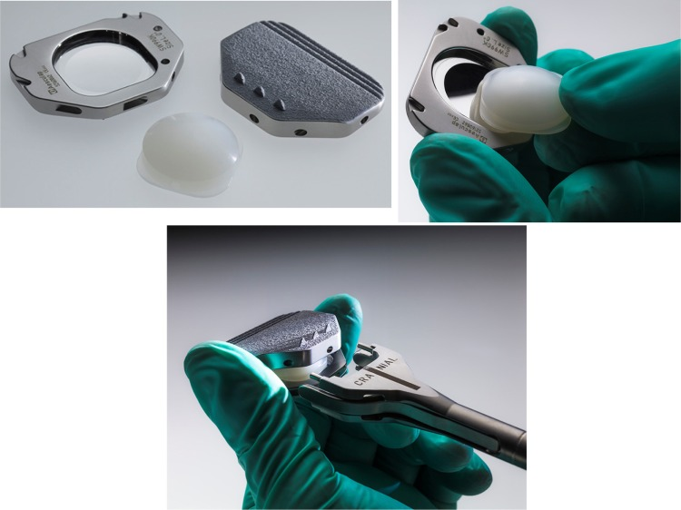
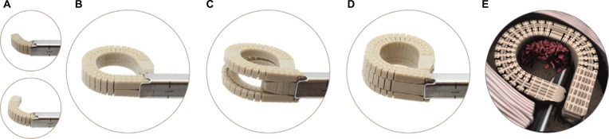
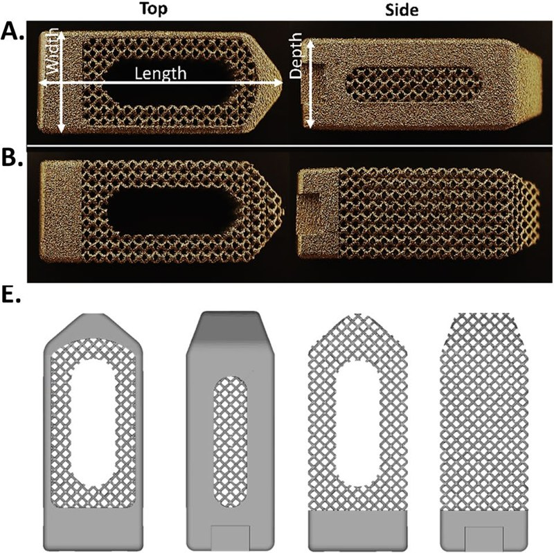
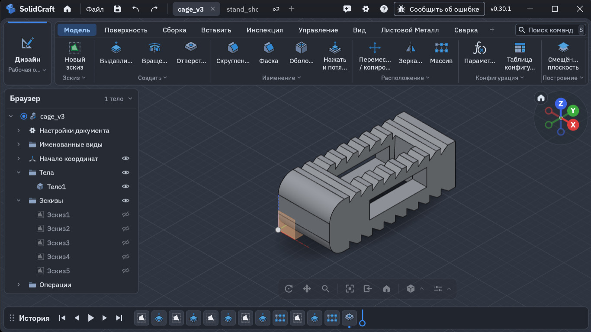

<section class="theory" markdown="1">

## Теоретические сведения
{: .section__title}

Межтеловой кейдж (interbody cage, intervertebral body fusion device) — имплантат, который ставят на место удаленного межпозвонкового диска, чтобы два соседних позвонка срослись в один костный блок. Кейдж держит высоту промежутка и несет нагрузку, пока кость прорастает через его окна; после сращения подвижности в этом сегменте нет. На второй практике по данной теме вы моделируете учебный кейдж 22 × 9 × 8 мм, и каждая его деталь — окно, зубцы, наклон, отверстие на торце — повторяет решение серийных изделий. Эта страница объясняет, зачем нужна каждая из них.

Страница состоит из двух частей. Часть 1 (разделы 1–6) — обзор типов кейджей и мини-тест. Часть 2 (раздел 7) — разбор эскиза учебной модели перед построением.
{: .th-full}

</section>

<section class="goal" markdown="1">

## 🎯 Цель работы
{: .section__title}

- объяснять, зачем ставят кейдж и чем он отличается от протеза диска;
- различать кейджи по хирургическому доступу и связывать доступ с формой и размером;
- отличать статичный кейдж от расширяющегося;
- называть материалы кейджей и их ограничения;
- читать эскиз учебной модели: какой размер какой операцией строится.

</section>

<aside class="callout callout--important" markdown="1">

⏱ Время и место выполнения
{: .callout__title}

Часть 1 читается самостоятельно между первой и второй практикой по данной теме, около 20 минут вместе с мини-тестом. Часть 2 разбирается в начале второй практики по данной теме, около 10 минут. Построение кейджа начинается на [task 4-6](task_4-6.html).

</aside>

<aside class="callout callout--warning" markdown="1">

Учебная модель — не медицинское изделие
{: .callout__title}

Модель этой практики и напечатанная по ней деталь предназначены только для обучения моделированию. Они не рассчитаны на нагрузку, не проходили испытаний и не могут быть имплантированы.

</aside>

<!-- ===================== 1 ===================== -->

<section class="subsection" id="s1" markdown="1">

## <span class="subsection__num">1.</span> Зачем нужен кейдж
{: .subsection__title}

Операция, для которой нужен кейдж, называется межтеловым спондилодезом (interbody fusion): хирург удаляет межпозвонковый диск, готовит замыкательные пластинки позвонков (плотные костные площадки сверху и снизу тела позвонка, к которым прилегает диск) и ставит в промежуток имплантат — кейдж, спейсер или костный трансплантат (Mobbs et al., 2015, раздел Introduction). Цель — стабилизировать болезненный сегмент; попутно операция восстанавливает высоту промежутка и изгиб позвоночника и освобождает нервные структуры (Mobbs et al., 2015, раздел Abstract).

Кейдж внутри полый. Полость заполняют костным материалом, и кость прорастает сквозь нее от одного позвонка к другому (Patel et al., 2019). Сращение занимает не меньше 6–12 месяцев (Patel et al., 2019, раздел Fundamentals of interbody fusion), и все это время нагрузку несет кейдж, обычно вместе с винтами и стержнями дополнительной фиксации.

<div class="definition" markdown="1">

<span class="definition__term">Спондилодез</span> — сращение соседних позвонков в один костный блок. Подвижность сегмента после него утрачена: это цель операции, а не побочный эффект.

</div>

<div class="definition" markdown="1">

<span class="definition__term">Протез диска</span> (total disc replacement) — имплантат с шарниром, который заменяет диск и сохраняет движение в сегменте.

</div>

Кейдж и протез диска решают противоположные задачи. После спондилодеза движение перераспределяется на соседние сегменты, и их дегенерация считается главным отдаленным риском операции; протез диска сохраняет движение сегмента, и от него ожидают меньшей нагрузки на соседние уровни (Pheasant et al., 2025). Спондилодез при этом остается стандартным вмешательством при дегенеративных заболеваниях поясничного отдела.

<figure class="diagram">
<svg role="img" viewBox="0 0 660 250">
<title>Слева спондилодез: между двумя позвонками кейдж, заполненный костным материалом, сегмент неподвижен. Справа протез диска: между позвонками шарнир из двух пластин и вкладыша, сегмент подвижен.</title>
<defs><marker id="ah451" viewBox="0 0 10 10" refX="8" refY="5" markerWidth="7" markerHeight="7" orient="auto-start-reverse"><path class="d-arrowhead" d="M0,0 L10,5 L0,10 z"></path></marker></defs>
<rect class="d-box" x="70" y="30" width="200" height="62" rx="12"></rect>
<rect class="d-box" x="70" y="140" width="200" height="62" rx="12"></rect>
<rect class="d-box d-box--object" x="110" y="92" width="120" height="48"></rect>
<rect class="d-box d-box--name" x="135" y="92" width="70" height="48"></rect>
<text class="d-text d-text--small" x="170" y="121" text-anchor="middle">кость</text>
<text class="d-text d-text--small" x="170" y="66" text-anchor="middle">позвонок</text>
<text class="d-text d-text--small" x="170" y="176" text-anchor="middle">позвонок</text>
<text class="d-text" x="170" y="232" text-anchor="middle">Кейдж: сегмент срастается</text>
<rect class="d-box" x="390" y="30" width="200" height="62" rx="12" transform="rotate(-5 490 92)"></rect>
<rect class="d-box" x="390" y="140" width="200" height="62" rx="12"></rect>
<rect class="d-box d-box--object" x="420" y="92" width="140" height="10" transform="rotate(-5 490 92)"></rect>
<path class="d-box d-box--name" d="M440,130 Q490,84 540,130 z"></path>
<rect class="d-box d-box--object" x="420" y="130" width="140" height="10"></rect>
<path class="d-arrow" d="M606,60 Q622,110 606,160" marker-start="url(#ah451)" marker-end="url(#ah451)"></path>
<text class="d-text d-text--small" x="490" y="176" text-anchor="middle">позвонок</text>
<text class="d-text" x="490" y="232" text-anchor="middle">Протез диска: движение сохраняется</text>
</svg>
<figcaption class="diagram__caption">Кейдж и протез диска, вид сбоку. Зеленым показаны имплантаты, желтым — костный материал в полости кейджа и вкладыш шарнира протеза. Адаптировано по Mobbs et al., 2015, и Pheasant et al., 2025.</figcaption>
</figure>

<figure class="figure-src">

<figcaption class="figure-src__caption">Протез поясничного диска activL: вверху слева — две металлические пластины с шипами и полиэтиленовый вкладыш, вверху справа — сборка, внизу — протез в инструменте для установки. Вкладыш скользит между пластинами, поэтому сегмент сохраняет движение.<br>Источник: Yue J. J., Garcia R., Miller L. E., Medical Devices: Evidence and Research, 2016, 9, p. 75–84, Fig. 1, <a href="https://creativecommons.org/licenses/by-nc/3.0/">CC BY-NC 3.0</a>, DOI <a href="https://doi.org/10.2147/MDER.S102949">10.2147/MDER.S102949</a>.</figcaption>
</figure>

Изображение другого серийного протеза диска, Prodisc L: [Pheasant et al., 2025, Fig. 1](https://www.mdpi.com/2077-0383/14/10/3337).
{: .muted}

</section>

<!-- ===================== 2 ===================== -->

<section class="subsection" id="s2" markdown="1">

## <span class="subsection__num">2.</span> Типы кейджей по хирургическому доступу
{: .subsection__title}

К диску можно подойти с разных сторон, и доступ определяет, какого размера и формы кейдж пройдет в рану. Сзади мешают спинной мозг и нервные корешки, поэтому коридор узкий и кейдж узкий. Спереди и сбоку нервных структур на пути нет, и кейдж может занять большую часть площади позвонка. Чем больше опорная площадь, тем устойчивее сегмент и равномернее нагрузка на замыкательные пластинки (Patel et al., 2019).

<figure class="diagram">
<svg role="img" viewBox="0 0 660 400">
<title>Поясничный позвонок, вид сверху. Стрелки показывают пять доступов к диску: ALIF спереди между сосудами, OLIF спереди сбоку перед поясничной мышцей, LLIF сбоку сквозь поясничную мышцу, TLIF сзади сбоку через межпозвонковое отверстие, PLIF сзади по обе стороны от остистого отростка.</title>
<defs><marker id="ah452" viewBox="0 0 10 10" refX="8" refY="5" markerWidth="7" markerHeight="7" orient="auto"><path class="d-arrowhead" d="M0,0 L10,5 L0,10 z"></path></marker></defs>
<ellipse cx="165" cy="190" rx="40" ry="50" style="fill: var(--c-muted); fill-opacity: 0.22; stroke: var(--c-muted)"></ellipse>
<ellipse cx="495" cy="190" rx="40" ry="50" style="fill: var(--c-muted); fill-opacity: 0.22; stroke: var(--c-muted)"></ellipse>
<path class="d-box" d="M250,215 L215,275 L150,285 L150,300 L225,300 L290,330 L315,330 L322,385 L338,385 L345,330 L370,330 L435,300 L510,300 L510,285 L445,275 L410,215 z"></path>
<ellipse class="d-box" cx="330" cy="150" rx="120" ry="85"></ellipse>
<ellipse cx="330" cy="270" rx="38" ry="28" style="fill: var(--c-muted); fill-opacity: 0.35; stroke: var(--c-muted)"></ellipse>
<circle cx="290" cy="46" r="13" style="fill: var(--c-muted); fill-opacity: 0.22; stroke: var(--c-muted)"></circle>
<circle cx="370" cy="46" r="13" style="fill: var(--c-muted); fill-opacity: 0.22; stroke: var(--c-muted)"></circle>
<text class="d-text d-text--small" x="330" y="155" text-anchor="middle">тело позвонка, диск</text>
<text class="d-text d-text--small" x="330" y="274" text-anchor="middle">канал</text>
<text class="d-text d-text--small" x="398" y="50">сосуды</text>
<text class="d-text d-text--small" x="545" y="194">мышца</text>
<path class="d-arrow" d="M330,4 L330,60" marker-end="url(#ah452)"></path>
<text class="d-text" x="250" y="22" text-anchor="end">ALIF</text>
<path class="d-arrow" d="M250,18 L322,18"></path>
<path class="d-arrow" d="M95,45 L222,98" marker-end="url(#ah452)"></path>
<text class="d-text" x="50" y="40">OLIF</text>
<path class="d-arrow" d="M20,175 L205,175" marker-end="url(#ah452)"></path>
<text class="d-text" x="20" y="165">LLIF</text>
<path class="d-arrow" d="M590,385 L432,262" marker-end="url(#ah452)"></path>
<text class="d-text" x="598" y="378">TLIF</text>
<path class="d-arrow" d="M262,396 L292,304" marker-end="url(#ah452)"></path>
<path class="d-arrow" d="M398,396 L368,304" marker-end="url(#ah452)"></path>
<text class="d-text" x="252" y="394" text-anchor="end">PLIF</text>
<text class="d-text d-text--small" x="640" y="18" text-anchor="end">спереди</text>
<text class="d-text d-text--small" x="640" y="340" text-anchor="end">сзади</text>
</svg>
<figcaption class="diagram__caption">Пять доступов к поясничному диску, вид сверху. Серым показаны позвоночный канал с нервными структурами, поясничные мышцы и крупные сосуды перед позвонком. Адаптировано по Mobbs et al., 2015, Fig. 1.</figcaption>
</figure>

| Доступ | Как хирург подходит к диску | Что ограничивает |
|---|---|---|
| PLIF (posterior lumbar interbody fusion, задний) | сзади: часть дужки (костной дуги, которая сзади замыкает позвоночный канал) удаляют, твердую мозговую оболочку и корешки отводят в сторону | узкий коридор; риск травмы корешков при отведении и мышц спины |
| TLIF (transforaminal, через межпозвонковое отверстие) | сзади сбоку, с одной стороны: удаляют часть дужки и суставной отросток | длительное отведение мышц спины, как при PLIF |
| ALIF (anterior, передний) | спереди, через забрюшинное пространство; крупные сосуды отводят | сосуды и органы живота; удобен для уровней L4–L5 и L5–S1 |
| LLIF (lateral, боковой) | сбоку, сквозь поясничную мышцу, под контролем нейромониторинга | поясничное сплетение; уровень L5–S1 закрыт гребнем подвздошной кости |
| OLIF (oblique, косой) | спереди сбоку, между брюшиной и поясничной мышцей | сосуды и симпатический ствол |

Описание доступов — по Mobbs et al., 2015, разделы PLIF, TLIF, ALIF, LLIF, OLIF/ATP.
{: .muted}

Форма кейджа следует за доступом. Для задних и боковых доступов делают прямоугольные кейджи, для TLIF — изогнутые («банан»), для ALIF — трапециевидные с большой опорной площадью (Patel et al., 2019). Размеры одной серии кейджей показывают разницу в масштабе. Угол лордоза в таблице — наклон верхней опорной поверхности кейджа к нижней; лордоз, изгиб поясничного отдела вперед, разобран в разделе 5.

| Кейдж | Размеры опорной поверхности, мм | Высота, мм | Угол лордоза |
|---|---|---|---|
| PLIF | 9, 11 или 13 × 20–30 | 7–14 | 5° |
| TLIF | 9, 11 или 13 × 22–32 | 7–14 | 5° |
| LLIF | 18–24 × 40–60 | 8–18 | 0° или 7° |
| ALIF | 30 × 24, 36 × 28 или 39 × 30 | 10–20 | 0°, 7° или 12° |
{: .table-mid}

Размеры — серия InterForm, документ FDA (Food and Drug Administration, Управление по контролю качества пищевых продуктов и лекарственных средств США) 510(k) K131082, раздел Device Description. Учебная модель 22 × 9 × 8 мм попадает в диапазон PLIF этой серии.
{: .muted}

<figure class="diagram">
<svg role="img" viewBox="0 0 660 250">
<title>Опорные поверхности четырех кейджей в одном масштабе: PLIF 9 на 22 мм, TLIF 11 на 28 мм, LLIF 20 на 50 мм, ALIF 36 на 28 мм.</title>
<rect class="d-box d-box--object" x="30" y="60" width="37.8" height="92.4" rx="4"></rect>
<text class="d-text" x="49" y="190" text-anchor="middle">PLIF</text>
<text class="d-text d-text--small" x="49" y="208" text-anchor="middle">9 × 22</text>
<path class="d-box d-box--object" d="M100,150 Q159,62 218,150 L186,150 Q159,114 132,150 z"></path>
<text class="d-text" x="159" y="190" text-anchor="middle">TLIF</text>
<text class="d-text d-text--small" x="159" y="208" text-anchor="middle">11 × 28</text>
<rect class="d-box d-box--object" x="250" y="66" width="210" height="84" rx="6"></rect>
<text class="d-text" x="355" y="190" text-anchor="middle">LLIF</text>
<text class="d-text d-text--small" x="355" y="208" text-anchor="middle">20 × 50</text>
<path class="d-box d-box--object" d="M505,34 L626,34 Q641,34 641,49 L635,140 Q633,152 621,152 L510,152 Q498,152 496,140 L490,49 Q490,34 505,34 z"></path>
<text class="d-text" x="565" y="190" text-anchor="middle">ALIF</text>
<text class="d-text d-text--small" x="565" y="208" text-anchor="middle">36 × 28</text>
<path class="d-arrow" d="M30,232 L72,232"></path>
<text class="d-text d-text--small" x="81" y="236">10 мм</text>
</svg>
<figcaption class="diagram__caption">Опорные поверхности кейджей в одном масштабе, вид сверху; взято по одному размеру из каждого ряда таблицы. Окна для костного материала не показаны. Размеры по FDA 510(k) K131082, формы по Patel et al., 2019.</figcaption>
</figure>

**Шейные кейджи.** В шейном отделе диск меньше, а доступ почти всегда передний: разрез идет вдоль переднего края грудино-ключично-сосцевидной мышцы. Операция называется ACDF (anterior cervical discectomy and fusion, передняя шейная дискэктомия и спондилодез). Шейный кейдж — небольшая клиновидная коробка шириной 12–20 мм, глубиной 12–16 мм и высотой 5–8 мм, спереди на 1–2 мм выше, чем сзади (Chong et al., 2015). Его фиксируют отдельной пластиной спереди или встроенными в кейдж фиксаторами (кейджи с «нулевым профилем», которые не выступают за переднюю поверхность позвонков).
{: .th-full}

</section>

<!-- ===================== 3 ===================== -->

<section class="subsection" id="s3" markdown="1">

## <span class="subsection__num">3.</span> Статичные и расширяющиеся кейджи
{: .subsection__title}

Статичный кейдж — цельная деталь постоянной высоты: хирург подбирает размер пробными шаблонами и вводит кейдж, уже заполненный костным материалом. Расширяющийся кейдж (expandable cage) состоит из нескольких частей и механизма: его вводят сложенным, низким и узким, а на месте раздвигают инструментом до нужной высоты и угла (Lee et al., 2024, разделы 1, 4).

<figure class="diagram">
<svg role="img" viewBox="0 0 660 250">
<title>Слева расширяющийся кейдж введен между позвонками в сложенном виде, промежуток низкий. Справа кейдж раздвинут: передний край поднят выше заднего, высота промежутка и угол между позвонками восстановлены.</title>
<defs><marker id="ah453" viewBox="0 0 10 10" refX="8" refY="5" markerWidth="7" markerHeight="7" orient="auto"><path class="d-arrowhead" d="M0,0 L10,5 L0,10 z"></path></marker></defs>
<rect class="d-box" x="50" y="40" width="210" height="50" rx="10"></rect>
<rect class="d-box" x="50" y="118" width="210" height="50" rx="10"></rect>
<rect class="d-box d-box--object" x="95" y="90" width="120" height="13"></rect>
<rect class="d-box d-box--object" x="95" y="105" width="120" height="13"></rect>
<text class="d-text" x="155" y="200" text-anchor="middle">Введен сложенным</text>
<path class="d-arrow" d="M285,104 L355,104" marker-end="url(#ah453)"></path>
<rect class="d-box" x="390" y="20" width="210" height="50" rx="10" transform="rotate(-7 600 70)"></rect>
<rect class="d-box" x="390" y="118" width="210" height="50" rx="10"></rect>
<path class="d-box d-box--object" d="M435,91 L555,76 L555,89 L435,104 z"></path>
<rect class="d-box d-box--object" x="435" y="105" width="120" height="13"></rect>
<path class="d-arrow" d="M450,104 L540,96" style="stroke-dasharray: 5 4"></path>
<text class="d-text" x="495" y="200" text-anchor="middle">Раздвинут на месте</text>
<text class="d-text d-text--small" x="50" y="232">сзади</text>
<text class="d-text d-text--small" x="610" y="232" text-anchor="end">спереди</text>
</svg>
<figcaption class="diagram__caption">Расширяющийся кейдж до и после раздвигания, вид сбоку. Щель между половинами — разъем: ее ширину задает винтовой механизм (пунктир) и удерживает замок. Адаптировано по Lee et al., 2024, Fig. 2.</figcaption>
</figure>

<figure class="figure-src">

<figcaption class="figure-src__caption">Расширяющийся кейдж Luna 3D другой конструкции, чем на схеме: (A, B) верхняя и нижняя части выходят из трубки и сворачиваются в кольцо, (C, D) между ними входит средняя часть и увеличивает высоту, (E) в середину кольца подают костный материал.<br>Источник: Coe J. D., Zucherman J. F., Kucharzyk D. W. et al., Medical Devices: Evidence and Research, 2016, 9, p. 341–347, Fig. 1, <a href="https://creativecommons.org/licenses/by-nc/3.0/">CC BY-NC 3.0</a>, DOI <a href="https://doi.org/10.2147/MDER.S112523">10.2147/MDER.S112523</a>.</figcaption>
</figure>

<aside class="callout callout--hint" markdown="1">

Щель расширяющегося кейджа — не пружина
{: .callout__title}

На фотографиях серийных расширяющихся кейджей (рисунок выше; другие модели — [Lee et al., 2024, Fig. 1](https://www.mdpi.com/2077-0383/13/10/2889)) видна щель между верхней и нижней частями. Это разъем двух жестких половин. После раздвигания механизм запирается, и кейдж работает как жесткая распорка: он не пружинит и подвижности сегменту не дает. Подвижность сохраняет только протез диска (раздел 1).

</aside>

Расширяющийся кейдж проходит через узкий задний коридор и при этом восстанавливает большую высоту и больший угол, чем прошел бы статичный: у отдельных моделей высота растет с 6 до 14 мм, а угол достигает 20° и более (Lee et al., 2024, раздел 4). Плата за это — цена, движущиеся части из металла и трудность плотно заполнить костным материалом кейдж, который раздвигают уже на месте. При чрезмерном раздвигании повреждаются замыкательные пластинки, и кейдж проседает в тело позвонка (subsidence). Клинические сравнения со статичными кейджами авторы обзора оценивают как неоднозначные.
{: .th-full}

</section>

<!-- ===================== 4 ===================== -->

<section class="subsection" id="s4" markdown="1">

## <span class="subsection__num">4.</span> Материалы
{: .subsection__title}

Два основных материала — титановый сплав и полимер PEEK (polyetheretherketone, полиэфирэфиркетон). Выбор между ними — компромисс между жесткостью, видимостью на снимках и способностью срастаться с костью.

| Материал | Преимущества | Ограничения |
|---|---|---|
| Титановый сплав | биосовместим, стоек к коррозии, прочен | намного жестче кости; непрозрачен для рентгена и дает артефакты на МРТ: костный блок внутри кейджа виден плохо |
| PEEK | упругость близка к кортикальной кости; прозрачен для рентгена: сращение видно на снимке | гидрофобная инертная поверхность, кость к ней прирастает плохо |
| PEEK с титановым покрытием или титановыми пластинами | упругость и прозрачность PEEK, поверхность титана | свойства соединения двух материалов еще изучаются |
| Пористый титан, напечатанный на 3D-принтере | кость врастает в поры; решетка снижает жесткость детали | изготовление и контроль размеров решетки сложнее |
{: .table-mid}

Таблица — по Patel et al., 2019; Phan, Mobbs, 2016; Liu et al., 2024.
{: .muted}

Слишком жесткий имплантат берет нагрузку на себя, и кость вокруг него теряет плотность (экранирование напряжений, stress shielding); он же сильнее продавливает замыкательную пластинку. Аддитивное производство решает эту задачу геометрией: решетка из того же титана мягче сплошной детали, а ее поры открыты для врастания кости (Liu et al., 2024). На фотографии ниже — титановые образцы в форме кейджа с габаритами 22 × 9 × 8 мм, напечатанные лазерным сплавлением порошка для исследования точности печати решеток. Форму и габариты учебной модели мы взяли по этим образцам.

<figure class="figure-src">

<figcaption class="figure-src__caption">Титановые образцы в форме кейджа 22 × 9 × 8 мм: (A) с рамкой, (B) без рамки, (E) их модели CAD. Виден скошенный нос, окно, решетчатые стенки и паз на заднем торце.<br>Источник: Snodderly K. L. et al., 3D Printing in Medicine, 2022, 8:14, Fig. 1 (панели A, B и E; остальные панели обрезаны), <a href="https://creativecommons.org/licenses/by/4.0/">CC BY 4.0</a>, DOI <a href="https://doi.org/10.1186/s41205-022-00141-z">10.1186/s41205-022-00141-z</a>.</figcaption>
</figure>

Модели этих образцов выложены в библиотеке NIH 3D (National Institutes of Health, Национальные институты здравоохранения США): запись [3DPX-017768](https://3d.nih.gov/entries/3DPX-017768), лицензия CC BY 4.0. Это макеты для отработки испытаний, а не изделия для имплантации.
{: .th-full}

</section>

<!-- ===================== 5 ===================== -->

<section class="subsection" id="s5" markdown="1">

## <span class="subsection__num">5.</span> Элементы конструкции и их назначение
{: .subsection__title}

У кейджей разных производителей повторяются одни и те же элементы. Каждый отвечает на одно требование: войти в промежуток, не сместиться, дать кости прорасти, удержаться на инструменте.

| Элемент | Назначение | В учебной модели |
|---|---|---|
| Окно сверху вниз | полость для костного материала; через нее кость срастается от позвонка к позвонку | окно 12 × 4 мм насквозь |
| Боковое окно | дополнительное отверстие для костного материала | сквозное окно 10 × 3 мм в обеих стенках |
| Зубцы на опорных поверхностях | трение о замыкательные пластинки: кейдж не смещается, пока нет сращения | по 9 треугольных зубцов сверху и снизу, шаг 2 мм |
| Суженный нос | передний конец уже основной части, как у образцов на фотографии раздела 4 | скругления R2,5 мм |
| Наклон опорной поверхности | задает угол между позвонками (лордоз) | высота 8 мм у носа, 7 мм у заднего торца |
| Отверстие на заднем торце | крепление инструмента, которым кейдж вводят и доворачивают | глухое отверстие диаметром 3,3 мм и глубиной 3,5 мм |

Назначение окон и зубцов — по Patel et al., 2019, и Faadhila et al., 2022 (кейдж TLIF с пирамидальными зубцами, окнами для костного материала и резьбовым отверстием под инструмент).
{: .muted}

**Зубцы несимметричны.** У каждого зубца пологий скат обращен к носу, а отвесная стенка — к заднему торцу. При введении кейдж скользит по скатам, а при попытке сместиться назад упирается отвесными стенками. Так же устроены зубцы учебной модели: вы построите их на [task 4-7](task_4-7.html).

**Наклон.** Поясничный отдел изогнут вперед (лордоз), поэтому у кейджей с углом лордоза передний край выше заднего: расширяющиеся кейджи для этого поднимают переднюю часть сильнее задней (Lee et al., 2024), а шейные кейджи спереди на 1–2 мм выше (Chong et al., 2015). При заднем доступе кейдж вводят носом вперед, и нос оказывается у переднего края позвонков. Поэтому у учебной модели нос выше заднего торца: 8 мм против 7 мм на длине 22 мм, угол около 2,6°. У серии InterForm угол кейджей PLIF равен 5° (FDA 510(k) K131082).
{: .th-full}

**Отверстие.** Кейдж вводят в межпозвонковый промежуток инструментом — держателем кейджа (inserter): это стержень с рукояткой и резьбой на конце. У серийных кейджей отверстие на заднем торце обычно резьбовое: хирург навинчивает кейдж на стержень, вводит и устанавливает его, затем вывинчивает стержень. В теле остается только кейдж: винта в этом отверстии нет, резьба нужна инструменту. В учебной модели резьбы нет: диаметр 3,3 мм — это диаметр сверла под резьбу M4 с шагом 0,7 мм (4 − 0,7 = 3,3).
{: .th-full}

</section>

<!-- ===================== 6 ===================== -->

<section class="subsection" id="s6" markdown="1">

## <span class="subsection__num">6.</span> Мини-тест
{: .subsection__title}

<div class="theory" markdown="1">

Теория к вопросам
{: .analysis__title}

**Механизм.** Все пять вопросов выводятся из одной цепочки: цель операции → доступ → требования к детали.

| Что нужно | Откуда следует | Чем обеспечено |
|---|---|---|
| позвонки срастаются, сегмент неподвижен | цель спондилодеза | жесткая распорка и полость с костным материалом |
| деталь проходит в рану | при заднем доступе на пути канал и корешки | опорная поверхность 9 × 22 мм у PLIF против 36 × 28 мм у ALIF; сложенный вид у расширяющихся |
| высота и угол восстановлены | диск удален, промежуток спадается | высота кейджа; у расширяющихся — механизм и замок |
| сращение можно проверить | контроль по снимкам | PEEK прозрачен для рентгена, титан нет |
| кейдж не смещается до сращения | сращение занимает не меньше 6–12 месяцев | зубцы и дополнительная фиксация винтами |

Типичные ошибки: считать, что кейдж заменяет диск и сохраняет движение; принимать щель расширяющегося кейджа за упругий элемент; объяснять размер кейджа размером позвонка, а не шириной доступа.

</div>

<div class="quiz" data-file="task_4-5_test.txt" data-comment="#" data-sign>
<p class="quiz__title">Вопросы к обзору</p>
<p class="quiz__intro">Впишите фамилию и инициалы, ответьте на вопросы и скопируйте полученный текст в файл <code>task_4-5_test.txt</code>. Файл сдается вместе с моделями (<a href="task_4-8.html">task 4-8</a>).</p>
<div class="quiz__q">
<p>1. Пациенту поставили межтеловой кейдж. Что будет с подвижностью этого сегмента через год при благополучном исходе?</p>
<label><input type="radio" data-ok> Подвижности не будет: позвонки срастутся в один костный блок.</label>
<label><input type="radio"> Подвижность сохранится: кейдж работает как искусственный диск.<span class="quiz__why" hidden>Движение сохраняет протез диска, у него есть шарнир. Кейдж — жесткая распорка, его задача противоположная.</span></label>
<label><input type="radio"> Подвижность сохранится частично: кейдж пружинит за счет окон.<span class="quiz__why" hidden>Окна нужны для костного материала, а не для упругости. После прорастания кости через окна сегмент неподвижен.</span></label>
<p class="quiz__exp" hidden>Кейдж ставят для спондилодеза: кость прорастает через полость и соединяет позвонки. Неподвижность сегмента — цель операции.</p>
</div>
<div class="quiz__q">
<p>2. В одной серии кейдж PLIF имеет опорную поверхность 9 × 22 мм, а кейдж ALIF — 36 × 28 мм. Чем объясняется разница?</p>
<label><input type="radio"> Кейджи ALIF ставят на более крупные позвонки.<span class="quiz__why" hidden>Оба кейджа ставят в поясничный отдел, часто на одни и те же уровни. Позвонок тот же, отличается путь к нему.</span></label>
<label><input type="radio" data-ok> При заднем доступе кейдж проходит мимо канала и корешков, коридор узкий; спереди таких препятствий нет.</label>
<label><input type="radio"> Узкий кейдж прочнее широкого, а сзади нагрузка больше.<span class="quiz__why" hidden>Наоборот: чем больше опорная площадь, тем устойчивее сегмент. Узкий кейдж — вынужденное решение из-за ширины доступа.</span></label>
<p class="quiz__exp" hidden>Размер кейджа ограничен доступом. Сзади на пути лежат позвоночный канал и нервные корешки, спереди и сбоку коридор шире.</p>
</div>
<div class="quiz__q">
<p>3. У расширяющегося кейджа между верхней и нижней частями видна щель. Что это?</p>
<label><input type="radio"> Упругий элемент: кейдж сжимается под нагрузкой и возвращает высоту.<span class="quiz__why" hidden>После раздвигания механизм запирается. Кейдж остается жесткой распоркой и под нагрузкой не сжимается.</span></label>
<label><input type="radio"> Дефект изготовления, который закрывают костным материалом.<span class="quiz__why" hidden>Щель предусмотрена конструкцией: кейдж состоит из двух половин, которые раздвигает механизм.</span></label>
<label><input type="radio" data-ok> Разъем двух жестких половин: его ширину задает механизм, после раздвигания он заперт.</label>
<p class="quiz__exp" hidden>Расширяющийся кейдж вводят сложенным и раздвигают на месте. Щель — расстояние между половинами, заданное механизмом и удерживаемое замком.</p>
</div>
<div class="quiz__q">
<p>4. Хирург хочет через полгода оценить по рентгеновскому снимку, проросла ли кость внутри кейджа. С каким материалом это проще?</p>
<label><input type="radio" data-ok> PEEK: он прозрачен для рентгена, кость внутри кейджа видна.</label>
<label><input type="radio"> Сплошной титан: он хорошо виден на снимке.<span class="quiz__why" hidden>Виден сам кейдж, а не кость внутри него: титан непрозрачен для рентгена и закрывает полость.</span></label>
<label><input type="radio"> Материал не влияет: снимок показывает только кость.<span class="quiz__why" hidden>Металл на снимке плотнее кости и закрывает то, что лежит за ним. Полимер PEEK на снимке почти не виден.</span></label>
<p class="quiz__exp" hidden>PEEK прозрачен для рентгеновского излучения, поэтому костный блок в полости кейджа виден на снимке. Титан дает тень и артефакты.</p>
</div>
<div class="quiz__q">
<p>5. Зачем учебной модели сквозное окно 12 × 4 мм сверху вниз?</p>
<label><input type="radio"> Чтобы уменьшить массу и расход материала при печати.<span class="quiz__why" hidden>Масса кейджа объемом меньше 1 см³ значения не имеет. У окна медицинское назначение.</span></label>
<label><input type="radio"> Чтобы инструмент захватывал кейдж при введении.<span class="quiz__why" hidden>Для инструмента служит отверстие на заднем торце. Окно сверху обращено к позвонкам, а не к хирургу.</span></label>
<label><input type="radio" data-ok> Это полость для костного материала: через нее кость срастается от верхнего позвонка к нижнему.</label>
<p class="quiz__exp" hidden>Окно повторяет полость серийного кейджа: ее заполняют костным материалом, и костный блок проходит сквозь кейдж.</p>
</div>
<div class="quiz__bar"><button type="button" class="tool-btn tool-btn--main quiz__check">Проверить</button><span class="quiz__status"></span></div>
<div class="quiz__result" hidden><p>Текст для файла <code>task_4-5_test.txt</code>:</p><pre class="quiz__comment"></pre><div class="quiz__bar"><button type="button" class="tool-btn quiz__copy">Скопировать</button><span class="quiz__copied"></span></div></div>
</div>

</section>

<!-- ===================== 7 ===================== -->

<section class="subsection" id="s7" markdown="1">

## <span class="subsection__num">7.</span> Разбор эскиза учебной модели
{: .subsection__title}

Этот раздел разбирается в начале второй практики по данной теме. Перед построением найдите на эскизе каждый размер и определите, какой операцией он получится.

<figure class="diagram">
<svg role="img" viewBox="0 0 660 500">
<title>Эскиз учебного кейджа. Вид сбоку: клин длиной 22 мм, высота 8 мм у носа и 7 мм у заднего торца, нос скруглен радиусом 2,5 мм, сверху и снизу по девять треугольных зубцов с шагом 2 мм, в стенке окно 10 на 3 мм, с заднего торца глухое отверстие диаметром 3,3 мм глубиной 3,5 мм. Вид сверху: ширина 9 мм, окно 12 на 4 мм.</title>
<text class="d-text d-text--small" x="20" y="24">Вид сбоку</text>
<path class="d-box d-box--object" d="M160.0,215.0 L180.0,215.0 L180.0,195.0 L206.6,215.0 L220.0,215.0 L220.0,195.0 L246.6,215.0 L260.0,215.0 L260.0,195.0 L286.6,215.0 L300.0,215.0 L300.0,195.0 L326.6,215.0 L340.0,215.0 L340.0,195.0 L366.6,215.0 L380.0,215.0 L380.0,195.0 L406.6,215.0 L420.0,215.0 L420.0,195.0 L446.6,215.0 L460.0,215.0 L460.0,195.0 L486.6,215.0 L500.0,215.0 L500.0,195.0 L526.6,215.0 L550.0,215.0 L550.0,75.0 L524.0,73.8 L500.0,91.1 L500.0,72.7 L484.0,72.0 L460.0,89.3 L460.0,70.9 L444.0,70.2 L420.0,87.5 L420.0,69.1 L404.0,68.4 L380.0,85.7 L380.0,67.3 L364.0,66.5 L340.0,83.9 L340.0,65.5 L324.0,64.7 L300.0,82.0 L300.0,63.6 L284.0,62.9 L260.0,80.2 L260.0,61.8 L244.0,61.1 L220.0,78.4 L220.0,60.0 L204.0,59.3 L180.0,76.6 L180.0,58.2 L157.8,57.2 A50,50 0 0 0 110.0,102.8 L110.0,165.0 A50,50 0 0 0 160.0,215.0 z"></path>
<rect class="d-box" x="250" y="105" width="200" height="60"></rect>
<text class="d-text d-text--small" x="350" y="139" text-anchor="middle">окно 10 × 3</text>
<path class="d-arrow" style="stroke-dasharray: 6 4" d="M550.0,112.0 L480.0,112.0 L480.0,178.0 L550.0,178.0"></path>
<path class="d-arrow" d="M516.0,178.0 L574.0,241.0"></path><text class="d-text d-text--small" x="502" y="257">⌀3,3, глубина 3,5</text>
<path class="d-arrow" d="M110,237 L550,237"></path><text class="d-text" x="290" y="255" text-anchor="middle">22</text>
<path class="d-arrow" d="M572,215 L572,75"></path><text class="d-text" x="580" y="150">7</text>
<path class="d-arrow" d="M88,215 L88,55"></path><text class="d-text" x="80" y="140" text-anchor="end">8</text>
<text class="d-text d-text--small" x="50" y="43">нос, R2,5</text>
<text class="d-text d-text--small" x="330" y="43" text-anchor="middle">9 зубцов, шаг 2</text>
<text class="d-text d-text--small" x="480" y="43">задний торец</text>
<text class="d-text d-text--small" x="20" y="277">Вид сверху</text>
<rect class="d-box d-box--object" x="110" y="285" width="440" height="180"></rect>
<rect class="d-box" x="230" y="335" width="240" height="80"></rect>
<text class="d-text d-text--small" x="350" y="379" text-anchor="middle">окно 12 × 4</text>
<path class="d-arrow" style="stroke-dasharray: 6 4" d="M250,285 L250,335"></path>
<path class="d-arrow" style="stroke-dasharray: 6 4" d="M250,415 L250,465"></path>
<path class="d-arrow" style="stroke-dasharray: 6 4" d="M450,285 L450,335"></path>
<path class="d-arrow" style="stroke-dasharray: 6 4" d="M450,415 L450,465"></path>
<path class="d-arrow" style="stroke-dasharray: 6 4" d="M550,342 L480,342 L480,408 L550,408"></path>
<path class="d-arrow" d="M572,285 L572,465"></path><text class="d-text" x="580" y="380">9</text>
<path class="d-arrow" d="M110,487 L310,487"></path><text class="d-text d-text--small" x="318" y="491">10 мм</text>
</svg>
<figcaption class="diagram__caption">Эскиз учебного кейджа, размеры в миллиметрах. Пунктиром показаны невидимые контуры: глухое отверстие на заднем торце и границы бокового окна в стенках. Положение зубцов показано условно.</figcaption>
</figure>

| Размер на эскизе | Операция в SolidCraft | Страница |
|---|---|---|
| длина 22, высота 8 у носа и 7 у заднего торца | эскиз профиля: три отрезка, заданные длиной и углом | [task 4-6](task_4-6.html) |
| R2,5 на двух углах носа | скругление в эскизе | [task 4-6](task_4-6.html) |
| ширина 9 | выдавливание профиля | [task 4-6](task_4-6.html) |
| окно 12 × 4 сверху | эскиз на верхней грани, вырез насквозь | [task 4-6](task_4-6.html) |
| окно 10 × 3 сбоку | эскиз на боковой грани, вырез насквозь | [task 4-6](task_4-6.html) |
| зубцы: по 9 сверху и снизу, шаг 2 | эскиз одного треугольного выреза, вырез, массив; отдельно для верха и низа | [task 4-7](task_4-7.html) |
| отверстие ⌀3,3, глубина 3,5 | операция «Отверстие» на заднем торце | [task 4-7](task_4-7.html) |

Порядок важен: зубцы и отверстие строятся на гранях, которые появляются после выдавливания, поэтому менять размеры профиля после зубцов нельзя — эскизы на гранях теряют привязки.

<figure class="figure-src">
<a href="../assets/img/task_4/4-5-1.jpg" target="_blank" rel="noopener" aria-label="Открыть снимок в полном размере"></a>
<figcaption class="figure-src__caption">Готовый кейдж в окне SolidCraft. Внизу — «История»: эскизы, вырезы, два массива и отверстие в порядке построения.</figcaption>
</figure>

<aside class="callout callout--hint" markdown="1">

Почему печатаем в масштабе 2 : 1
{: .callout__title}

Модель строится в реальном размере 22 × 9 × 8 мм. Зубец высотой около 1 мм и стенка толщиной 2,5 мм — это две-три и шесть дорожек сопла 0,4 мм: на настольном принтере такие детали получаются грубо. Поэтому на практике 5 модель увеличивается в слайсере вдвое, до 44 × 18 × 16 мм. Размеры в CAD при этом не меняются.

</aside>

</section>

<section class="then" markdown="1">

## Затем
{: .then__title}

1. Сохраните текст мини-теста в файл `task_4-5_test.txt` в папке `cad_4`. В первых строках текста стоят ваша фамилия, дата и число проверок.
1. Перейдите к [task 4-6](task_4-6.html): клин со скругленным носом, выдавливание и окна.
{: .steps}

```text
cad_4/
├── plate.sc
├── stand.sc
├── stand.stl
└── @@task_4-5_test.txt@@
```
{: .folder-tree}

</section>

<section class="section sources" markdown="1">

## Источники
{: .section__title}

1. Mobbs R. J., Phan K., Malham G., Seex K., Rao P. J. Lumbar interbody fusion: techniques, indications and comparison of interbody fusion options including PLIF, TLIF, MI-TLIF, OLIF/ATP, LLIF and ALIF // Journal of Spine Surgery, 2015, 1(1), p. 2–18, DOI [10.3978/j.issn.2414-469X.2015.10.05](https://doi.org/10.3978/j.issn.2414-469X.2015.10.05) — Abstract, Introduction, разделы по доступам, Fig. 1.
1. Patel D. V., Yoo J. S., Karmarkar S. S., Lamoutte E. H., Singh K. Interbody options in lumbar fusion // Journal of Spine Surgery, 2019, 5(Suppl 1), p. S19–S24, DOI [10.21037/jss.2019.04.04](https://doi.org/10.21037/jss.2019.04.04) — формы и материалы кейджей, срок сращения.
1. Lee S.-B., Yoon J., Park S.-J., Chae D.-S. Expandable Cages for Lumbar Interbody Fusion: A Narrative Review // Journal of Clinical Medicine, 2024, 13(10), 2889, DOI [10.3390/jcm13102889](https://doi.org/10.3390/jcm13102889) — разделы 1, 4–7, Fig. 2.
1. Pheasant M. S., Parry M. W., Girgis M., Tang A., Chen T. The Future of Motion Preservation and Arthroplasty in the Degenerative Lumbar Spine // Journal of Clinical Medicine, 2025, 14(10), 3337, DOI [10.3390/jcm14103337](https://doi.org/10.3390/jcm14103337) — Introduction.
1. Yue J. J., Garcia R., Miller L. E. The activL Artificial Disc: a next-generation motion-preserving implant for chronic lumbar discogenic pain // Medical Devices: Evidence and Research, 2016, 9, p. 75–84, DOI [10.2147/MDER.S102949](https://doi.org/10.2147/MDER.S102949) — Fig. 1.
1. Coe J. D., Zucherman J. F., Kucharzyk D. W., Poelstra K. A., Miller L. E., Kunwar S. Multiexpandable cage for minimally invasive posterior lumbar interbody fusion // Medical Devices: Evidence and Research, 2016, 9, p. 341–347, DOI [10.2147/MDER.S112523](https://doi.org/10.2147/MDER.S112523) — раздел Device, Fig. 1.
1. Chong E., Pelletier M. H., Mobbs R. J., Walsh W. R. The design evolution of interbody cages in anterior cervical discectomy and fusion: a systematic review // BMC Musculoskeletal Disorders, 2015, 16:99, DOI [10.1186/s12891-015-0546-x](https://doi.org/10.1186/s12891-015-0546-x) — размеры и форма шейных кейджей.
1. Phan K., Mobbs R. J. Evolution of Design of Interbody Cages for Anterior Lumbar Interbody Fusion // Orthopaedic Surgery, 2016, 8(3), p. 270–277, DOI [10.1111/os.12259](https://doi.org/10.1111/os.12259).
1. Liu S.-X., Zeng T.-H., Chen C.-M. et al. 3D-printed porous titanium versus polyetheretherketone cages in lateral lumbar interbody fusion: a systematic review and meta-analysis of subsidence // Frontiers in Medicine, 2024, 11:1389533, DOI [10.3389/fmed.2024.1389533](https://doi.org/10.3389/fmed.2024.1389533) — Introduction.
1. Snodderly K. L., Fogarasi M., Badhe Y. et al. Dimensional variability characterization of additively manufactured lattice coupons // 3D Printing in Medicine, 2022, 8:14, DOI [10.1186/s41205-022-00141-z](https://doi.org/10.1186/s41205-022-00141-z) — Methods, Fig. 1.
1. NIH 3D, запись 3DPX-017768: Additively Manufactured Mock Spine Cage Designs for Mechanical Performance Test Assessments, [3d.nih.gov/entries/3DPX-017768](https://3d.nih.gov/entries/3DPX-017768).
1. Faadhila A. et al. Design of a Transforaminal Lumbar Interbody Fusion (TLIF) Spine Cage // International Journal of Technology, 2022, 13(8), p. 1663–1671, DOI [10.14716/ijtech.v13i8.6152](https://doi.org/10.14716/ijtech.v13i8.6152) — п. 3.1, Fig. 2.
1. FDA 510(k) K131082. InterForm Interbody Cage System, 2013 — Device Description.
{: .sources__list}

</section>
