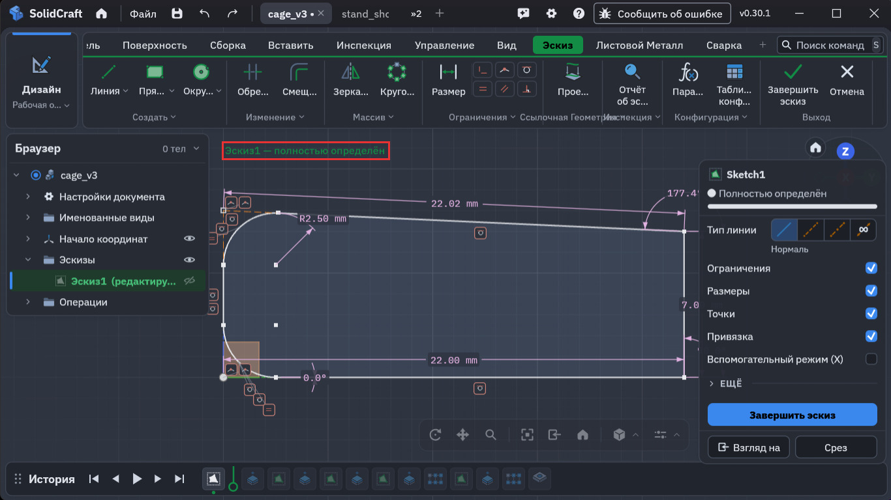
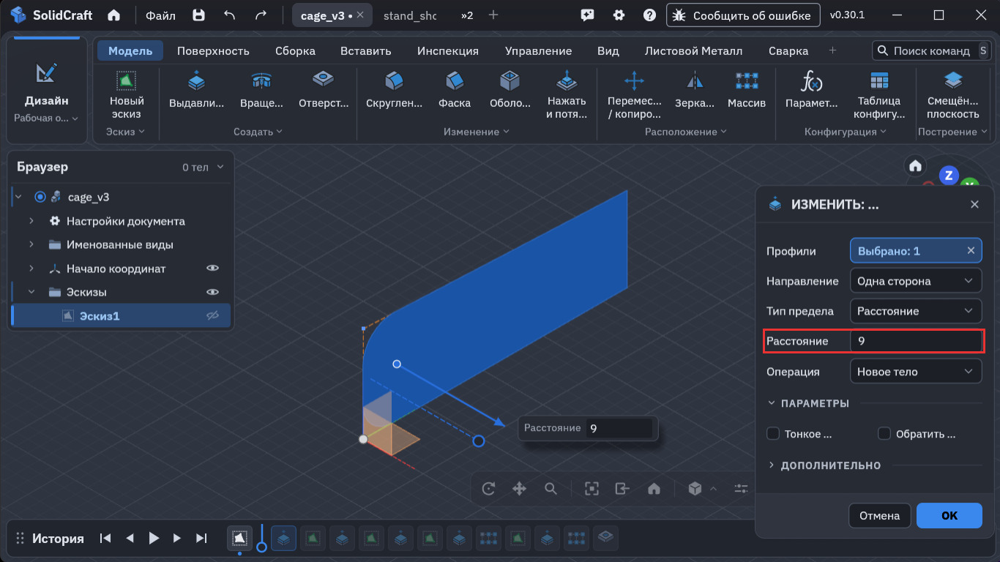
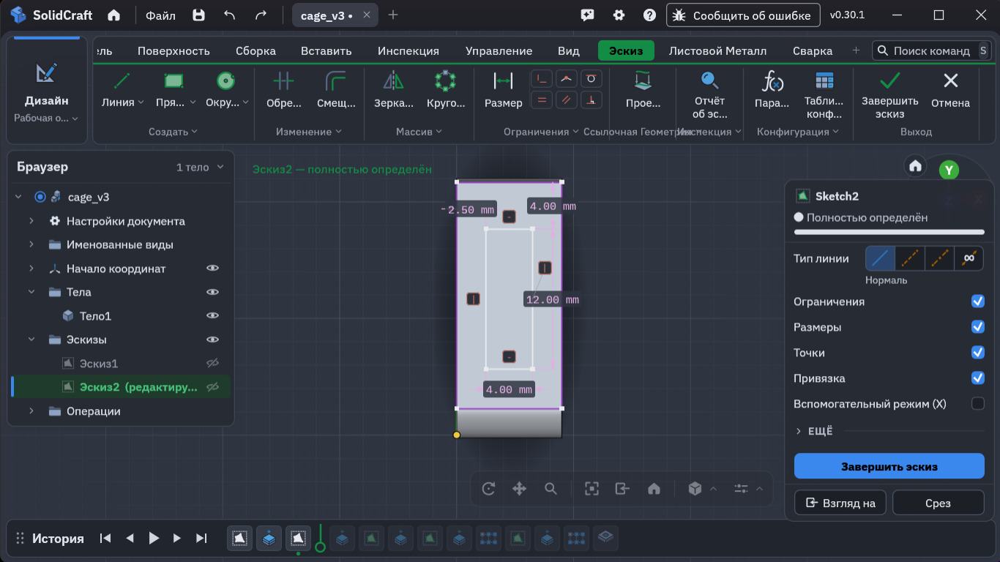
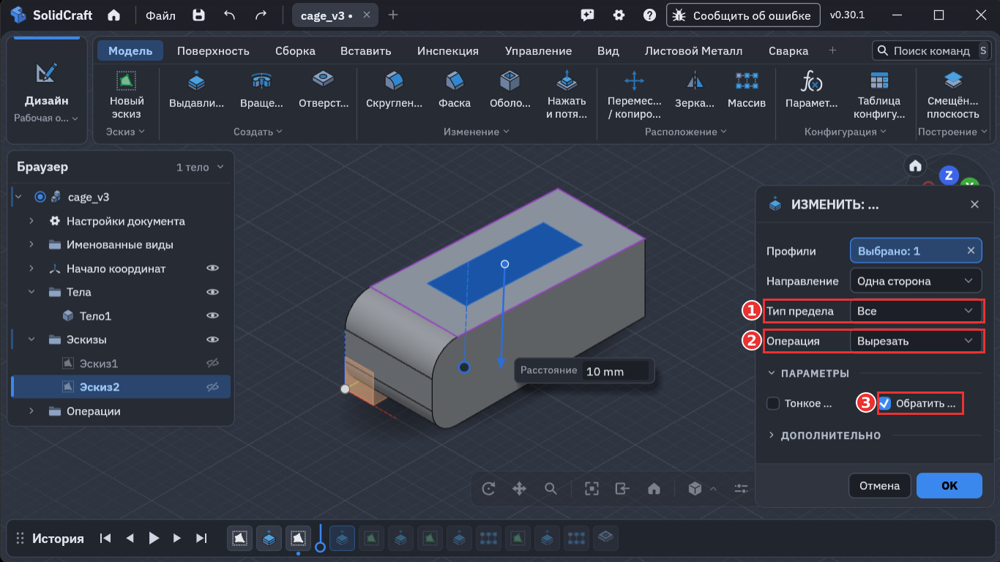
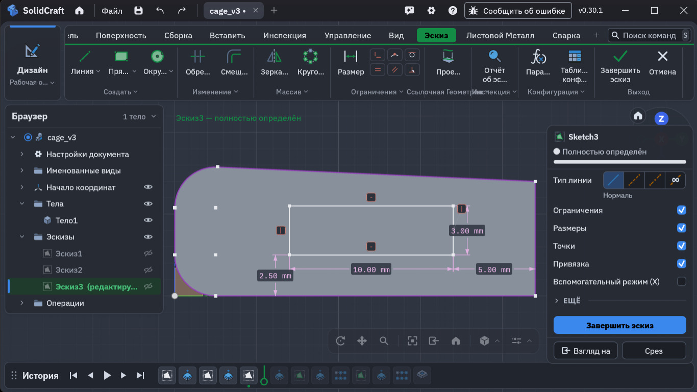
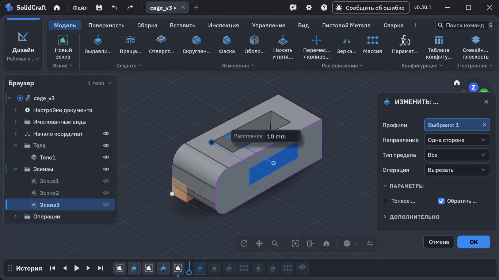

<section class="theory" markdown="1">

## Теоретические сведения
{: .section__title}

Кейдж строится в том же порядке, что и пластина с отверстием: сначала тело, потом вырезы. Тело — это профиль, выдавленный на ширину 9 мм. Профиль замкнут и состоит из трех отрезков, заданных длиной и углом, и четвертого, который возвращается в начало координат. Затем из тела вырезаются два окна: одно сверху вниз, другое сквозь обе боковые стенки.

Новый прием страницы — эскиз на грани тела. До сих пор эскизы лежали на базовой плоскости; окно рисуется прямо на грани, а его положение задается размерами от ребер этой грани. Вырез идет от грани внутрь тела, и направление нужно указать явно.
{: .th-full}

</section>

<section class="goal" markdown="1">

## 🎯 Цель работы
{: .section__title}

- строить замкнутый профиль отрезками «длина, угол»;
- создавать эскиз на грани тела и привязывать его размерами к ребрам;
- вырезать контур насквозь и выбирать направление выреза;
- сохранять проект под новым именем.

</section>

<aside class="callout callout--important" markdown="1">

⏱ Время и место выполнения
{: .callout__title}

Страница выполняется на второй практике по данной теме, около 30 минут, после разбора эскиза ([task 4-5](task_4-5.html), раздел 7). Результат — тело кейджа с двумя окнами; зубцы и отверстие строятся на [task 4-7](task_4-7.html).

</aside>

<!-- ===================== 1 ===================== -->

<section class="subsection" id="s1" markdown="1">

## <span class="subsection__num">1.</span> Профиль клина
{: .subsection__title}

На входе — новый пустой проект. На выходе — замкнутый контур: низ 22 мм, задний торец 7 мм, наклонный верх, нос 8 мм со скруглениями.

| Отрезок | Длина, мм | Угол | Конец отрезка (x; y), мм |
|---|---|---|---|
| низ | 22 | 0° | 22; 0 |
| задний торец | 7 | 90° | 22; 7 |
| верх | 22,023 | 177,397° | 0; 8 |
| нос | нажатие ЛКМ в начало координат | | 0; 0 |
{: .table-mid}

Нос кейджа находится в начале координат, задний торец — справа. Верх поднимается от торца к носу на 1 мм на длине 22 мм: его длина √(22² + 1²) = 22,023 мм, наклон к горизонтали arctg(1 / 22) = 2,603°, а абсолютный угол 180 − 2,603 = 177,397°.
{: .th-full}

1. Создайте новый проект (Ctrl+N). В браузере слева раскройте строку «Начало координат»: под ней появятся три базовые плоскости.
1. Нажмите «Новый эскиз» и нажмите ЛКМ по строке YZ в браузере: эскиз откроется сразу. Выбирайте плоскость в списке, а не в окне вида: в изометрии нажатие ЛКМ по вертикальной плоскости легко попадает в соседнюю плоскость XZ. Эталон построен на плоскости YZ: на кубике осей в углу окна Z смотрит вверх, Y — вправо. На вертикальной плоскости кейдж получается стоящим: верхняя грань сверху, боковые окна сбоку.
1. Приблизьте вид: наведите курсор на начало координат и прокрутите колесо мыши от себя. Клин мал, 22 × 7 мм, и на обычном виде его линии сливаются. Масштаб меняется вокруг курсора. После первого отрезка приблизьте еще раз, чтобы отрезок занял большую часть поля.
1. Выберите «Линия» и нажмите ЛКМ в начале координат.
1. Наберите `22`, Tab, `0`, Enter.
1. Наберите `7`, Tab, `90`, Enter.
1. Наберите `22.023`, Tab, `177.397`, Enter.
1. Нажмите ЛКМ в начале координат: контур замкнется. Нажмите Esc один раз.
1. Выберите «Скругление» эскиза, нажмите ЛКМ по двум углам носа — нижнему и верхнему — и введите радиус `2.5`. Нажмите OK.
1. Проверьте статус «полностью определен» и нажмите «Завершить эскиз».
{: .steps}

<figure class="figure-src">
<a href="../assets/img/task_4/4-6-2.jpg" target="_blank" rel="noopener" aria-label="Открыть снимок в полном размере"></a>
<figcaption class="figure-src__caption">Профиль клина со скругленным носом: 22 мм по низу, 7 мм у заднего торца, R2,5 у носа. В рамке — статус «полностью определен».</figcaption>
</figure>

<aside class="callout callout--warning" markdown="1">

Угол 177,397, а не 182,603
{: .callout__title}

Угол 177,397° ведет верх влево вверх: нос получается выше торца, 8 мм против 7. Угол 182,603° ведет линию влево вниз и дает обратный клин. Проверьте по эскизу: левая сторона контура должна быть длиннее правой.

</aside>

</section>

<!-- ===================== 2 ===================== -->

<section class="subsection" id="s2" markdown="1">

## <span class="subsection__num">2.</span> Выдавливание
{: .subsection__title}

1. Нажмите «Выдавливание» и нажмите ЛКМ внутри контура.
1. Расстояние — `9`, операция — «Новое тело». Нажмите OK.
1. Сохраните проект: Ctrl+S, папка `cad_4`, имя `cage`.
{: .steps}

<figure class="figure-src">
<a href="../assets/img/task_4/4-6-3.jpg" target="_blank" rel="noopener" aria-label="Открыть снимок в полном размере"></a>
<figcaption class="figure-src__caption">Выдавливание клина. В рамке — расстояние 9. Синим показан профиль, стрелка — направление выдавливания.</figcaption>
</figure>

Проверьте размеры эскиза до следующего шага. После того как на гранях появятся окна и зубцы, менять профиль нельзя: эскизы на гранях теряют привязки к ребрам, и их приходится чинить по одному.

</section>

<!-- ===================== 3 ===================== -->

<section class="subsection" id="s3" markdown="1">

## <span class="subsection__num">3.</span> Окно сверху
{: .subsection__title}

На входе — тело кейджа. На выходе — сквозное окно 12 × 4 мм от верхней грани до нижней.

1. Нажмите «Новый эскиз» и нажмите ЛКМ по верхней, наклонной грани: эскиз откроется сразу, вид повернется к грани. Длинная сторона грани идет на экране сверху вниз, задний торец вверху.
1. Выберите «Прямоугольник», нажмите ЛКМ внутри грани ближе к заднему торцу, наберите `4`, Tab, `12`, Enter: первое поле — размер по горизонтали экрана.
1. Выберите «Размер». Нажмите ЛКМ по короткой стороне прямоугольника, обращенной к заднему торцу, затем по ребру заднего торца; введите `4` и нажмите Enter. Если нажатие попадает в подпись длины, снимите галочку «Размеры» в панели эскиза справа: подписи скроются, размеры останутся. По ребру нажимайте в стороне от его середины: в середине срабатывает привязка к точке, и окно ввода не открывается.
1. Тем же инструментом задайте расстояние `2.5` между длинной стороной прямоугольника и ближайшим длинным ребром грани.
1. Проверьте статус «полностью определен» и нажмите «Завершить эскиз».
1. Нажмите «Выдавливание» и нажмите ЛКМ внутри прямоугольника.
1. Операция — «Вырезать», тип предела — «Все», поставьте галочку «Обратить». Нажмите OK.
{: .steps}

<figure class="figure-src">
<a href="../assets/img/task_4/4-6-4.jpg" target="_blank" rel="noopener" aria-label="Открыть снимок в полном размере"></a>
<figcaption class="figure-src__caption">Эскиз окна на верхней грани: 4 × 12 мм, 4 мм до ребра заднего торца (вверху снимка) и 2,5 мм до длинного ребра.</figcaption>
</figure>

<figure class="figure-src">
<a href="../assets/img/task_4/4-6-5.jpg" target="_blank" rel="noopener" aria-label="Открыть снимок в полном размере"></a>
<figcaption class="figure-src__caption">1 — тип предела «Все»; 2 — операция «Вырезать»; 3 — галочка «Обратить».</figcaption>
</figure>

Ширина грани 9 мм, окна — 4 мм: при отступе 2,5 мм окно стоит по центру, и стенки с обеих сторон равны 2,5 мм.

<aside class="callout callout--warning" markdown="1">

Вырез создан, а окна нет
{: .callout__title}

По умолчанию вырез идет от грани наружу, в пустоту: операция появляется в истории, но тело не меняется. Галочка «Обратить» разворачивает вырез внутрь тела. Если окна нет, откройте операцию двойным нажатием ЛКМ по ее значку в «Истории» и поставьте галочку.

</aside>

</section>

<!-- ===================== 4 ===================== -->

<section class="subsection" id="s4" markdown="1">

## <span class="subsection__num">4.</span> Боковое окно
{: .subsection__title}

На входе — тело с окном сверху. На выходе — окно 10 × 3 мм сквозь обе боковые стенки.

1. Нажмите «Новый эскиз» и нажмите ЛКМ по боковой грани с профилем клина. Таких граней две: берите ту, что обращена к вам в виде «Главная» (перед выбором нажмите «Главная»). В открывшемся эскизе скругленный нос должен быть слева, задний торец — справа.
1. Нарисуйте прямоугольник `10`, Tab, `3`, Enter внутри грани.
1. Инструментом «Размер» задайте `5` от короткой стороны прямоугольника, обращенной к заднему торцу, до ребра заднего торца и `2.5` от нижней стороны до нижнего ребра грани. Галочку «Размеры» в новом эскизе снимите заново.
1. Проверьте статус «полностью определен» и нажмите «Завершить эскиз».
1. «Выдавливание»: нажатие ЛКМ внутри прямоугольника, «Вырезать», «Все», «Обратить», OK.
1. Нажмите «Главная» и поверните модель: окно должно быть видно в обеих боковых стенках. Сохраните проект.
{: .steps}

<figure class="figure-src">
<a href="../assets/img/task_4/4-6-6.jpg" target="_blank" rel="noopener" aria-label="Открыть снимок в полном размере"></a>
<figcaption class="figure-src__caption">Эскиз бокового окна: 10 × 3 мм, 5 мм до ребра заднего торца и 2,5 мм до нижнего ребра.</figcaption>
</figure>

<figure class="figure-src">
<a href="../assets/img/task_4/4-6-7.jpg" target="_blank" rel="noopener" aria-label="Открыть снимок в полном размере"></a>
<figcaption class="figure-src__caption">Вырез бокового окна: те же «Вырезать», «Все», «Обратить». Окно сверху уже готово.</figcaption>
</figure>

При входе в новый эскиз программа сама поворачивает и масштабирует вид. Деталь на экране каждый раз другого размера: ориентируйтесь по ребрам грани, а не по месту на экране.
{: .th-full}

<div class="check" markdown="1">

Проверьте себя
{: .check__title}

Сверка подтверждает, что тело готово к построению зубцов. Она ничего не меняет в модели.

| Показатель | Должно быть | Если не совпало |
|---|---|---|
| Клин | нос выше заднего торца: 8 и 7 мм | обратный клин — в третьем отрезке введено 182.603 вместо 177.397 |
| Нос | два скругления R2,5 со стороны начала координат | скруглен задний торец: скругления поставлены не на те углы |
| Окно сверху | насквозь, по центру ширины, в 4 мм от заднего торца | окна нет — не стоит «Обратить»; окно глухое — тип предела не «Все» |
| Боковое окно | видно в обеих стенках | видно в одной — тип предела не «Все» |
| Статус каждого из трех эскизов | полностью определен | у эскиза окна не поставлены размеры привязки к ребрам |

</div>

</section>

<!-- ===================== 5 ===================== -->

<section class="subsection" id="s5" markdown="1">

## <span class="subsection__num">5.</span> Мини-тест
{: .subsection__title}

<div class="theory" markdown="1">

Теория к вопросам
{: .analysis__title}

**Механизм.** Эскиз на грани отличается от эскиза на базовой плоскости двумя свойствами: его некуда привязать, кроме ребер грани, и операция от него имеет направление — в тело или от тела.

| Что задается | Чем | Пример на окне сверху |
|---|---|---|
| форма | числа при рисовании | 4, Tab, 12 |
| положение | размеры от сторон до ребер грани | 4 от заднего торца, 2,5 от длинного ребра |
| глубина | тип предела «Все» | окно проходит тело насквозь при любой высоте |
| направление | галочка «Обратить» | вырез идет внутрь тела |

Прямоугольник, нарисованный на грани без размеров привязки, имеет две степени свободы: его можно двигать по грани. Окно получится, но у каждого студента в своем месте.

Тип предела «Все» надежнее числа: высота кейджа меняется от 7 до 8 мм, и вырез на 7 мм у носа не дошел бы до нижней грани.

</div>

<div class="quiz" data-file="task_4-6_test.txt" data-comment="#">
<p class="quiz__title">Вопросы к странице</p>
<p class="quiz__intro">Ответьте на вопросы. Текст результата сохранять не нужно: тест этой страницы не сдается.</p>
<div class="quiz__q">
<p>1. Вырез окна появился в «Истории», но тело не изменилось. В чем причина?</p>
<label><input type="radio" data-ok> Вырез направлен от грани наружу; нужна галочка «Обратить».</label>
<label><input type="radio"> Эскиз окна не полностью определен.<span class="quiz__why" hidden>Недоопределенный эскиз вырезается так же, только окно стоит не на месте. Тело не меняется из-за направления выреза.</span></label>
<label><input type="radio"> Выбрана операция «Объединить».<span class="quiz__why" hidden>«Объединить» добавила бы выступ над гранью, и тело изменилось бы. Здесь оно осталось прежним.</span></label>
<p class="quiz__exp" hidden>По умолчанию вырез идет от грани наружу, где материала нет. «Обратить» разворачивает его внутрь тела.</p>
</div>
<div class="quiz__q">
<p>2. Почему для окон выбран тип предела «Все», а не расстояние 8 мм?</p>
<label><input type="radio"> Потому что расстояние нельзя ввести для выреза.<span class="quiz__why" hidden>Расстояние ввести можно. «Все» выбрано потому, что не зависит от высоты тела в данном месте.</span></label>
<label><input type="radio" data-ok> «Все» режет до конца тела при любой его толщине; число пришлось бы подбирать и менять вместе с профилем.</label>
<label><input type="radio"> Потому что «Все» строится быстрее.<span class="quiz__why" hidden>Время построения одинаково. Разница в том, что «Все» не привязано к конкретному числу.</span></label>
<p class="quiz__exp" hidden>Высота клина меняется по длине, а ширина тела равна 9 мм. Предел «Все» проходит тело насквозь в обоих случаях без подбора числа.</p>
</div>
<div class="quiz__q">
<p>3. Окно сверху шириной 4 мм стоит в 2,5 мм от длинного ребра грани шириной 9 мм. Какова толщина второй стенки?</p>
<label><input type="radio"> 5 мм.<span class="quiz__why" hidden>5 мм — это сумма двух стенок: 9 − 4 = 5. Одна из них уже равна 2,5 мм.</span></label>
<label><input type="radio"> 6,5 мм.<span class="quiz__why" hidden>6,5 мм — расстояние от ребра до дальней стороны окна: 2,5 + 4. Стенка — то, что осталось за окном.</span></label>
<label><input type="radio" data-ok> 2,5 мм: 9 − 2,5 − 4 = 2,5, окно стоит по центру.</label>
<p class="quiz__exp" hidden>9 − 2,5 − 4 = 2,5 мм. Отступ 2,5 мм выбран так, чтобы стенки были равны.</p>
</div>
<div class="quiz__bar"><button type="button" class="tool-btn tool-btn--main quiz__check">Проверить</button><span class="quiz__status"></span></div>
<div class="quiz__result" hidden><p>Ответы:</p><pre class="quiz__comment"></pre><div class="quiz__bar"><button type="button" class="tool-btn quiz__copy">Скопировать</button><span class="quiz__copied"></span></div></div>
</div>

</section>

<section class="subsection" id="video" markdown="1">

## <span class="subsection__num">6.</span> Видео
{: .subsection__title}

Если шаг не получился, посмотрите его в записи. Скорость выбирается в панели под роликом. Ролик без звука, шаги подписаны титрами под кадром. Номера шагов в титрах идут по порядку ролика и не совпадают с номерами списков страницы. Сохранение проекта в записи не показано.

<figure class="figure-src figure-video">
<video controls preload="none" playsinline width="1368" height="832" poster="../assets/video/task_4/4-6.jpg" aria-label="Видео: Клин, окно сверху и боковое окно">
<source src="../assets/video/task_4/4-6.mp4" type="video/mp4">
Браузер не показывает видео. <a href="../assets/video/task_4/4-6.mp4">Скачайте файл</a>.
</video>
<figcaption class="figure-src__caption">Клин, окно сверху и боковое окно. Длительность 4 мин 17 с, файл 5,9 МБ: загрузка начнется после нажатия кнопки воспроизведения.</figcaption>
</figure>

</section>

<section class="then" markdown="1">

## Затем
{: .then__title}

1. Проверьте, что проект сохранен в `cad_4` под именем `cage.sc`.
1. Не закрывая проект, перейдите к [task 4-7](task_4-7.html): зубцы и отверстие.
{: .steps}

```text
cad_4/
├── plate.sc
├── stand.sc
├── stand.stl
├── task_4-5_test.txt
└── @@cage.sc@@
```
{: .folder-tree}

</section>

<section class="section sources" markdown="1">

## Источники
{: .section__title}

1. SolidCraft: документация, разделы [Sketching and constraints](https://docs.solidcraft.io/guide/sketching.html) (эскиз на грани, размеры) и [Solid features](https://docs.solidcraft.io/guide/features.html) (вырез, предел «насквозь», пересчет операций после правки эскиза).
1. SolidCraft 0.30.1, проверено на программе: замкнутый профиль отрезками, скругление носа R2,5, вырез «Все» с галочкой «Обратить», размеры привязки прямоугольника к ребрам грани.
1. FDA 510(k) K131082. InterForm Interbody Cage System, 2013 — диапазон размеров кейджей PLIF.
{: .sources__list}

</section>
