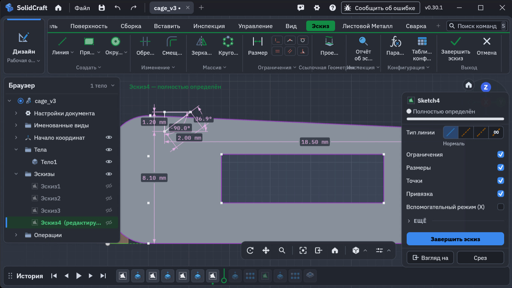
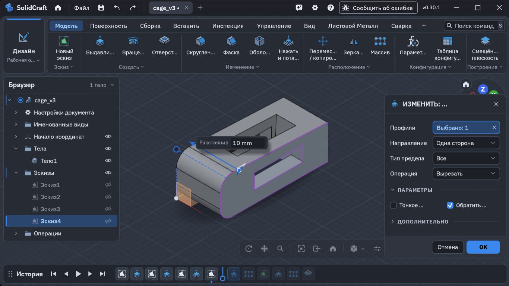
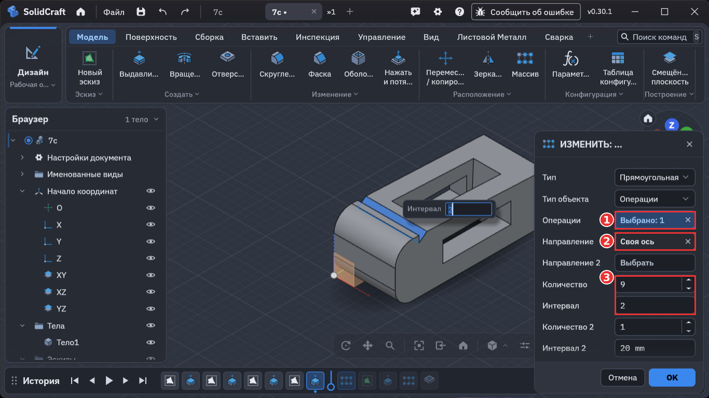
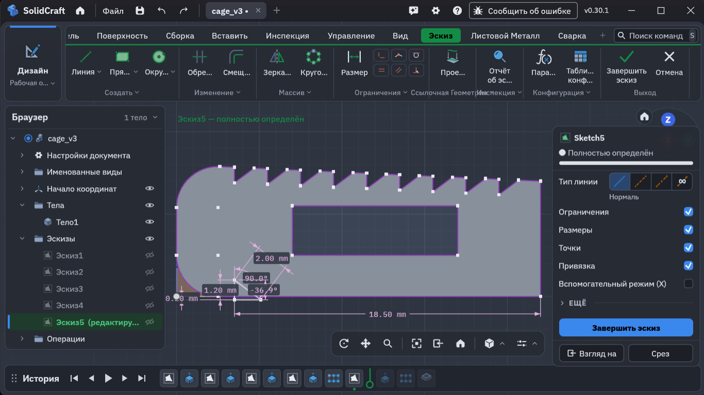
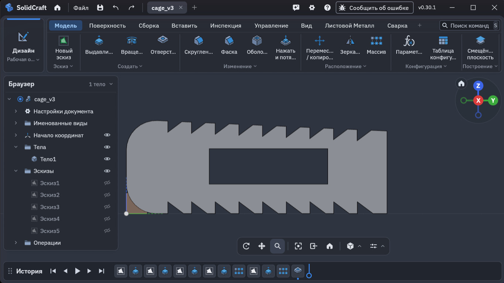
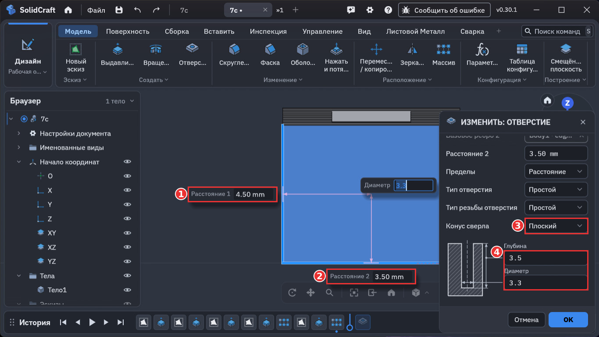
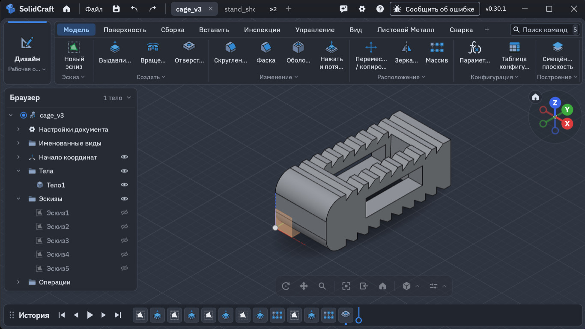

<section class="theory" markdown="1">

## Теоретические сведения
{: .section__title}

Зубцы кейджа — это ряд одинаковых треугольных вырезов на верхней и нижней поверхностях. Строится один вырез, остальные восемь создает массив, как ребра подставки. Вырез рисуется на боковой грани и режет тело насквозь по ширине, поэтому зубец идет через обе стенки сразу.

Треугольник выреза несимметричен: одна сторона отвесная, другая наклонена под 36,87° — это угол треугольника со сторонами 3, 4 и 5. Отвесная сторона обращена к носу. Между вырезами остаются зубцы с пологим скатом к носу и отвесной стенкой к заднему торцу: кейдж входит в промежуток легче, чем выходит ([task 4-5](task_4-5.html), раздел 5).
{: .th-full}

</section>

<section class="goal" markdown="1">

## 🎯 Цель работы
{: .section__title}

- рисовать контур, который начинается вне грани;
- задавать положение контура размерами от ребер;
- строить массив вырезов вдоль наклонного ребра;
- ставить отверстие по двум расстояниям от ребер.

</section>

<aside class="callout callout--important" markdown="1">

⏱ Время и место выполнения
{: .callout__title}

Страница выполняется на второй практике по данной теме, около 35 минут. На входе — проект `cage.sc` с телом и двумя окнами ([task 4-6](task_4-6.html)).

</aside>

<!-- ===================== 1 ===================== -->

<section class="subsection" id="s1" markdown="1">

## 1. Верхний зубец
{: .subsection__title}

На входе — тело с окнами. На выходе — один треугольный вырез на верхней поверхности у носа.

<figure class="diagram">
<svg role="img" viewBox="0 0 660 250">
<title>Треугольный вырез на верхней поверхности, вид сбоку. Начальная точка лежит чуть выше верхнего ребра. От нее отвесная сторона 1,2 мм идет вниз, затем наклонная сторона 2 мм под углом 36,87 градуса поднимается вправо, третья сторона замыкает контур. Отвесная сторона стоит в 18,5 мм от ребра заднего торца, начальная точка — в 8,1 мм от нижнего ребра.</title>
<path class="d-box d-box--object" d="M60,92 L600,116 L600,236 L60,236 z"></path>
<path class="d-box" style="fill: var(--c-bg, #fff)" d="M200,62 L200,182 L360,62 z"></path>
<circle cx="200" cy="62" r="5" style="fill: var(--c-text)"></circle>
<text class="d-text d-text--small" x="192" y="52" text-anchor="end">начальная точка</text>
<text class="d-text" x="190" y="130" text-anchor="end">1,2, −90°</text>
<text class="d-text" x="300" y="140">2, 36,87°</text>
<text class="d-text d-text--small" x="380" y="56">замкнуть: ЛКМ в начальную точку</text>
<text class="d-text d-text--small" x="70" y="228">тело кейджа; нос слева, задний торец справа</text>
<text class="d-text d-text--small" x="470" y="104">верхнее ребро</text>
</svg>
<figcaption class="diagram__caption">Контур верхнего выреза, вид сбоку, увеличено. Часть треугольника выше верхнего ребра лежит вне тела и ничего не режет; вырез образует его нижняя часть.</figcaption>
</figure>

1. Нажмите «Новый эскиз» и нажмите ЛКМ по боковой грани с профилем клина. Берите ту же грань, что для бокового окна: она обращена к вам в виде «Главная». В открывшемся эскизе скругленный нос должен быть слева, задний торец — справа, как на схеме выше. Если наоборот, выбрана противоположная грань: на ней те же углы дадут зубцы обратного направления. Нажмите «Отмена» справа на ленте эскиза и выберите другую боковую грань. Если эскиз уже завершен, отмените его клавишами Ctrl+Z.
1. Нажмите «Вписать», наведите курсор на верхний край грани у носа и приблизьте вид колесом мыши, примерно в три раза: зубец меньше 2 мм.
1. Выберите «Линия». Первое нажатие ЛКМ сделайте немного выше верхнего ребра, сразу за скруглением носа: вне грани, на глаз в 0,2–0,3 мм от ребра.
1. Наберите `1.2`, Tab, `-90`, Enter: отвесная сторона вниз.
1. Наберите `2`, Tab, `36.87`, Enter: наклонная сторона вправо вверх.
1. Нажмите ЛКМ в начальную точку: контур замкнется. Нажмите Esc один раз.
1. В панели эскиза справа снимите галочку «Размеры»: подписи длин и углов скроются, сами размеры останутся. Иначе нажатие ЛКМ по стороне маленького треугольника попадает в подпись и открывает чужой размер. В каждом новом эскизе галочка включается снова.
1. Выберите «Размер». Нажмите ЛКМ по отвесной стороне треугольника, затем по ребру заднего торца; введите `18.5` и нажмите Enter. Перед этим нажмите «Вписать», чтобы видеть ребро торца. По ребру нажимайте в стороне от его середины: в середине срабатывает привязка к точке, размер ставится между двумя точками, и окно ввода не открывается.
1. Тем же инструментом нажмите ЛКМ по начальной точке, затем по нижнему ребру грани; введите `8.1`.
1. Проверьте статус «полностью определен» и нажмите «Завершить эскиз».
1. «Выдавливание»: снова приблизьте зубец колесом мыши и нажмите ЛКМ внутри треугольника в той его части, что лежит ниже верхнего ребра, внутри тела. Ребро делит треугольник на две области; область выше ребра лежит вне тела, и вырез по ней ничего не меняет.
1. «Тип предела» — «Все», «Операция» — «Вырезать», галочка «Обратить». Нажмите кнопку вида «Главная» и проверьте предпросмотр: красный вырез идет сквозь тело. Нажмите OK.
{: .steps}

<figure class="figure-src">

<figcaption class="figure-src__caption">Треугольник верхнего выреза у носа: 18,5 мм до ребра заднего торца и 8,1 мм до нижнего ребра. Первая точка лежит выше верхнего ребра.</figcaption>
</figure>

<figure class="figure-src">

<figcaption class="figure-src__caption">Вырез по треугольнику: «Вырезать», «Все», «Обратить».</figcaption>
</figure>

<aside class="callout callout--hint" markdown="1">

Почему первая точка вне грани
{: .callout__title}

Нажатие ЛКМ точно по ребру грани линию не начинает: программа считает ребро спроецированной геометрией. Поэтому контур начинают рядом с ребром, снаружи. Точное положение точки потом задают два размера, так что первое нажатие ЛКМ может быть приблизительным.

</aside>

Размеры ставят вырез в 3,5 мм от носа (22 − 18,5) и опускают его дно на 0,94 мм ниже поверхности. Без этих двух размеров положение зубцов у каждого студента было бы своим.
{: .th-full}

</section>

<!-- ===================== 2 ===================== -->

<section class="subsection" id="s2" markdown="1">

## 2. Массив верхних зубцов
{: .subsection__title}

1. Нажмите «Массив». «Тип объекта» — «Операции».
1. В поле «Операции» нажмите ЛКМ по значку выреза зубца в «Истории».
1. «Направление»: нажмите ЛКМ по верхнему длинному ребру тела. Ребро наклонное, и массив пойдет вдоль наклона.
1. «Количество» — `9`, «Интервал» — `2`.
1. Проверьте предпросмотр: вырезы идут от носа к заднему торцу. Если они уходят за нос, поставьте интервал `-2`: знак зависит от того, в какую сторону программа направила выбранное ребро, и при проверке на программе получались оба знака. Нажмите OK.
{: .steps}

<figure class="figure-src">

<figcaption class="figure-src__caption">1 — выбрана операция выреза; 2 — направление (при повторном открытии программа пишет «Своя ось»); 3 — количество 9 и интервал 2; у вас знак интервала может быть другим. Синим выделен исходный вырез; на вашем экране предпросмотр покажет все девять.</figcaption>
</figure>

Массив идет вдоль наклонного ребра, поэтому каждый следующий вырез опускается вместе с поверхностью и глубина зубцов одинакова по всей длине.
{: .th-full}

</section>

<!-- ===================== 3 ===================== -->

<section class="subsection" id="s3" markdown="1">

## 3. Нижние зубцы
{: .subsection__title}

Нижний ряд строится так же, но треугольник перевернут.

1. «Новый эскиз» на той же боковой грани. Проверьте то же: нос слева, задний торец справа.
1. «Вписать», затем приблизьте колесом мыши нижний край грани у носа. «Линия»: первое нажатие ЛКМ немного ниже нижнего ребра, за скруглением носа.
1. Наберите `1.2`, Tab, `90`, Enter: отвесная сторона вверх.
1. Наберите `2`, Tab, `-36.87`, Enter: наклонная сторона вправо вниз.
1. Нажмите ЛКМ в начальную точку, нажмите Esc.
1. Снимите галочку «Размеры» в панели эскиза. «Размер»: `18.5` от отвесной стороны до ребра заднего торца; `0.2` от начальной точки до нижнего ребра.
1. «Завершить эскиз», затем «Выдавливание»: нажмите ЛКМ внутри треугольника выше нижнего ребра, внутри тела; «Все», «Вырезать», «Обратить». Проверьте предпросмотр в виде «Главная» и нажмите OK.
1. «Массив»: «Операции», вырез нижнего зубца, направление — нижнее длинное ребро, количество `9`, интервал `2`. Проверьте предпросмотр: ряд идет к заднему торцу; иначе смените знак интервала.
1. Сохраните проект.
{: .steps}

<figure class="figure-src">

<figcaption class="figure-src__caption">Нижний треугольник: 18,5 мм до ребра заднего торца, начальная точка на 0,2 мм ниже нижнего ребра.</figcaption>
</figure>

<figure class="figure-src">

<figcaption class="figure-src__caption">Кейдж сбоку: по девять вырезов сверху и снизу.</figcaption>
</figure>

Отвесная сторона длиной 1,2 мм начинается на 0,2 мм ниже ребра, поэтому глубина нижнего выреза равна 1,0 мм.
{: .th-full}

</section>

<!-- ===================== 4 ===================== -->

<section class="subsection" id="s4" markdown="1">

## 4. Отверстие на заднем торце
{: .subsection__title}

На входе — кейдж с зубцами. На выходе — глухое отверстие диаметром 3,3 мм и глубиной 3,5 мм в центре заднего торца.

1. Поверните модель задним торцом к себе: нажмите ЛКМ по шарику оси Y на кубике осей, затем «Вписать». Задний торец — плоская грань 9 × 7 мм без скруглений.
1. Нажмите «Отверстие» и нажмите ЛКМ по этой грани. Если в диалоге не видно полей «Базовое ребро», прокрутите его колесом мыши вверх; поля «Глубина» и «Диаметр» находятся ниже.
1. «Базовое ребро 1»: вертикальное ребро торца, «Расстояние 1» — `4.5`.
1. «Базовое ребро 2»: нижнее ребро торца, «Расстояние 2» — `3.5`.
1. В списке «Конус сверла» выберите «Плоский»: дно отверстия станет плоским, поле угла исчезнет.
1. Диаметр — `3.3`, глубина — `3.5`. Значения вводите так: нажатие ЛКМ в поле, Ctrl+A, число.
1. Нажмите OK и сохраните проект.
{: .steps}

<figure class="figure-src">

<figcaption class="figure-src__caption">1 — расстояние 4,5 от вертикального ребра; 2 — расстояние 3,5 от нижнего ребра; 3 — конус сверла «Плоский»; 4 — глубина 3,5 и диаметр 3,3. Поля «Базовое ребро» выше в том же диалоге: прокрутите его колесом мыши вверх.</figcaption>
</figure>

<figure class="figure-src">

<figcaption class="figure-src__caption">Готовый кейдж в изометрии.</figcaption>
</figure>

Расстояния 4,5 и 3,5 мм — половины ширины 9 мм и высоты 7 мм: отверстие стоит в центре торца. Окно сверху начинается в 4 мм от торца, а плоское дно отверстия лежит в 3,5 мм от него. Стенка окна наклонена вместе с верхней гранью, поэтому на высоте отверстия она отстоит от торца на 4,1–4,2 мм: между дном отверстия и окном остается стенка толщиной 0,6–0,7 мм, отверстие глухое.

<aside class="callout callout--hint" markdown="1">

Почему дно плоское
{: .callout__title}

При значении «Угол» программа добавляет к глубине 3,5 мм конус сверла с углом 118°. Высота конуса при диаметре 3,3 мм — около 1 мм: его вершина проходит стенку и выходит в окно, отверстие перестает быть глухим. Объем при этом меняется меньше чем на 3 мм³, и «Проверка STL» ошибку не заметит.

</aside>

<aside class="callout callout--warning" markdown="1">

Отверстие вышло сквозным
{: .callout__title}

Если в поле глубины осталось старое значение вместе с новым (например, «10 3.5») или в списке «Конус сверла» осталось «Угол», отверстие пройдет до окна. Откройте операцию из «Истории», выделите поле целиком (Ctrl+A) и введите `3.5` заново.

</aside>

Проверьте себя
{: .check__title}

Сверка подтверждает, что модель готова к экспорту. Она ничего не меняет в модели.

| Показатель | Должно быть | Если не совпало |
|---|---|---|
| Зубцы сверху и снизу | по 9 вырезов, первый в 3,5 мм от носа | вырезов меньше — проверьте «Количество»; ряд ушел за нос — знак интервала |
| Форма зубца | отвесная стенка выреза со стороны носа, скат к заднему торцу | перепутаны знаки углов −90 и 36,87 (сверху) или 90 и −36,87 (снизу); либо эскиз построен на противоположной боковой грани |
| Зубцы | идут через обе боковые стенки | тип предела выреза не «Все» |
| Отверстие | в центре торца, глухое: в окне сверху проема нет | сквозное — в поле глубины лишнее число или в списке «Конус сверла» осталось «Угол»; не в центре — расстояния 4.5 и 3.5 |
| Статус эскизов зубцов | полностью определен | не поставлены размеры 18.5 и 8.1 (сверху), 18.5 и 0.2 (снизу) |

</section>

<!-- ===================== 5 ===================== -->

<section class="subsection" id="s5" markdown="1">

## 5. Мини-тест
{: .subsection__title}

Теория к вопросам
{: .analysis__title}

**Механизм.** Наклонная сторона выреза длиной 2 мм под углом 36,87° смещается на 2 · cos 36,87° = 1,6 мм по горизонтали и на 2 · sin 36,87° = 1,2 мм по вертикали: она возвращается на высоту начальной точки.

| Ряд | Начальная точка | Глубина выреза в теле |
|---|---|---|
| верхний | 8,1 мм от нижнего ребра; поверхность в этом месте на высоте 8 − 3,5 / 22 = 7,84 мм | 7,84 − (8,1 − 1,2) = 0,94 мм |
| нижний | на 0,2 мм ниже нижнего ребра | 1,2 − 0,2 = 1,0 мм |

Девять вырезов с шагом 2 мм занимают 8 · 2 = 16 мм от первого до последнего. Первый стоит в 3,5 мм от носа, последний начинается в 19,5 мм и заканчивается раньше заднего торца на 22-м миллиметре.

Отверстие и окно сверху: плоское дно отверстия лежит в 3,5 мм от торца, стенка окна на высоте отверстия — в 4,1–4,2 мм. Между ними 0,6–0,7 мм. Если глубину отверстия увеличить до 4,2 мм и больше, оно выйдет в окно.

Вопросы к странице

Ответьте на вопросы. Текст результата сохранять не нужно: тест этой страницы не сдается.

1. Зачем к треугольнику выреза добавлены размеры 18,5 и 8,1, если вырез получается и без них?

<label><input type="radio"> Без них программа не дает завершить эскиз.Эскиз завершается и с двумя степенями свободы. Размеры нужны, чтобы положение было одинаковым и проверяемым.</label>
<label><input type="radio" data-ok> Первая точка поставлена нажатием ЛКМ на глаз; размеры задают положение и глубину зубцов одинаково у всех.</label>
<label><input type="radio"> Они задают длины сторон треугольника.Длины сторон заданы числами 1,2 и 2 при рисовании. Размеры 18,5 и 8,1 — расстояния до ребер грани.</label>

Форма треугольника задана при рисовании, положение — нет. Два размера от ребер убирают две степени свободы.

2. Какова глубина верхнего выреза в теле, если начальная точка стоит в 8,1 мм от нижнего ребра, а поверхность в этом месте на высоте 7,84 мм?

<label><input type="radio"> 1,2 мм.1,2 мм — длина отвесной стороны. Ее верхняя часть, 8,1 − 7,84 = 0,26 мм, лежит выше поверхности и ничего не режет.</label>
<label><input type="radio"> 0,26 мм.0,26 мм — на столько начальная точка выше поверхности. Глубина — то, что осталось от стороны 1,2 мм ниже поверхности.</label>
<label><input type="radio" data-ok> 0,94 мм: дно выреза на высоте 8,1 − 1,2 = 6,9 мм, а поверхность на 7,84 мм.</label>

Дно выреза: 8,1 − 1,2 = 6,9 мм. Глубина: 7,84 − 6,9 = 0,94 мм.

3. Студент ввел глубину отверстия 5 мм вместо 3,5. Что изменится?

<label><input type="radio" data-ok> Отверстие выйдет в окно сверху: окно начинается в 4 мм от торца.</label>
<label><input type="radio"> Ничего: отверстие останется глухим, только глубже.До окна от торца около 4 мм. Отверстие глубиной 5 мм пройдет стенку и откроется в окно.</label>
<label><input type="radio"> Отверстие пройдет кейдж насквозь до носа.До носа 22 мм. Отверстие глубиной 5 мм дойдет только до окна сверху.</label>

Стенка между дном отверстия и окном — 0,6–0,7 мм: окно на высоте отверстия начинается в 4,1–4,2 мм от торца. При глубине 5 мм стенки нет.

<button type="button" class="tool-btn tool-btn--main quiz__check">Проверить</button>

Ответы:
<pre class="quiz__comment"></pre>
<button type="button" class="tool-btn quiz__copy">Скопировать</button>

</section>

<section class="subsection" id="video" markdown="1">

## 6. Видео
{: .subsection__title}

Если шаг не получился, посмотрите его в записи. Скорость выбирается в панели под роликом. Ролики без звука, шаги подписаны титрами под кадром. Номера шагов в титрах идут по порядку ролика и не совпадают с номерами списков страницы. Сохранение проекта в записи не показано.

<figure class="figure-src figure-video">
<video controls preload="none" playsinline width="1368" height="832" poster="../assets/video/task_4/4-7a.jpg" aria-label="Видео: Верхний зубец и массив верхних зубцов (разделы 1 и 2)">
<source src="../assets/video/task_4/4-7a.mp4" type="video/mp4">
Браузер не показывает видео. <a href="../assets/video/task_4/4-7a.mp4">Скачайте файл</a>.
</video>
<figcaption class="figure-src__caption">Верхний зубец и массив верхних зубцов (разделы 1 и 2). Длительность 2 мин 19 с, файл 3,1 МБ: загрузка начнется после нажатия кнопки воспроизведения.</figcaption>
</figure>

<figure class="figure-src figure-video">
<video controls preload="none" playsinline width="1368" height="832" poster="../assets/video/task_4/4-7b.jpg" aria-label="Видео: Нижние зубцы (раздел 3)">
<source src="../assets/video/task_4/4-7b.mp4" type="video/mp4">
Браузер не показывает видео. <a href="../assets/video/task_4/4-7b.mp4">Скачайте файл</a>.
</video>
<figcaption class="figure-src__caption">Нижние зубцы (раздел 3). Длительность 2 мин 16 с, файл 3,2 МБ: загрузка начнется после нажатия кнопки воспроизведения.</figcaption>
</figure>

<figure class="figure-src figure-video">
<video controls preload="none" playsinline width="1368" height="832" poster="../assets/video/task_4/4-7c.jpg" aria-label="Видео: Отверстие на заднем торце (раздел 4)">
<source src="../assets/video/task_4/4-7c.mp4" type="video/mp4">
Браузер не показывает видео. <a href="../assets/video/task_4/4-7c.mp4">Скачайте файл</a>.
</video>
<figcaption class="figure-src__caption">Отверстие на заднем торце (раздел 4). Длительность 1 мин 8 с, файл 2,1 МБ: загрузка начнется после нажатия кнопки воспроизведения.</figcaption>
</figure>

</section>

<section class="then" markdown="1">

## Затем
{: .then__title}

1. Проверьте, что проект `cage.sc` сохранен после отверстия.
1. Не закрывая проект, перейдите к [task 4-8](task_4-8.html): экспорт, проверка и сдача.
{: .steps}

</section>

<section class="section sources" markdown="1">

## Источники
{: .section__title}

1. SolidCraft: документация, раздел [Solid features](https://docs.solidcraft.io/guide/features.html) — отверстие с привязкой к двум ребрам, массивы операций.
1. SolidCraft 0.30.1, проверено на программе: контур с первой точкой вне грани, вырез «Все» с «Обратить», массив вдоль наклонного ребра (9 вырезов, интервал 2), отверстие по двум базовым ребрам с плоским дном; толщина стенки между отверстием и окном измерена по сетке эталона.
1. Faadhila A. et al. Design of a Transforaminal Lumbar Interbody Fusion (TLIF) Spine Cage // International Journal of Technology, 2022, 13(8), p. 1663–1671, DOI [10.14716/ijtech.v13i8.6152](https://doi.org/10.14716/ijtech.v13i8.6152) — зубцы на опорных поверхностях и отверстие под инструмент.
{: .sources__list}

</section>
