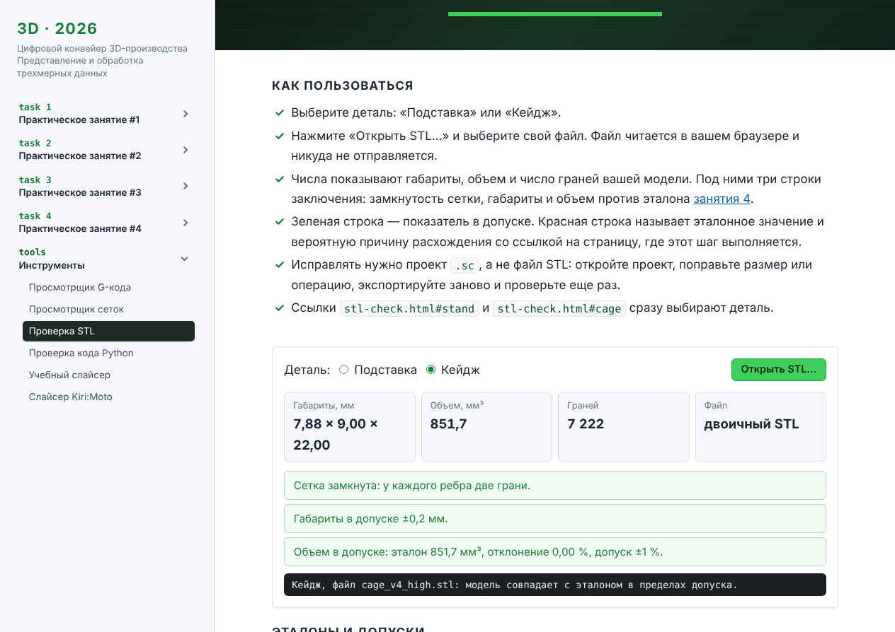
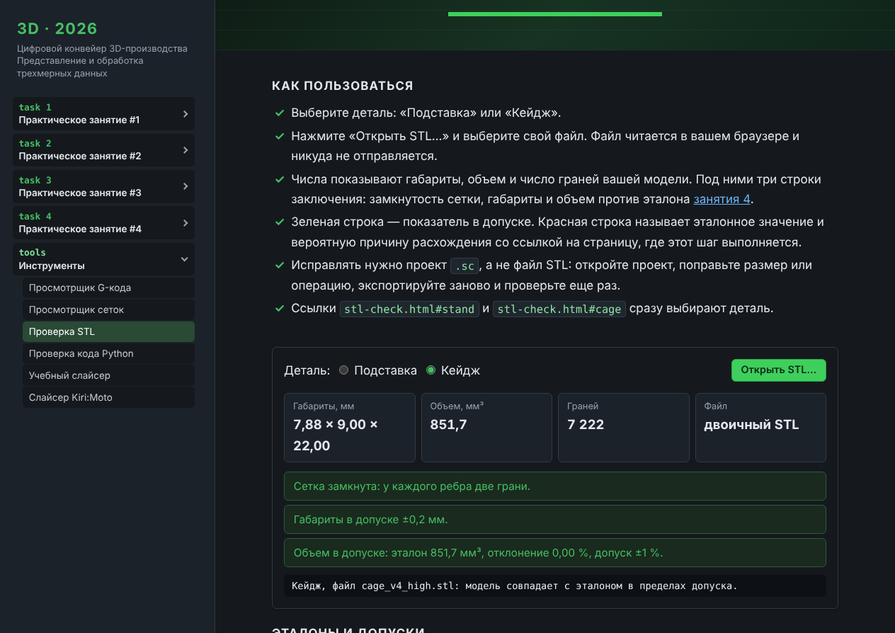

<section class="theory" markdown="1">

## Теоретические сведения
{: .section__title}

Кейдж экспортируется и проверяется так же, как подставка: файл проекта, файл сетки, сравнение с эталоном по габаритам, объему и замкнутости. Отличие в том, что у кейджа габариты почти ничего не говорят о правильности: окна, зубцы и отверстие лежат внутри габаритов 22 × 9 × 8 мм. Главным показателем становится объем.

Модель экспортируется в реальном размере. Для печати она мала: масштаб 2 : 1 задается в слайсере на практике 5, и в CAD ничего увеличивать не нужно.
{: .th-full}

</section>

<section class="goal" markdown="1">

## 🎯 Цель работы
{: .section__title}

- экспортировать кейдж в STL и проверить его на сайте;
- по отклонению объема определять, какого элемента не хватает;
- собрать и сдать файлы занятия.

</section>

<aside class="callout callout--important" markdown="1">

⏱ Время и место выполнения
{: .callout__title}

Страница выполняется в конце второй практики по данной теме, около 15 минут. На входе — проект `cage.sc` с готовым кейджем ([task 4-7](task_4-7.html)).

</aside>

<!-- ===================== 1 ===================== -->

<section class="subsection" id="s1" markdown="1">

## <span class="subsection__num">1.</span> Экспорт
{: .subsection__title}

1. Сохраните проект: Ctrl+S.
1. «Файл» → «Export STL…» → «Добавить все тела», формат STL, качество «Высокое».
1. «Сохранить»: папка `cad_4`, имя `cage`.
{: .steps}

Шаги те же, что на [task 4-4](task_4-4.html), раздел 2; скриншоты окна экспорта — там.
{: .muted}

</section>

<!-- ===================== 2 ===================== -->

<section class="subsection" id="s2" markdown="1">

## <span class="subsection__num">2.</span> Проверка модели
{: .subsection__title}

1. Откройте инструмент [«Проверка STL»](../stl-check.html#cage), выберите деталь «Кейдж» и откройте `cage.stl`.
1. Сравните показатели с таблицей.
{: .steps}

<div class="check" markdown="1">

Проверьте себя
{: .check__title}

Габариты подтверждают профиль и ширину, объем — что на месте окна, ряды зубцов и отверстие целиком, замкнутость — что сетку можно печатать. Проверка ничего не меняет в файле.

| Показатель | Значение | Если не совпало |
|---|---|---|
| Габариты, мм | 22,00 × 9,00 × 7,88, допуск ±0,2 | высота 7,88, а не 8: вершину носа срезает скругление R2,5; 22 — длина профиля; 9 — расстояние выдавливания |
| Объем, мм³ | 851,7, допуск ±1 % | больше — нет окна, зубцов или отверстия; меньше — лишний вырез или сквозное отверстие (таблица раздела 3) |
| Замкнутость | у каждого ребра сетки две грани | экспортировано не то тело: повторите раздел 1 |

</div>

<figure class="figure-src">
<a class="shot--light" href="../assets/img/task_4/4-8-1.png" target="_blank" rel="noopener" aria-label="Открыть снимок в полном размере"></a>
<a class="shot--dark" href="../assets/img/task_4/4-8-1_dark.png" target="_blank" rel="noopener" aria-label="Открыть снимок в полном размере"></a>
<figcaption class="figure-src__caption">Результат проверки эталонного кейджа: все три показателя в допуске.</figcaption>
</figure>

</section>

<!-- ===================== 3 ===================== -->

<section class="subsection" id="s3" markdown="1">

## <span class="subsection__num">3.</span> Как читать отклонение объема
{: .subsection__title}

Каждый вырез убирает из тела известный объем. Если объем модели больше эталона, сравните избыток с таблицей: совпадение покажет, какого элемента нет.

| Элемент | Расчет | Объем, мм³ |
|---|---|---|
| Окно сверху | 12 · 4 · средняя высота 7,45 | около 358 |
| Боковое окно | 10 · 3 · две стенки по 2,5 | 150 |
| Отверстие | π · 1,65² · 3,5 | около 30 |
| Один ряд зубцов | 9 треугольных вырезов; над окном сверху они проходят только стенки | около 30–40 |
{: .table-mid}

Средняя высота тела над окном сверху: окно занимает участок от 6 до 18 мм от носа, высота там меняется от 7,73 до 7,18 мм. Объемы окон посчитаны без учета того, что они пересекаются между собой и с зубцами, поэтому числа приблизительные.
{: .th-full}

Допуск ±1 % от объема кейджа — около 8,5 мм³. Объем эталона при трех качествах экспорта совпал до 0,1 мм³, поэтому допуск узкий: он замечает пропущенное окно, ряд зубцов и отверстие (около 30 мм³).

Мелкие отклонения укладываются в допуск, и проверка их не видит: один пропущенный зубец (3–5 мм³), глубину отверстия 3,0 мм вместо 3,5 (около 4 мм³), диаметр 3,0 мм вместо 3,3 (около 5 мм³), конус сверла вместо плоского дна (меньше 3 мм³), зубцы обратного направления. Эти элементы преподаватель проверяет по файлу `cage.sc`.

</section>

<!-- ===================== 4 ===================== -->

<section class="subsection" id="s4" markdown="1">

## <span class="subsection__num">4.</span> Мини-тест
{: .subsection__title}

<div class="theory" markdown="1">

Теория к вопросам
{: .analysis__title}

**Механизм.** Габариты — это размеры габаритного параллелепипеда (bounding box): наименьшего прямоугольного параллелепипеда со сторонами вдоль осей, в который помещается деталь. Вырез, который не выходит на его грани, габариты не меняет, а объем уменьшает.

| Ошибка | Габариты | Объем |
|---|---|---|
| нет бокового окна | совпадают | больше на 150 мм³ |
| нет отверстия | совпадают | больше на 30 мм³ |
| обратный клин (нос 7, торец 8) | высота 8,00 вместо 7,88: в допуске | почти тот же |
| выдавливание на 8 вместо 9 | 22 × 8 × 7,88 | меньше |

Обратный клин проверка по габаритам и объему не отличает: наибольшая высота меняется на 0,12 мм, что меньше допуска, а материала столько же. Его видно только на модели, поэтому форма клина стоит в блоке «Проверьте себя» страницы [task 4-6](task_4-6.html) и проверяется преподавателем по файлу проекта.

Масштаб печати на объем модели не влияет: в файле `cage.stl` деталь имеет реальный размер. При увеличении вдвое в слайсере линейные размеры растут в 2 раза, а объем — в 2³ = 8 раз.

</div>

<div class="quiz" data-file="task_4-8_test.txt" data-comment="#">
<p class="quiz__title">Вопросы к странице</p>
<p class="quiz__intro">Ответьте на вопросы. Текст результата сохранять не нужно: тест этой страницы не сдается.</p>
<div class="quiz__q">
<p>1. Габариты кейджа совпали с эталоном, объем больше на 150 мм³. Какого элемента нет?</p>
<label><input type="radio"> Отверстия на торце.<span class="quiz__why" hidden>Отверстие убирает около 30 мм³: π · 1,65² · 3,5. Избыток 150 мм³ в пять раз больше.</span></label>
<label><input type="radio" data-ok> Бокового окна: 10 · 3 · (2,5 + 2,5) = 150 мм³.</label>
<label><input type="radio"> Окна сверху.<span class="quiz__why" hidden>Окно сверху убирает около 358 мм³. Избыток 150 мм³ соответствует боковому окну.</span></label>
<p class="quiz__exp" hidden>Боковое окно 10 × 3 мм проходит две стенки по 2,5 мм: 10 · 3 · 5 = 150 мм³.</p>
</div>
<div class="quiz__q">
<p>2. Почему проверка на сайте не замечает обратный клин (нос 7 мм, торец 8 мм)?</p>
<label><input type="radio" data-ok> Наибольшая высота почти та же: 8,00 мм против 7,88, отличие меньше допуска; объем тоже почти тот же.</label>
<label><input type="radio"> Потому что проверка сравнивает только объем.<span class="quiz__why" hidden>Проверка сравнивает габариты, объем и замкнутость. Габариты обратного клина укладываются в допуск.</span></label>
<label><input type="radio"> Потому что сетка обратного клина не замкнута.<span class="quiz__why" hidden>Сетка замкнута в обоих случаях. Замкнутость не зависит от формы детали.</span></label>
<p class="quiz__exp" hidden>Габарит — наибольший размер. У правильного клина вершину носа срезает скругление: 7,88 мм; у обратного наибольшая высота на плоском торце: 8,00 мм. Отличие 0,12 мм меньше допуска 0,2 мм. Объем почти не меняется. Форму клина проверяют по модели.</p>
</div>
<div class="quiz__q">
<p>3. Кейдж будет напечатан в масштабе 2 : 1. Какой размер должна иметь модель в файле <code>cage.stl</code>?</p>
<label><input type="radio"> 44 × 18 × 16 мм: модель увеличивают в CAD перед экспортом.<span class="quiz__why" hidden>Модель с такими габаритами не пройдет проверку против эталона 22 × 9 × 8 мм. Масштаб задается в слайсере.</span></label>
<label><input type="radio" data-ok> 22 × 9 × 8 мм: масштаб задается в слайсере на практике 5.</label>
<label><input type="radio"> Любой: слайсер сам подберет размер под стол принтера.<span class="quiz__why" hidden>Слайсер печатает модель в том размере, который записан в файле, если масштаб не изменен вручную.</span></label>
<p class="quiz__exp" hidden>В CAD модель хранится в реальном размере. Масштаб печати — параметр слайсера; объем при увеличении вдвое вырастет в 8 раз.</p>
</div>
<div class="quiz__bar"><button type="button" class="tool-btn tool-btn--main quiz__check">Проверить</button><span class="quiz__status"></span></div>
<div class="quiz__result" hidden><p>Ответы:</p><pre class="quiz__comment"></pre><div class="quiz__bar"><button type="button" class="tool-btn quiz__copy">Скопировать</button><span class="quiz__copied"></span></div></div>
</div>

</section>

<!-- ===================== 5 ===================== -->

<section class="subsection" id="s5" markdown="1">

## <span class="subsection__num">5.</span> Сдача работы
{: .subsection__title}

Сдаются пять файлов. Файл `plate.sc` — разминка, его сдавать не нужно.

| Файл | Проверка перед сдачей |
|---|---|
| `stand.sc` | открывается в SolidCraft 0.30.1, в истории эскиз, два выдавливания и массив |
| `stand.stl` | прошел «Проверку STL» для подставки |
| `cage.sc` | открывается; нос выше заднего торца; все эскизы полностью определены |
| `cage.stl` | прошел «Проверку STL» для кейджа; габариты 22 × 9 × 7,88 мм |
| `task_4-5_test.txt` | текст мини-теста страницы [task 4-5](task_4-5.html) |

Преподаватель открывает файлы проектов и смотрит историю построения, а также может попросить изменить один размер и показать, что модель перестроилась.

</section>

<!-- ===================== 6 ===================== -->

<section class="subsection" id="s6" markdown="1">

## <span class="subsection__num">6.</span> Самостоятельное построение без шагов (по желанию)
{: .subsection__title}

Эта часть не обязательна и на сайте не проверяется: результат смотрит преподаватель.

Сделайте подставку с 12 ребрами вместо 15. Откройте `stand.sc`, сохраните его под именем `stand_12.sc` («Файл» → «Сохранить как…») и измените массив: двойное нажатие ЛКМ по его значку в «Истории». Интервал посчитайте сами так, чтобы первое и последнее ребро остались на краях полосы шириной 34 мм: ширина ребра 1,4 мм, формула — в теории к тесту [task 4-3](task_4-3.html). Экспортируйте `stand_12.stl`.

«Проверка STL» эту модель не зачтет: объем станет меньше эталона примерно на 7,6 % (три ребра по 2,5 %). Габариты и замкнутость должны остаться в допуске. Запишите в сообщении преподавателю интервал, который вы ввели, и расчет.

</section>

<section class="then" markdown="1">

## Затем
{: .then__title}

1. Проверьте, что в папке `cad_4` лежат пять файлов для сдачи.
1. Переместите папку `cad_4` в личную папку и сдайте ее так же, как папки предыдущих занятий.
1. Файлы `stand.stl` и `cage.stl` сохраните у себя: они нужны на практике 5.
{: .steps}

Итоговая структура папок должна выглядеть так:

```text
ivanov_ii/
├── pipeline_1/
├── pipeline_2/
├── pipeline_3/
└── @@cad_4/@@
    ├── stand.sc
    ├── stand.stl
    ├── cage.sc
    ├── cage.stl
    └── task_4-5_test.txt
```
{: .folder-tree}

</section>

<section class="section sources" markdown="1">

## Источники
{: .section__title}

1. SolidCraft: документация, раздел [Import and export](https://docs.solidcraft.io/guide/files.html) — экспорт STL.
1. Расчет объемов вырезов по размерам учебной модели (раздел 3); объем эталона — по сетке эталонной модели практики (отверстие с плоским дном).
{: .sources__list}

</section>
