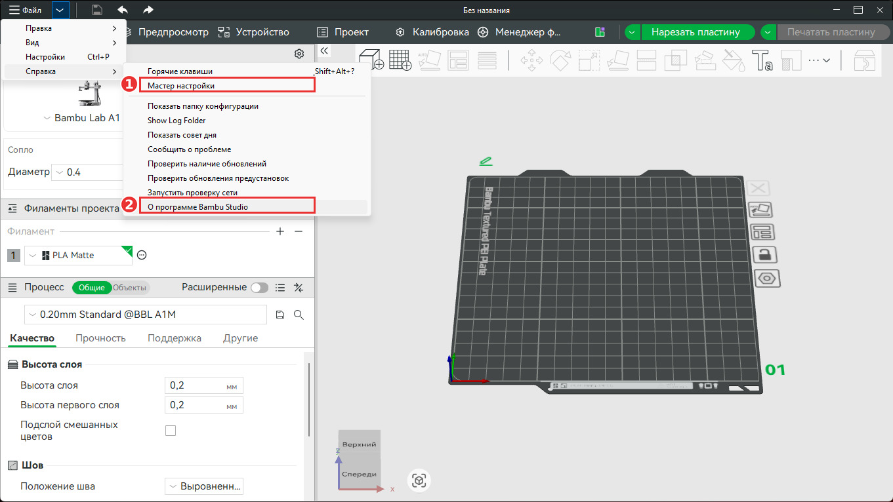
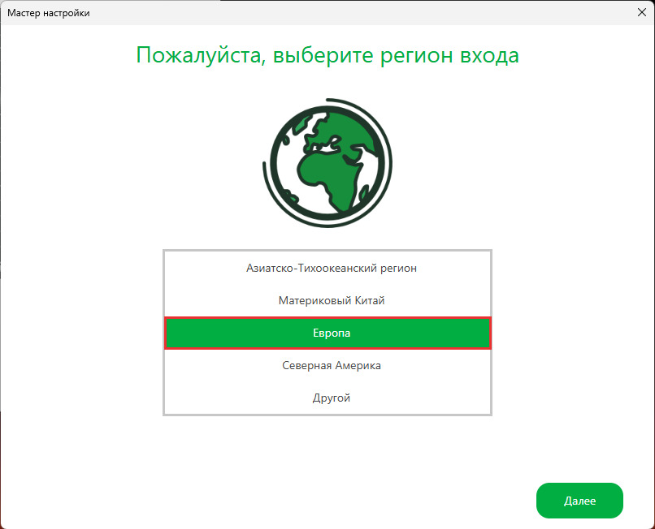
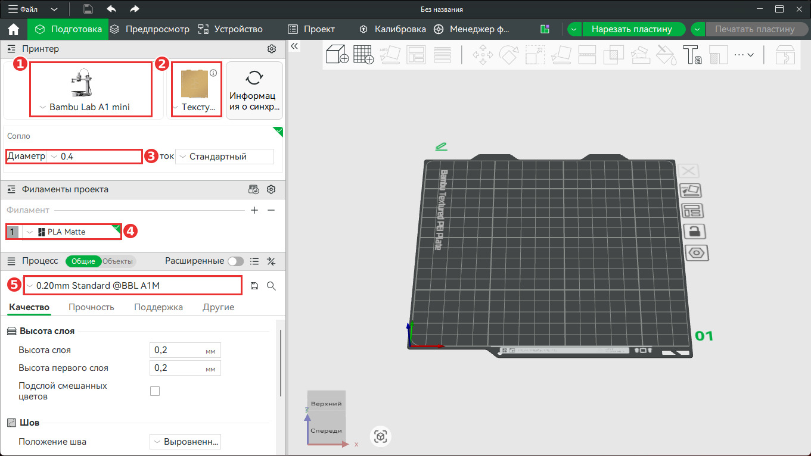
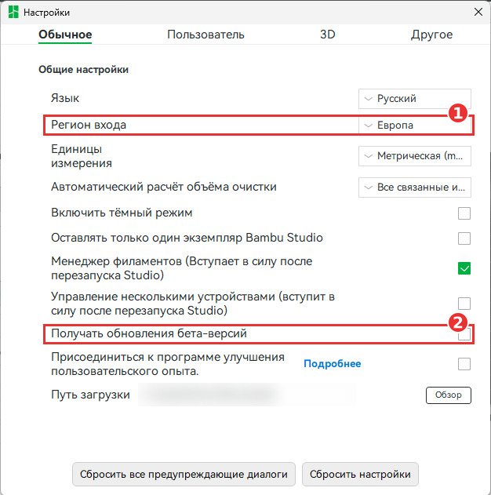
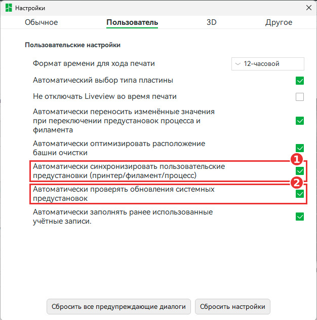
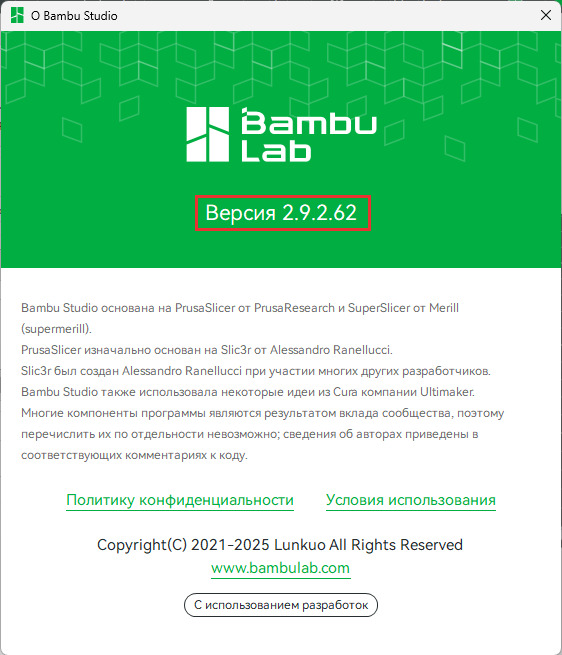
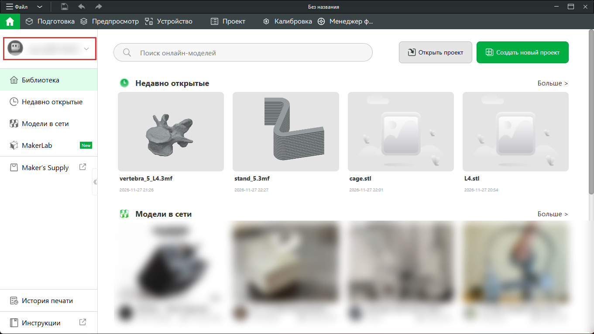

<section class="theory" markdown="1">

## Теоретические сведения
{: .section__title}

[Bambu Studio](https://github.com/bambulab/BambuStudio) — бесплатный слайсер компании Bambu Lab с открытым исходным кодом. Он готовит модель к печати на принтерах Bambu Lab: размещает ее на столе, режет на слои, строит траекторию сопла, сохраняет G-код и отправляет задание на принтер. По окну «О программе» Bambu Studio основана на PrusaSlicer, которым вы пользовались на практиках 1–3, поэтому многие настройки вам уже знакомы, хотя названы иначе (таблица соответствия — в справке [task 5-10](task_5-10.html)). На занятии вся группа работает в одной версии — 2.9.2.62.

Версия зафиксирована, потому что от нее зависят числа на страницах практики. Время печати и масса нити, которые вы будете сверять с эталоном, получены в Bambu Studio 2.9.2.62 с системными профилями этой версии. Программа умеет обновлять сама себя и отдельно от этого — системные профили принтера, материала и процесса. Любое из двух обновлений сдвинет ваши числа относительно эталона, поэтому на этой странице вы отключите проверку обновлений профилей.
{: .th-full}

</section>

<section class="goal" markdown="1">

## 🎯 Цель работы
{: .section__title}

- скачать установщик Bambu Studio 2.9.2.62 с официальной страницы выпуска;
- установить программу и проверить номер версии;
- выбрать принтер Bambu Lab A1 mini, лист, материал Bambu PLA Matte и профиль процесса;
- отключить синхронизацию пользовательских профилей и проверку обновлений системных профилей;
- на первой практике войти в общую учетную запись и получить свой позвонок.

</section>

<aside class="callout callout--important" markdown="1">

⏱ Время и место выполнения
{: .callout__title}

Разделы 1–5 выполните самостоятельно до первой практики по данной теме, около 30 минут: размер установщика — около 370 МБ. Раздел 6 выполняется в начале первой практики, около 15 минут: вход в учетную запись, распределение позвонков и скачивание своего позвонка. Если программа не установилась или не запускается, сообщите преподавателю до занятия.

</aside>

<!-- ===================== 1 ===================== -->

<section class="subsection" id="s1" markdown="1">

## <span class="subsection__num">1.</span> Где взять установщик
{: .subsection__title}

Установщик берется только с официальной страницы выпуска 2.9.2.62 в репозитории программы: [github.com/bambulab/BambuStudio/releases/tag/v02.09.02.62](https://github.com/bambulab/BambuStudio/releases/tag/v02.09.02.62). Выпуск называется «2.9.2 Public Release».

1. Откройте страницу выпуска и найдите внизу список Assets.
1. Скачайте один файл для своей системы: для Windows — `Bambu_Studio_win-v02.09.02.62-20261124164959.exe` (373 МБ), для macOS — `Bambu_Studio_mac-v02.09.02.62-20261124164959.dmg` (243 МБ).
{: .steps}

<aside class="callout callout--warning" markdown="1">

Проверьте номер версии
{: .callout__title}

Кнопка загрузки на сайте Bambu Lab и раздел Latest на GitHub ведут на самую новую версию. Если это не 2.9.2.62, не берите ее: в адресе страницы, с которой вы скачиваете файл, должно стоять `v02.09.02.62`, а в имени файла — `v02.09.02.62`. Не скачивайте программу с других сайтов.

</aside>

Имена и размеры файлов сверены со страницей выпуска 27.11.2026. В том же списке лежат архив `.zip` для Windows и файлы AppImage для Ubuntu 22 и 24; они на курсе не проверялись.
{: .th-full}

</section>

<!-- ===================== 2 ===================== -->

<section class="subsection" id="s2" markdown="1">

## <span class="subsection__num">2.</span> Установка на Windows
{: .subsection__title}

1. Запустите скачанный файл `.exe` двойным нажатием ЛКМ.
1. Если Windows попросит разрешение на изменения, подтвердите его: программа ставится в папку `C:\Program Files\Bambu Studio`, для этого нужны права администратора.
1. Пройдите шаги установщика, не меняя папку установки.
1. Запустите Bambu Studio из меню «Пуск».
{: .steps}

</section>

<!-- ===================== 3 ===================== -->

<section class="subsection" id="s3" markdown="1">

## <span class="subsection__num">3.</span> Установка на macOS
{: .subsection__title}

1. Откройте скачанный файл `.dmg` и перетащите Bambu Studio в папку «Программы» (Applications).
1. Запустите Bambu Studio из папки «Программы».
{: .steps}

<aside class="callout callout--warning" markdown="1">

Что проверено на курсе
{: .callout__title}

Все шаги практики проверены в Windows 11. В macOS программа на курсе не проверялась: клавиши, меню и диалоги в ней могут отличаться. Если на вашем компьютере программа не запускается, сообщите преподавателю до занятия.

</aside>

</section>

<!-- ===================== 4 ===================== -->

<section class="subsection" id="s4" markdown="1">

## <span class="subsection__num">4.</span> Принтер, лист, материал и процесс
{: .subsection__title}

При первом запуске программа открывает мастер настройки: регион, соглашение об использовании (Terms of Use, кнопка «Принять»), принтер и материалы. Регион — «Европа»: в этом регионе заведена учетная запись группы, и с другим регионом войти в нее не получится. Из принтеров отметьте Bambu Lab A1 mini с соплом 0,4 мм, из материалов — Bambu PLA Matte. Мастер можно открыть снова: стрелка вниз справа от кнопки «Файл» → «Справка» → «Мастер настройки».

После мастера откройте вкладку «Подготовка» (Prepare) и проверьте левую панель сверху вниз:

| Панель | Поле | Должно быть |
|---|---|---|
| «Принтер» | принтер | Bambu Lab A1 mini |
| «Принтер» | лист (картинка справа от принтера) | Textured PEI Plate — текстурированный лист PEI |
| «Сопло» | «Диаметр» | 0.4 |
| «Филаменты проекта» | материал 1 | PLA Matte |
| «Процесс» | профиль | 0.20mm Standard @BBL A1M |
{: .table-mid}

Если в «Филаментах проекта» стоит другой материал (например, Bambu PLA Basic, который программа предлагает по умолчанию), нажмите ЛКМ по названию материала и выберите в списке «Bambu» → «Bambu PLA Matte @BBL A1M». Если стоит другой профиль процесса, нажмите ЛКМ по его названию и выберите «0.20mm Standard @BBL A1M». Если указан другой лист, нажмите ЛКМ по названию листа под его картинкой справа от принтера и выберите в списке «Текстурированная PEI пластина» (Textured PEI Plate).

PEI (polyetherimide, полиэфиримид) — термостойкий пластик, которым покрыт стальной лист стола. Лист текстурированный, и программа берет для него свою температуру стола: 65 °C для PLA Matte. Лист другого типа дал бы другую температуру и другую адгезию.
{: .th-full}

<figure class="figure-src">
<a href="../assets/img/task_5/5-0-1.jpg" target="_blank" rel="noopener" aria-label="Открыть снимок в полном размере"></a>
<figcaption class="figure-src__caption">Стрелка вниз справа от «Файл» → «Справка»: 1 — «Мастер настройки»; 2 — «О программе Bambu Studio».</figcaption>
</figure>

<figure class="figure-src">
<a href="../assets/img/task_5/5-0-2.jpg" target="_blank" rel="noopener" aria-label="Открыть снимок в полном размере"></a>
<figcaption class="figure-src__caption">Мастер настройки, первая страница: регион входа «Европа» (рамка). Дальше мастер показывает соглашение об использовании, затем выбор принтера и материалов.</figcaption>
</figure>

<figure class="figure-src">
<a href="../assets/img/task_5/5-0-3.jpg" target="_blank" rel="noopener" aria-label="Открыть снимок в полном размере"></a>
<figcaption class="figure-src__caption">Левая панель вкладки «Подготовка» сверху вниз: 1 — принтер Bambu Lab A1 mini; 2 — лист Textured PEI Plate; 3 — диаметр сопла 0.4; 4 — материал PLA Matte; 5 — профиль процесса 0.20mm Standard @BBL A1M.</figcaption>
</figure>

</section>

<!-- ===================== 5 ===================== -->

<section class="subsection" id="s5" markdown="1">

## <span class="subsection__num">5.</span> Настройки программы
{: .subsection__title}

Окно настроек открывается стрелкой вниз справа от кнопки «Файл» → «Настройки» или клавишами Ctrl+P.

1. На вкладке «Обычное» проверьте, что в поле «Регион входа» стоит «Европа», и снимите флажок «Получать обновления бета-версий», если он стоит.
1. Перейдите на вкладку «Пользователь» и снимите флажок «Автоматически синхронизировать пользовательские предустановки (принтер/филамент/процесс)». Учетная запись у группы одна: с включенной синхронизацией профиль, измененный одним студентом, появится у всех.
1. На той же вкладке снимите флажок «Автоматически проверять обновления системных предустановок»: обновленные профили сдвинут время и массу относительно эталона.
1. Закройте окно настроек.
1. Проверьте версию: стрелка вниз справа от «Файл» → «Справка» → «О программе Bambu Studio». В окне «О Bambu Studio» должно стоять «Версия 2.9.2.62».
1. Если программа предложит обновиться, откажитесь.
{: .steps}

<div class="check" markdown="1">

Проверьте себя
{: .check__title}

Подготовка завершена, если выполнены все условия таблицы. Проверка ничего не меняет в программе.

| Показатель | Должно быть | Если не совпало |
|---|---|---|
| Окно «О Bambu Studio» | «Версия 2.9.2.62» | установлена другая версия: удалите программу и установите 2.9.2.62 со страницы выпуска (раздел 1) |
| Принтер и сопло | Bambu Lab A1 mini, 0.4 | в мастере выбран другой принтер: откройте «Мастер настройки» и отметьте A1 mini 0,4 мм |
| Материал | PLA Matte | выбран материал по умолчанию: смените его в «Филаментах проекта» (раздел 4) |
| Лист | Textured PEI Plate | выбран другой лист: смените его в панели «Принтер» (раздел 4) |
| Профиль процесса | 0.20mm Standard @BBL A1M | выбран другой профиль: смените его в панели «Процесс» |
| «Пользователь»: синхронизация предустановок, проверка обновлений системных предустановок | оба флажка сняты | профили будут меняться без вашего ведома: снимите флажки (раздел 5) |

</div>

<figure class="figure-src">
<a href="../assets/img/task_5/5-0-4.jpg" target="_blank" rel="noopener" aria-label="Открыть снимок в полном размере"></a>
<figcaption class="figure-src__caption">Окно «Настройки», вкладка «Обычное»: 1 — «Регион входа» — «Европа»; 2 — флажок «Получать обновления бета-версий» снят. Путь загрузки на снимке закрыт.</figcaption>
</figure>

<figure class="figure-src">
<a href="../assets/img/task_5/5-0-5.jpg" target="_blank" rel="noopener" aria-label="Открыть снимок в полном размере"></a>
<figcaption class="figure-src__caption">Вкладка «Пользователь»: 1 — синхронизация пользовательских предустановок; 2 — проверка обновлений системных предустановок. На снимке оба флажка еще стоят: снимите их.</figcaption>
</figure>

<figure class="figure-src">
<a href="../assets/img/task_5/5-0-6.jpg" target="_blank" rel="noopener" aria-label="Открыть снимок в полном размере"></a>
<figcaption class="figure-src__caption">Окно «О Bambu Studio»: в рамке номер версии 2.9.2.62.</figcaption>
</figure>

</section>

<!-- ===================== 6 ===================== -->

<section class="subsection" id="s6" markdown="1">

## <span class="subsection__num">6.</span> На первой практике: учетная запись и позвонок
{: .subsection__title}

Принтер в лаборатории привязан к одной учетной записи Bambu Lab на всю группу. Через нее программа отправляет задание на принтер. Данные для входа преподаватель дает в телеграм-канале курса; на сайте их нет.

1. Откройте домашнюю страницу программы — значок домика слева от вкладки «Подготовка» — и нажмите ЛКМ по строке учетной записи вверху слева.
1. Войдите в учетную запись группы. При входе с нового компьютера сервис может прислать код подтверждения на почту учетной записи; код сообщит преподаватель.
1. Договоритесь в группе, кто какой позвонок печатает. Позвонки делятся без повторов, начиная с L5 вверх: в группе из трех человек — L3, L4, L5; из четырех — L2–L5; из пяти — L1–L5. Th12 — шестой или запасной ([task 5](task_5.html), раздел «Позвонки группы»).
1. Создайте в своем репозитории папку `print_5` для файлов этого занятия.
1. Скачайте архив [`print_5_start.zip`](../assets/files/print_5_start.zip) и распакуйте в папку `print_5` оба его файла: `README.md` и `.gitignore`. В Windows файл `.gitignore` виден в «Проводнике»; в macOS имена с точкой в начале скрыты: показать их можно клавишами Cmd+Shift+. в окне Finder.
1. Только после этого скачайте файл своего позвонка (`L1.stl` … `L5.stl` или `Th12.stl`) по ссылке, которую преподаватель дает в телеграм-канале курса, и положите его в папку `print_5`. Имя файла не меняйте: по нему `.gitignore` узнает файл позвонка и не пускает его в репозиторий ([task 5-1](task_5-1.html), раздел 2).
{: .steps}

<aside class="callout callout--warning" markdown="1">

Файл позвонка не публикуется
{: .callout__title}

Модели позвонков предоставлены для занятия и не выкладываются в открытый доступ. Не добавляйте файл позвонка в репозиторий и не передавайте его за пределы группы. От случайного добавления защищает файл `.gitignore` из архива: как он работает, сказано на [task 5-1](task_5-1.html), раздел 2.

</aside>

<figure class="figure-src">
<a href="../assets/img/task_5/5-0-7.jpg" target="_blank" rel="noopener" aria-label="Открыть снимок в полном размере"></a>
<figcaption class="figure-src__caption">Домашняя страница: в рамке строка учетной записи (имя на снимке закрыто). Нажмите на нее ЛКМ, чтобы войти.</figcaption>
</figure>

</section>

<section class="then" markdown="1">

## Затем
{: .then__title}

1. Проверьте, что после первой практики в папке `print_5` лежат три файла из дерева ниже.
1. Перейдите к [task 5-1](task_5-1.html): интерфейс программы и положение позвонка на столе.
{: .steps}

```text
print_5/
├── @@.gitignore@@
├── @@L4.stl@@
└── @@README.md@@
```
{: .folder-tree}

Вместо `L4.stl` в папке лежит файл вашего позвонка.

</section>

<section class="section sources" markdown="1">

## Источники
{: .section__title}

1. Bambu Studio: страница выпуска 2.9.2.62 («2.9.2 Public Release»), [github.com/bambulab/BambuStudio/releases/tag/v02.09.02.62](https://github.com/bambulab/BambuStudio/releases/tag/v02.09.02.62) — файлы установки для Windows и macOS.
1. Bambu Studio: исходный код и профили, [github.com/bambulab/BambuStudio](https://github.com/bambulab/BambuStudio) — профили принтера Bambu Lab A1 mini 0.4 nozzle, материала Bambu PLA Matte @BBL A1M, процесса 0.20mm Standard @BBL A1M.
1. Bambu Lab Wiki: [Account multifactor authentication](https://wiki.bambulab.com/en/studio-handy/account-multifactor-authentication) — код подтверждения при входе.
1. Git: документация, [gitignore](https://git-scm.com/docs/gitignore) — файл `.gitignore`.
1. Bambu Studio 2.9.2.62, проверено на программе 27–28.11.2026: окно «О программе», левая панель вкладки «Подготовка» и список листов, окно «Настройки» (вкладки «Обычное» и «Пользователь»).
{: .sources__list}

</section>
