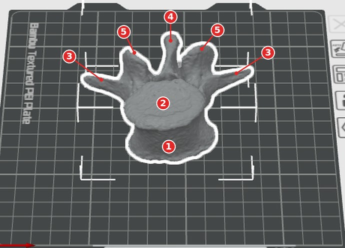
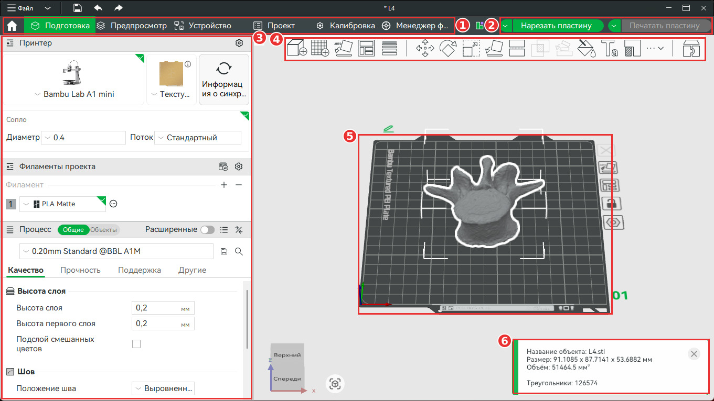
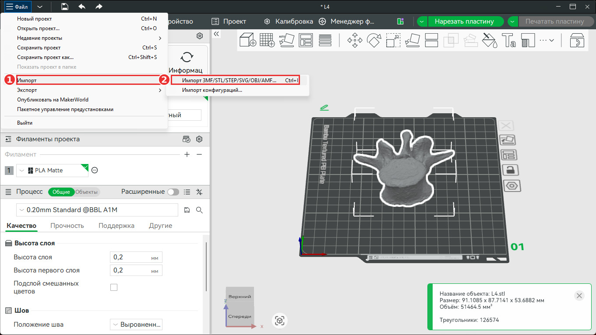
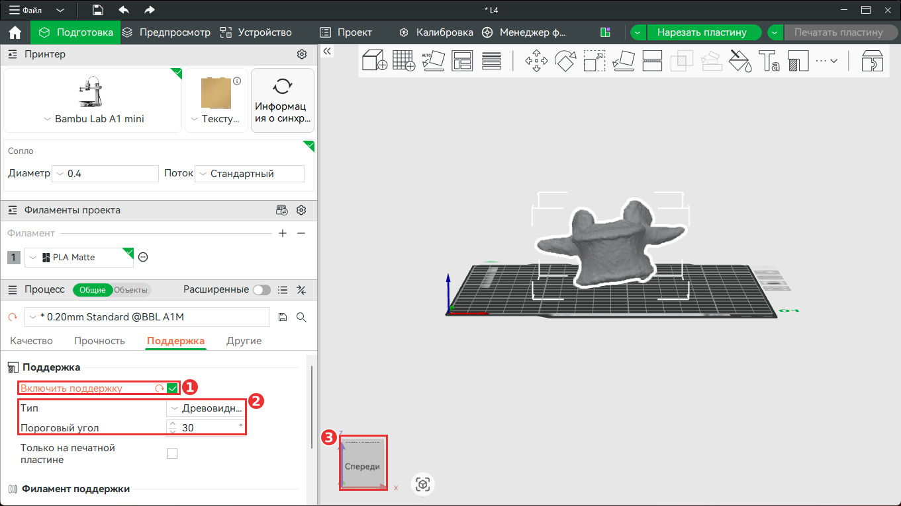
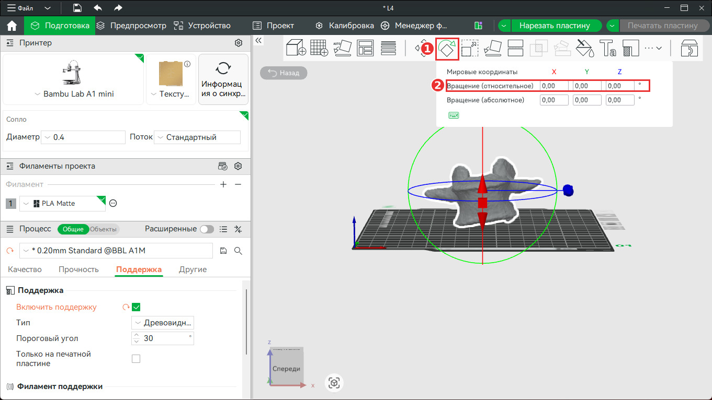
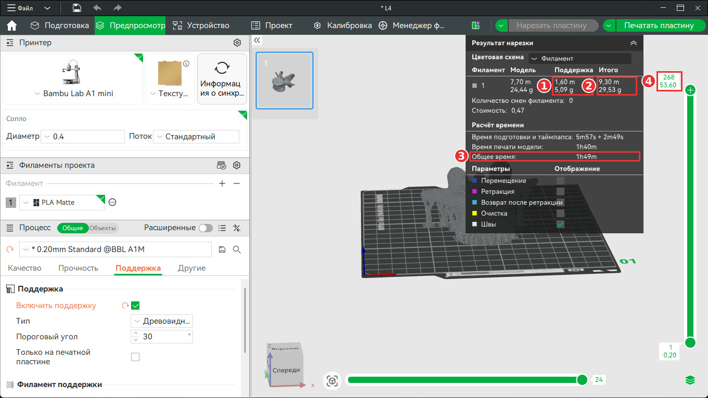
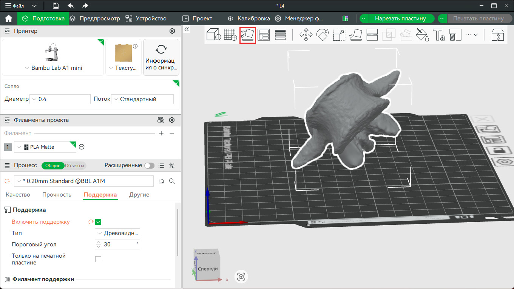
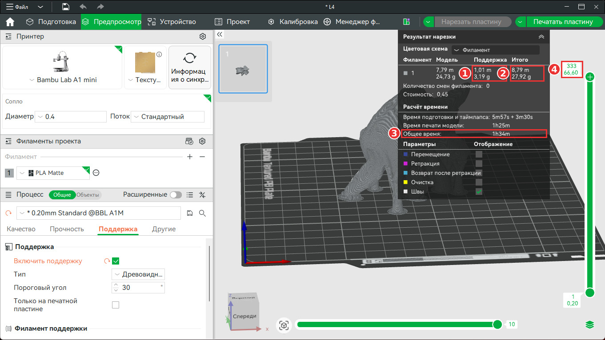

<section class="theory" markdown="1">

## Теоретические сведения
{: .section__title}

Позвонок — первая деталь этого занятия, и у нее нет ни одной плоской грани. Подставку и кейдж практики 4 вы строили из плоских граней и ставили на стол самой большой из них. Кость устроена иначе: тело позвонка, дужка и отростки — изогнутые поверхности, и в любом положении позвонок касается стола несколькими маленькими площадками, а его нижние поверхности нависают над столом. Поэтому положение позвонка на столе выбирают не по опорной грани, а по тому, сколько поддержек и времени оно потребует.

Части позвонка, которые названы в шагах, показаны на рисунке. Тело — массивная передняя часть в форме короткого цилиндра: оно несет вес. Основания этого цилиндра, верхнее и нижнее, называются замыкательными пластинками: к ним прилегают межпозвонковые диски. Дужка — костное кольцо позади тела; вместе с телом она окружает канал спинного мозга. От дужки отходят отростки: остистый — назад, два поперечных — в стороны, суставные — к соседним позвонкам (Betts et al., 2022, п. 7.3).

<figure class="figure-src">
<a href="../assets/img/task_5/5-1-0.jpg" target="_blank" rel="noopener" aria-label="Открыть рисунок в полном размере"></a>
<figcaption class="figure-src__caption">Позвонок L4 на столе Bambu Studio, вид спереди и сверху: 1 — тело; 2 — замыкательная пластинка, основание тела; 3 — поперечные отростки; 4 — остистый отросток; 5 — суставные отростки. Дужка лежит позади тела, отростки отходят от нее. Модель: М. А. Головин, ФГБУ ФНОЦ МСЭ и Р им. Г. А. Альбрехта Минтруда России.</figcaption>
</figure>

Модели позвонков получены сегментацией снимков компьютерной томографии (КТ) пациента: на снимках выделяют кость и превращают ее границу в сетку треугольников — тот же формат STL, что на практиках 2 и 4. Сетка позвонка содержит 93–130 тысяч треугольников — в 13–18 раз больше, чем сетка кейджа практики 4 (7222 треугольника).
{: .th-full}

</section>

<section class="goal" markdown="1">

## 🎯 Цель работы
{: .section__title}

- находить в окне Bambu Studio вкладки, панели настроек и панель инструментов;
- импортировать модель и сверять ее габариты с таблицей;
- нарезать модель с поддержками и читать результат нарезки;
- сравнивать два положения детали по массе поддержек и времени и выбирать одно из них.

</section>

<aside class="callout callout--important" markdown="1">

⏱ Время и место выполнения
{: .callout__title}

Страница выполняется на первой практике по данной теме, около 25 минут: две нарезки позвонка по 20–30 секунд, шесть чисел в `README.md` и мини-тест. Нужны установленная программа и папка `print_5` с файлом вашего позвонка, `README.md` и `.gitignore` ([task 5-0](task_5-0.html), раздел 6).

</aside>

<!-- ===================== 1 ===================== -->

<section class="subsection" id="s1" markdown="1">

## <span class="subsection__num">1.</span> Окно программы
{: .subsection__title}

Окно Bambu Studio делится на вкладки, левую панель настроек, панель инструментов над столом и область стола.

| Область | Где | Что в ней |
|---|---|---|
| Вкладки | верхняя строка | «Подготовка» (Prepare) — размещение модели и настройки; «Предпросмотр» (Preview) — результат нарезки по слоям; «Устройство» (Device) — принтер и ход печати; «Проект», «Калибровка» и «Менеджер филаментов» (на снимке название обрезано) на занятии не нужны. Значок домика слева — домашняя страница |
| Кнопки нарезки и печати | справа в той же строке | «Нарезать пластину» (Slice plate) и «Печатать пластину» (Print plate) |
| Левая панель | слева на вкладке «Подготовка» | «Принтер», «Сопло», «Филаменты проекта», «Процесс» с вкладками «Качество», «Прочность», «Поддержка», «Другие» |
| Панель инструментов | над столом | добавление модели, «Автоориентация», перемещение, «Вращение [R]», «Масштаб [S]», «Форма текста [T]» и другие |
| Стол | в центре | лист 180 × 180 мм с моделями |
{: .table-mid}

Вид стола поворачивается перетаскиванием ЛКМ по пустому месту, масштаб меняется колесом мыши. Кубик в левом нижнем углу показывает, откуда вы смотрите: «Верхний», «Спереди», «Левый».

Заголовки панелей «Принтер» и «Филаменты проекта» сворачивают панель нажатием ЛКМ: на маленьком экране так видно больше настроек процесса. Кнопка с двойной стрелкой влево над левым краем стола сворачивает всю левую панель, такая же кнопка со стрелкой вправо разворачивает ее обратно.

Переключатель «Общие / Объекты» над вкладками процесса выбирает, к чему относятся настройки: ко всему столу или к выбранной модели. На этом занятии все настройки меняются в режиме «Общие».
{: .th-full}

<figure class="figure-src">
<a href="../assets/img/task_5/5-1-1.jpg" target="_blank" rel="noopener" aria-label="Открыть снимок в полном размере"></a>
<figcaption class="figure-src__caption">Окно Bambu Studio 2.9.2.62 после импорта позвонка L4: 1 — вкладки; 2 — «Нарезать пластину» и «Печатать пластину»; 3 — левая панель; 4 — панель инструментов; 5 — стол; 6 — сообщение об импортированной модели: имя, размер, объем, число треугольников. Модель: М. А. Головин, ФГБУ ФНОЦ МСЭ и Р им. Г. А. Альбрехта Минтруда России.</figcaption>
</figure>

</section>

<!-- ===================== 2 ===================== -->

<section class="subsection" id="s2" markdown="1">

## <span class="subsection__num">2.</span> Файлы для записей
{: .subsection__title}

Числа нарезок вы записываете в файл `README.md` в папке `print_5`; его проверяет преподаватель. Форма с пустыми таблицами и файл `.gitignore` уже лежат в папке: вы распаковали их из архива [`print_5_start.zip`](../assets/files/print_5_start.zip) на [task 5-0](task_5-0.html), раздел 6.

1. Проверьте, что в папке `print_5` лежат `README.md`, `.gitignore` и файл вашего позвонка. Если первых двух нет, скачайте архив и распакуйте его в `print_5`.
1. Откройте `README.md` в редакторе кода и впишите фамилию и свой позвонок в строку «Мой позвонок».
1. Откройте терминал в папке `print_5` и выполните команду `git status`. В списке новых файлов есть `README.md` и `.gitignore`, а файла позвонка (`L4.stl` и т. п.) нет. Если файл позвонка есть в списке, в папке нет `.gitignore` из архива или файл позвонка переименован: верните ему исходное имя.
{: .steps}

Файл `.gitignore` содержит три шаблона имен: `vertebra_5*`, `L[1-5].stl` и `Th12.stl`. Файлы, имена которых подходят под шаблон, git не добавляет в репозиторий и не показывает в `git status`. Первый шаблон закрывает проект и нарезанный файл позвонка, которые вы сохраните на [task 5-2](task_5-2.html), второй и третий — саму модель позвонка. Не удаляйте `.gitignore` и не переименовывайте файл позвонка: файл с другим именем под шаблоны не подходит, и команда `git add .` добавит его в репозиторий.

</section>

<!-- ===================== 3 ===================== -->

<section class="subsection" id="s3" markdown="1">

## <span class="subsection__num">3.</span> Импорт позвонка
{: .subsection__title}

1. На вкладке «Подготовка» нажмите Ctrl+I (или «Файл» → «Импорт» → «Импорт 3MF/STL/STEP/SVG/OBJ/AMF…»), выберите файл своего позвонка в папке `print_5` и нажмите «Открыть».
1. Позвонок появится в центре стола, а в правом нижнем углу — сообщение с именем объекта, размером, объемом и числом треугольников.
1. Сверьте размер и число треугольников с таблицей «Проверьте себя».
{: .steps}

<div class="check" markdown="1">

Проверьте себя
{: .check__title}

Совпадение размеров подтверждает, что вы открыли нужный позвонок в натуральную величину. Значения получены импортом файлов в Bambu Studio 2.9.2.62 и измерением сеток.

| Позвонок | Размер X × Y × Z, мм | Треугольники | Если не совпало |
|---|---|---|---|
| Th12 | 51,6 × 74,6 × 52,8 | 93 244 | открыт другой позвонок или файл не из папки преподавателя |
| L1 | 77,4 × 79,0 × 57,2 | 102 592 | то же |
| L2 | 85,7 × 85,7 × 56,8 | 112 052 | то же |
| L3 | 97,4 × 86,9 × 55,3 | 123 452 | то же |
| L4 | 91,1 × 87,7 × 53,7 | 126 574 | то же |
| L5 | 94,2 × 84,7 × 51,0 | 129 532 | то же |

Если размер не совпадает ни с одной строкой таблицы, удалите модель со стола (выберите ее ЛКМ и нажмите Delete) и проверьте, тот ли файл вы скачали из папки преподавателя.

</div>

<figure class="figure-src">
<a href="../assets/img/task_5/5-1-2.jpg" target="_blank" rel="noopener" aria-label="Открыть снимок в полном размере"></a>
<figcaption class="figure-src__caption">«Файл» → 1 «Импорт» → 2 «Импорт 3MF/STL/STEP/SVG/OBJ/AMF…» (Ctrl+I).</figcaption>
</figure>

</section>

<!-- ===================== 4 ===================== -->

<section class="subsection" id="s4" markdown="1">

## <span class="subsection__num">4.</span> Два положения на столе
{: .subsection__title}

Для позвонка сравниваются два положения. Первое — анатомическое: позвонок стоит на столе так же, как в позвоночнике стоящего человека. Тело опирается на стол одной из замыкательных пластинок, а дужка с отростками отходит от него назад и в стороны (рисунок в начале страницы). Замыкательная пластинка — самая большая и самая ровная поверхность позвонка, поэтому это положение взято за исходное; дальше оно называется «положение по правилу». Это правило страницы, а не единственно верный ответ: его проверяет сравнение со вторым положением. Второе выбирает программа кнопкой «Автоориентация» (Auto orient): она поворачивает модель сама. Выбор делается по двум числам результата нарезки — массе поддержек и общему времени.

<article class="task" id="task-1" markdown="1">

### Задание 1. Два положения позвонка: таблица и выбор <span class="level level--3">Уровень 3 · применение</span>
{: .task__title}

Файл: <span class="task__file">README.md</span>
{: .task__meta}

1. Включите поддержки: в панели «Процесс» режим «Общие», вкладка «Поддержка» → флажок «Включить поддержку». Остальные поля вкладки не меняйте: тип «Древовидная (авто)», «Пороговый угол» 30.
1. Посмотрите на позвонок спереди: кубик видов → «Спереди». Файлы из папки преподавателя уже лежат в положении по правилу: тело позвонка стоит на столе, поперечные отростки расходятся в стороны, как на снимке ниже. Поворачивать модель не нужно. Если вы уже повернули позвонок, отмените поворот клавишами Ctrl+Z или удалите модель (Delete) и импортируйте файл заново.
1. Нажмите «Нарезать пластину». Программа откроет вкладку «Предпросмотр». В панели «Результат нарезки» справа вверху найдите в строке материала числа столбцов «Поддержка» и «Итого» (метры и граммы), а ниже, в «Расчете времени», — «Общее время». Впишите массу поддержек, массу «Итого» и общее время в первую строку таблицы `README.md` и сверьте их с таблицей «Проверьте себя».
1. Вернитесь на вкладку «Подготовка», выберите позвонок и нажмите на панели инструментов «Автоориентация» (третья кнопка слева). Позвонок повернется.
1. Снова нажмите «Нарезать пластину» и впишите те же три числа во вторую строку таблицы.
1. Выберите положение. Если у одного из них меньше и масса поддержек, и общее время, берите его. Если признаки расходятся, выбирайте по массе поддержек: меньше поддержек — меньше следов на кости и меньше работы при их удалении ([task 5-9](task_5-9.html)). Запишите выбор и причину одной фразой под таблицей.
1. Если вы выбрали положение по правилу, вернитесь на «Подготовку» и отмените автоориентацию: Ctrl+Z.
{: .steps}

</article>

<div class="check" markdown="1">

Проверьте себя
{: .check__title}

Числа эталонных нарезок в положении по правилу: позвонок сразу после импорта, поддержки «Древовидная (авто)», профиль 0.20mm Standard @BBL A1M. С ними сверяется первая строка вашей таблицы.

| Позвонок | Поддержка, г | Итого, г | Общее время | Если не совпало |
|---|---|---|---|---|
| Th12 | 4,50 | 23,64 | 1 ч 27 мин | поддержка 0 г — флажок «Включить поддержку» снят; другие числа — позвонок повернут, выбран другой материал или профиль процесса ([task 5-0](task_5-0.html), раздел 4) |
| L1 | 6,01 | 26,85 | 1 ч 39 мин | то же |
| L2 | 6,07 | 28,78 | 1 ч 43 мин | то же |
| L3 | 6,79 | 31,80 | 1 ч 53 мин | то же |
| L4 | 5,09 | 29,53 | 1 ч 49 мин | то же |
| L5 | 4,09 | 28,12 | 1 ч 42 мин | то же |

</div>

Инструмент «Вращение [R]» на панели инструментов поворачивает модель на заданный угол (снимок ниже): на этой странице он не нужен, им вы будете поворачивать кейдж на [task 5-6](task_5-6.html).
{: .th-full}

Числа эталонной нарезки позвонка L4 сразу после импорта, в одном проекте (поддержки «Древовидная (авто)», профиль 0.20mm Standard @BBL A1M):

| Положение | Поддержка, г | Итого, г | Общее время |
|---|---|---|---|
| по правилу: тело на замыкательной пластинке | 5,09 | 29,53 | 1 ч 49 мин |
| «Автоориентация»: позвонок на боку | 3,19 | 27,92 | 1 ч 34 мин |

У L4 автоориентация экономит 1,9 г поддержек и 15 минут. Ваш позвонок даст свои числа, и выбор может оказаться другим. Положение на оценку не влияет: преподаватель проверяет, что числа записаны и выбор следует из них.

Общее время на несколько минут больше «Времени печати модели»: в него входит «Время подготовки и таймлапса», у L4 около 9 минут. Подготовка — стартовая процедура принтера перед печатью: нагрев, выравнивание стола. Таймлапс (timelapse) — ускоренное видео печати, собранное из кадров камеры принтера. В окне отправки запись таймлапса выключена ([task 5-2](task_5-2.html), раздел 4), но время на нее программа закладывает в расчет при нарезке. Сразу после импорта STL и после повторного открытия сохраненного проекта программа режет одну и ту же модель немного по-разному: у L4 общее время 1 ч 49 мин против 1 ч 45 мин при одинаковой массе. Поэтому числа сравниваются только внутри одного проекта ([task 5-10](task_5-10.html), «Проблемы и решения»).
{: .th-full}

<figure class="figure-src">
<a href="../assets/img/task_5/5-1-3.jpg" target="_blank" rel="noopener" aria-label="Открыть снимок в полном размере"></a>
<figcaption class="figure-src__caption">1 — флажок «Включить поддержку»; 2 — «Тип» «Древовидная (авто)» и «Пороговый угол» 30 остаются как в профиле; 3 — вид «Спереди». Модель: М. А. Головин, ФГБУ ФНОЦ МСЭ и Р им. Г. А. Альбрехта Минтруда России.</figcaption>
</figure>

<figure class="figure-src">
<a href="../assets/img/task_5/5-1-4.jpg" target="_blank" rel="noopener" aria-label="Открыть снимок в полном размере"></a>
<figcaption class="figure-src__caption">1 — «Вращение [R]»; 2 — строка «Вращение (относительное)»: угол вводится в поле нужной оси. Модель: М. А. Головин, ФГБУ ФНОЦ МСЭ и Р им. Г. А. Альбрехта Минтруда России.</figcaption>
</figure>

<figure class="figure-src">
<a href="../assets/img/task_5/5-1-5.jpg" target="_blank" rel="noopener" aria-label="Открыть снимок в полном размере"></a>
<figcaption class="figure-src__caption">Результат нарезки L4 в положении по правилу, сразу после импорта: 1 — поддержка 5,09 г; 2 — итого 29,53 г; 3 — общее время 1 ч 49 мин; 4 — число слоев 268, высота 53,60 мм. Модель: М. А. Головин, ФГБУ ФНОЦ МСЭ и Р им. Г. А. Альбрехта Минтруда России.</figcaption>
</figure>

<figure class="figure-src">
<a href="../assets/img/task_5/5-1-6.jpg" target="_blank" rel="noopener" aria-label="Открыть снимок в полном размере"></a>
<figcaption class="figure-src__caption">Позвонок после «Автоориентации» (кнопка в рамке). Модель: М. А. Головин, ФГБУ ФНОЦ МСЭ и Р им. Г. А. Альбрехта Минтруда России.</figcaption>
</figure>

<figure class="figure-src">
<a href="../assets/img/task_5/5-1-7.jpg" target="_blank" rel="noopener" aria-label="Открыть снимок в полном размере"></a>
<figcaption class="figure-src__caption">После автоориентации: 1 — поддержка 3,19 г; 2 — итого 27,92 г; 3 — общее время 1 ч 34 мин; 4 — число слоев 333, высота 66,60 мм. Модель: М. А. Головин, ФГБУ ФНОЦ МСЭ и Р им. Г. А. Альбрехта Минтруда России.</figcaption>
</figure>

</section>

<article class="task" id="task-2" markdown="1">

### Задание 2. Вопросы к странице <span class="level level--2">Уровень 2 · понимание</span>
{: .task__title}

<div class="theory" markdown="1">

Теория к вопросам
{: .analysis__title}

**Почему поддержки нужны в любом положении.** Поддержка строится под каждой гранью, которая смотрит вниз и наклонена к горизонтали меньше порогового угла: в профиле порог 30° ([task 3-2](../task_3/task_3-2.html), [task 5-3](task_5-3.html)). Плоской грани у позвонка нет. Измерение сеток в пяти положениях (на каждой из сторон габаритного параллелепипеда) дало площадь касания стола от 0 до 35 мм² и площадь таких нависающих граней от 6 до 15 см². Деталь, которая касается стола несколькими квадратными миллиметрами, без поддержек и без опоры под отростками не напечатать ни в одном положении. Положение меняет только количество поддержек.

**Из чего складывается общее время.** В «Расчете времени» три строки: «Время подготовки и таймлапса», «Время печати модели» и «Общее время» — их сумма. У L4 в положении по правилу подготовка и таймлапс занимают 5 мин 57 с + 2 мин 49 с, печать модели — 1 ч 40 мин, всего 1 ч 49 мин. Подготовка — стартовая процедура принтера: нагрев стола и сопла, выравнивание стола; от детали она почти не зависит.

**Что делает `.gitignore`.** Git читает файл `.gitignore` в папке и не добавляет в репозиторий файлы, имена которых подходят под его шаблоны. Знак `*` заменяет любые символы: шаблон `vertebra_5*` подходит и к `vertebra_5.3mf`, и к `vertebra_5.gcode.3mf`. Квадратные скобки заменяют один символ из набора: шаблон `L[1-5].stl` подходит к `L1.stl` … `L5.stl`. На файлы с другими именами, например `cage_5.3mf`, шаблоны не действуют. Шаблон защищает только файл, которого в репозитории еще нет: файл, уже попавший в коммит, git продолжает отслеживать ([task 5-8](task_5-8.html), раздел 3).

</div>

<div class="quiz" data-comment="#">
<p class="quiz__title">Вопросы к странице</p>
<p class="quiz__intro">Ответьте на вопросы; текст теста не сдается.</p>
<div class="quiz__q">
<p>1. Почему позвонок нельзя напечатать без поддержек, даже если найти для него удачное положение?</p>
<label><input type="radio" data-ok> У кости нет плоской грани: в любом положении она касается стола несколькими маленькими площадками, а ее нижние поверхности нависают положе порогового угла.</label>
<label><input type="radio"> Поддержки нужны любой детали выше 50 мм.<span class="quiz__why" hidden>Поддержка зависит от наклона граней, а не от высоты: подставка высотой 34 мм на боку печатается без поддержек, а позвонок — нет.</span></label>
<label><input type="radio"> В профиле 0.20mm Standard поддержки включены всегда.<span class="quiz__why" hidden>В профиле поддержки выключены: флажок «Включить поддержку» вы ставите сами в разделе 4.</span></label>
<p class="quiz__exp" hidden>Поддержка строится под гранями, наклоненными к горизонтали меньше порога 30°. У позвонка таких граней 6–15 см² в любом положении, а площадь касания стола — единицы квадратных миллиметров.</p>
</div>
<div class="quiz__q">
<p>2. Время печати модели L4 равно 1 ч 40 мин, а общее время 1 ч 49 мин. Откуда разница?</p>
<label><input type="radio" data-ok> Из времени подготовки и таймлапса: стартовая процедура принтера и съемка таймлапса, всего около 9 минут.</label>
<label><input type="radio"> Это время печати поддержек, которое не входит во время модели.<span class="quiz__why" hidden>Поддержки печатаются вместе с моделью, по тем же слоям, и входят во «Время печати модели».</span></label>
<label><input type="radio"> Это запас, который программа добавляет на ошибку расчета.<span class="quiz__why" hidden>Запаса в расчете нет: разница названа в панели отдельной строкой «Время подготовки и таймлапса», 5 мин 57 с + 2 мин 49 с.</span></label>
<p class="quiz__exp" hidden>5 мин 57 с + 2 мин 49 с ≈ 9 мин; 1 ч 40 мин + 9 мин = 1 ч 49 мин.</p>
</div>
<div class="quiz__q">
<p>3. В папке <code>print_5</code> лежит <code>.gitignore</code> с шаблонами <code>vertebra_5*</code>, <code>L[1-5].stl</code> и <code>Th12.stl</code>. Студент с позвонком L4 выполнил <code>git add .</code> Какие файлы позвонка попадут в репозиторий?</p>
<label><input type="radio" data-ok> Никакие: <code>vertebra_5.3mf</code> и <code>vertebra_5.gcode.3mf</code> подходят под первый шаблон, <code>L4.stl</code> — под второй.</label>
<label><input type="radio"> Файл <code>L4.stl</code>: шаблоны закрывают только имена, которые начинаются с <code>vertebra_5</code>.<span class="quiz__why" hidden>Так было бы с одним шаблоном <code>vertebra_5*</code>. Шаблон <code>L[1-5].stl</code> подходит к <code>L4.stl</code>: цифра 4 входит в набор в квадратных скобках.</span></label>
<label><input type="radio"> Все три: <code>.gitignore</code> начинает действовать только после первого коммита.<span class="quiz__why" hidden>Шаблоны действуют сразу, как только <code>.gitignore</code> лежит в папке. Не действуют они только на файл, который уже попал в коммит.</span></label>
<p class="quiz__exp" hidden>Знак <code>*</code> заменяет любые символы, квадратные скобки — один символ из набора. Команда <code>git add .</code> пропускает все три файла позвонка и добавляет <code>README.md</code> и <code>.gitignore</code>.</p>
</div>
<div class="quiz__bar"><button type="button" class="tool-btn tool-btn--main quiz__check">Проверить</button><span class="quiz__status"></span></div>
<div class="quiz__result" hidden><p>Результат:</p><pre class="quiz__comment"></pre><div class="quiz__bar"><button type="button" class="tool-btn quiz__copy">Скопировать</button><span class="quiz__copied"></span></div></div>
</div>

</article>

<section class="then" markdown="1">

## Затем
{: .then__title}

1. Оставьте позвонок в выбранном положении с включенными поддержками: на [task 5-2](task_5-2.html) вы проверите первый слой, сохраните проект и отправите его на печать.
{: .steps}

```text
print_5/
├── .gitignore
├── L4.stl
└── README.md
```
{: .folder-tree}

</section>

<section class="section sources" markdown="1">

## Источники
{: .section__title}

1. Лекция 3 «Цифровой конвейер аддитивного производства», блок 6 (слайды 74–75): ориентация детали и поддержки.
1. Redwood B., Schöffer F., Garret B. The 3D Printing Handbook. 3D Hubs, 2017 — п. 11.1 (поддержки, порог нависания).
1. Betts J. G., Young K. A., Wise J. A. et al. Anatomy and Physiology 2e. OpenStax, 2022 — п. 7.3 «The Vertebral Column», [openstax.org](https://openstax.org/books/anatomy-and-physiology-2e/pages/7-3-the-vertebral-column): тело, дужка и отростки позвонка.
1. Git: документация, [gitignore](https://git-scm.com/docs/gitignore) — шаблоны имен файлов, знак `*` и квадратные скобки.
1. Bambu Studio 2.9.2.62, проверено на программе 27.11.2026: вкладки и панели окна, импорт Ctrl+I и сообщение о модели, «Автоориентация», «Результат нарезки» и «Расчет времени»; эталонные нарезки шести позвонков и L4 в двух положениях.
{: .sources__list}

</section>
