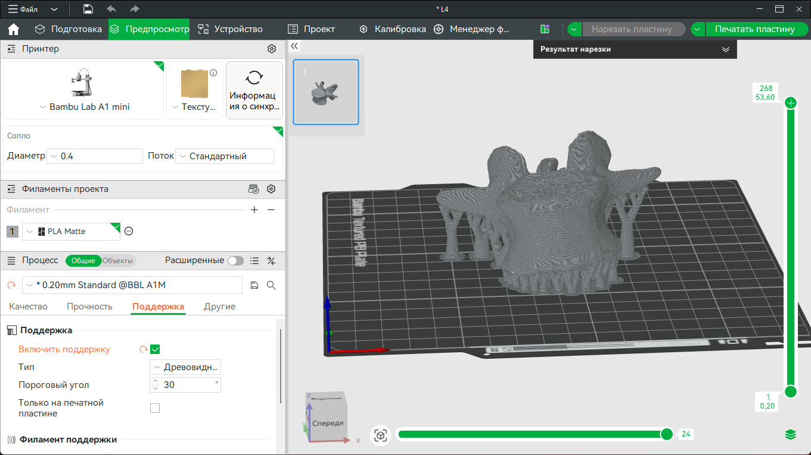
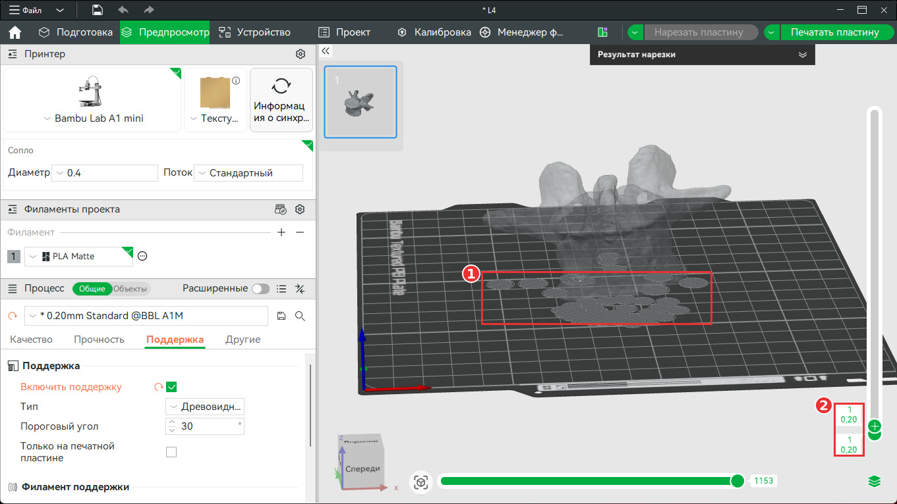
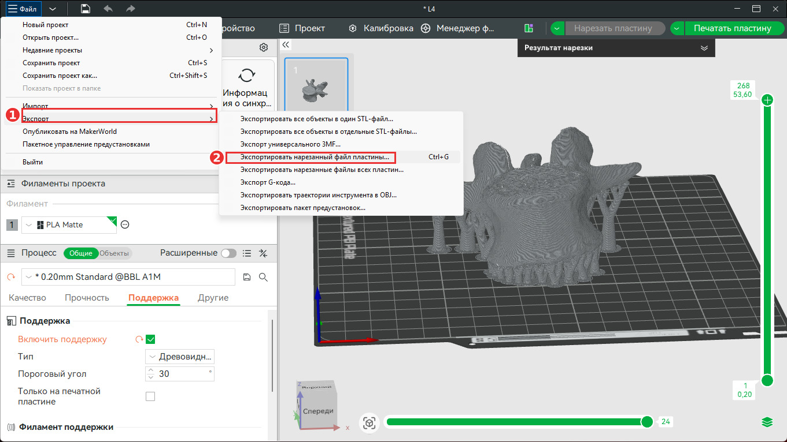
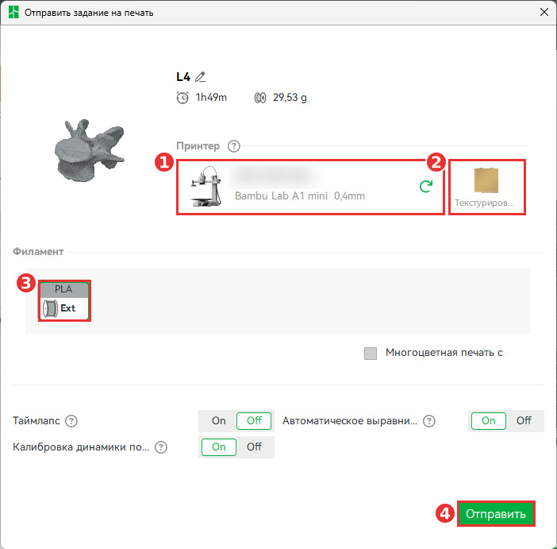
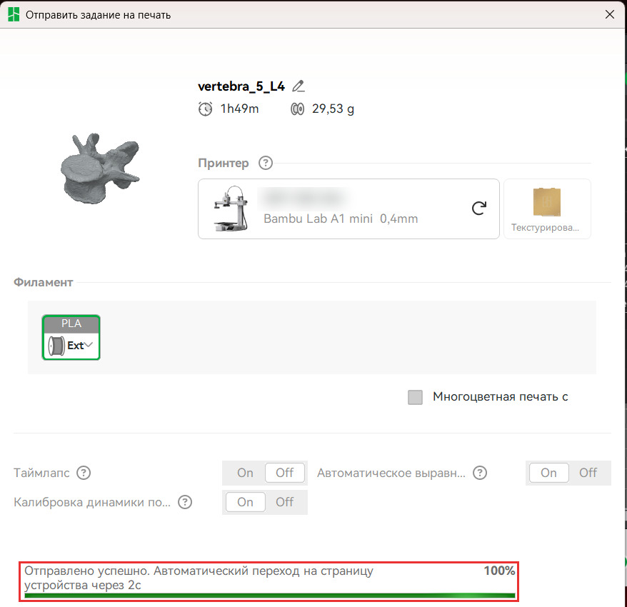
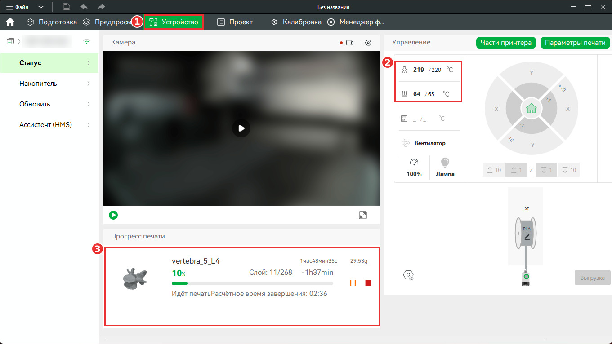
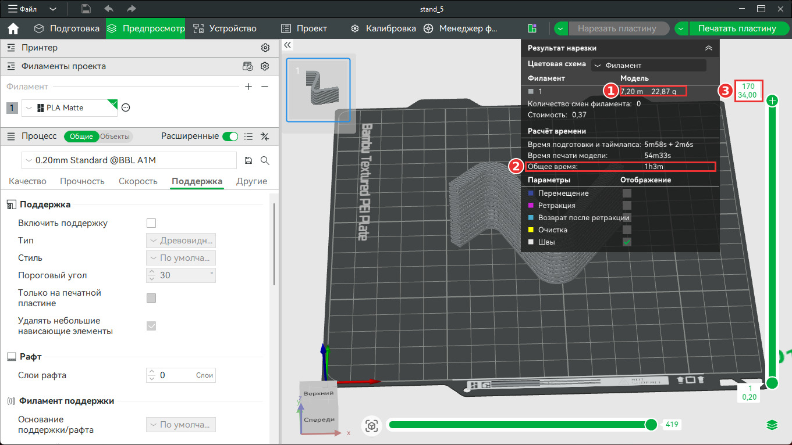

<section class="theory" markdown="1">

## Теоретические сведения
{: .section__title}

На [task 5-1](task_5-1.html) позвонок нарезан с поддержками в выбранном положении. Перед отправкой на печать нужно убедиться, что деталь будет держаться на столе, и сохранить два файла. Оба записаны в формате 3MF (3D Manufacturing Format): это архив, в котором кроме сетки модели лежат настройки печати, а в нарезанном файле — еще и результат нарезки. Проект `.3mf` хранит модель, ее положение и все настройки, но не результат нарезки. Нарезанный файл `.gcode.3mf` хранит G-код для принтера, расчетное время и массу нити, но не сетку модели. Принтер получает второй файл; первый нужен, чтобы открыть работу снова и изменить настройки.

Отправка идет через облако Bambu Lab: программа передает нарезанный файл принтеру, привязанному к учетной записи группы. Учетная запись одна на всех, поэтому запустить печать можно с любого компьютера группы и из любого места. Правила раздела 3 защищают от этого: печать запускается только у принтера, на свободный принтер и пустой стол.
{: .th-full}

</section>

<section class="goal" markdown="1">

## 🎯 Цель работы
{: .section__title}

- проверять по первому слою, на что опирается деталь;
- сохранять проект `.3mf` и нарезанный файл `.gcode.3mf` и объяснять, что хранит каждый;
- сверять время и массу нарезки с эталоном;
- соблюдать правила работы у общего принтера и технику безопасности;
- отправлять задание на принтер через облако.

</section>

<aside class="callout callout--important" markdown="1">

⏱ Время и место выполнения
{: .callout__title}

Страница выполняется на первой практике по данной теме, около 25 минут. Отправьте позвонок на печать как можно раньше: принтер работает, пока вы выполняете [task 5-4](task_5-4.html). Позвонок печатается полтора-два часа, поэтому на занятии печать успевает запустить один человек. Остальные выполняют разделы 1–3, встают в очередь в телеграм-канале курса и переходят к [task 5-4](task_5-4.html); раздел 4 они выполняют, когда подойдет очередь, в том числе между занятиями.

</aside>

<!-- ===================== 1 ===================== -->

<section class="subsection" id="s1" markdown="1">

## <span class="subsection__num">1.</span> Первый слой
{: .subsection__title}

Позвонок касается стола несколькими маленькими площадками, и его высота больше 50 мм. Такая деталь может оторваться от стола посреди печати, поэтому до отправки посмотрите, на что она опирается.

1. На вкладке «Предпросмотр» перетащите ЛКМ верхний бегунок вертикального ползунка справа вниз, до слоя 1. Над бегунком написаны номер слоя и его высота: «1» и «0,20».
1. Посмотрите на стол: первый слой почти целиком состоит из круглых оснований древовидных поддержек под телом и отростками. Сам позвонок стола почти не касается.
1. Верните бегунок наверх.
{: .steps}

В профиле «Тип каймы» стоит «Авто» (вкладка «Другие», группа «Адгезия к печатной пластине»): программа сама решает, нужна ли кайма. В эталонной нарезке L4 отдельной каймы на первом слое нет: позвонок держат основания поддержек. Тип каймы на этом занятии не меняется.
{: .th-full}

<figure class="figure-src">
<a href="../assets/img/task_5/5-2-1.jpg" target="_blank" rel="noopener" aria-label="Открыть снимок в полном размере"></a>
<figcaption class="figure-src__caption">Нарезанный позвонок L4 с древовидными поддержками; панель «Результат нарезки» свернута. Модель: М. А. Головин, ФГБУ ФНОЦ МСЭ и Р им. Г. А. Альбрехта Минтруда России.</figcaption>
</figure>

<figure class="figure-src">
<a href="../assets/img/task_5/5-2-2.jpg" target="_blank" rel="noopener" aria-label="Открыть снимок в полном размере"></a>
<figcaption class="figure-src__caption">Верхний бегунок опущен до слоя 1: 1 — основания поддержек; 2 — номер и высота слоя «1» и «0,20». Модель: М. А. Головин, ФГБУ ФНОЦ МСЭ и Р им. Г. А. Альбрехта Минтруда России.</figcaption>
</figure>

</section>

<!-- ===================== 2 ===================== -->

<section class="subsection" id="s2" markdown="1">

## <span class="subsection__num">2.</span> Сохранение и проверка чисел
{: .subsection__title}

1. Сохраните проект: «Файл» → «Сохранить проект как…» (Ctrl+Shift+S), папка `print_5`, имя `vertebra_5.3mf`.
1. Сохраните нарезанный файл: «Файл» → «Экспорт» → «Экспортировать нарезанный файл пластины…» (Ctrl+G), та же папка, имя `vertebra_5.gcode.3mf`.
1. Запишите в `README.md`, в строку «Нарезка, отправленная на печать», общее время и массу «Итого» из панели «Результат нарезки».
1. Сверьте числа с таблицей «Проверьте себя». Это проверка: настройки по ее итогу не меняются.
{: .steps}

Нарезанный файл хранит результат той нарезки, которая была на экране в момент экспорта. Если после экспорта вы повернули позвонок или изменили настройку, нарежьте проект и сохраните оба файла заново.

Оба файла не попадают в репозиторий: их закрывает строка `vertebra_5*` в `.gitignore` ([task 5-1](task_5-1.html), раздел 2). Проверить проект и нарезанный файл можно на странице [проверки файлов Bambu Studio](../bambu-check.html): она покажет, какой это позвонок, масштаб, принтер, материал и включены ли поддержки. Файл открывается только в вашем браузере и никуда не отправляется.

<div class="check" markdown="1">

Проверьте себя
{: .check__title}

Числа нарезки, которая уходит на печать, сверяются не с эталоном, а со строкой выбранного положения в вашей таблице `README.md` ([task 5-1](task_5-1.html), раздел 4): эталон для положения по правилу вы уже сверили там.

| Показатель | Должно быть | Если не совпало |
|---|---|---|
| Поддержка, г | как в строке выбранного положения | 0 г — флажок «Включить поддержку» снят: верните его ([task 5-1](task_5-1.html), раздел 4); другое число — позвонок стоит не в выбранном положении |
| Итого, г | как в той же строке | изменены настройки или материал ([task 5-0](task_5-0.html), раздел 4) |
| Общее время | как в той же строке; после повторного открытия проекта — на 2–4 % меньше | другая разница — изменены настройки; разница до 4 % — повторное открытие проекта ([task 5-10](task_5-10.html), «Проблемы и решения») |

</div>

<figure class="figure-src">
<a href="../assets/img/task_5/5-2-3.jpg" target="_blank" rel="noopener" aria-label="Открыть снимок в полном размере"></a>
<figcaption class="figure-src__caption">«Файл» → 1 «Экспорт» → 2 «Экспортировать нарезанный файл пластины…» (Ctrl+G).</figcaption>
</figure>

</section>

<!-- ===================== 3 ===================== -->

<section class="subsection" id="s3" markdown="1">

## <span class="subsection__num">3.</span> Правила у принтера и техника безопасности
{: .subsection__title}

Принтер один на группу, учетная запись тоже одна. Правила:

1. Очередь к принтеру — в телеграм-канале курса: напишите, например, «готов, L4». Печать запускает тот, чья очередь.
1. Запускайте печать, только находясь у принтера: учетная запись позволяет запустить печать из любого места, в том числе на занятый или неубранный стол.
1. Перед запуском проверьте, что принтер свободен, а стол пуст.
1. Если на столе лежит готовая чужая деталь, снимите ее, когда лист остынет: снимите лист со стола и изогните его, деталь отойдет сама. Поддержки не отделяйте. Чья это деталь, сказано в последнем сообщении о запуске в канале (раздел 4, шаг 7): положите деталь в коробку у принтера с запиской «позвонок, фамилия».
1. Не отменяйте и не перезапускайте чужие задания.
1. Не трогайте поверхность листа пальцами: жир с кожи ухудшает прилипание. Если детали отлипают, протрите лист изопропиловым спиртом.
{: .steps}

<aside class="callout callout--warning" markdown="1">

Техника безопасности
{: .callout__title}

Сопло нагревается до 220 °C, стол — до 65 °C (профиль Bambu PLA Matte для текстурированного листа). Не трогайте их во время печати и сразу после нее. Стол движется вперед и назад: не держите руки в рабочей зоне, пока принтер работает. Деталь снимайте только с остывшего листа. Поддержки удаляйте бокорезами только в защитных очках, от себя, держа деталь над столом и ниже уровня лица ([task 5-9](task_5-9.html)).

</aside>

</section>

<!-- ===================== 4 ===================== -->

<section class="subsection" id="s4" markdown="1">

## <span class="subsection__num">4.</span> Отправка на печать
{: .subsection__title}

1. Подойдите к принтеру, когда подошла ваша очередь, и выполните проверки раздела 3.
1. Проверьте, что открыт проект `vertebra_5` и он нарезан. Если вы закрывали программу или проект, откройте `vertebra_5.3mf` («Файл» → «Открыть проект…», Ctrl+O) и нажмите «Нарезать пластину»: на принтер уходит нарезка открытого проекта, а не сохраненный файл `vertebra_5.gcode.3mf`. Время новой нарезки бывает на 2–4 % меньше записанного ([task 5-10](task_5-10.html), «Проблемы и решения»).
1. Нажмите «Печатать пластину» справа вверху.
1. В окне «Отправить задание на печать» нажмите ЛКМ по значку карандаша справа от имени задания (вверху окна, над временем и массой): имя станет полем ввода. Допишите к нему свою фамилию латиницей, например `vertebra_5_Ivanov`. Имя задания видят все, кто вошел в учетную запись группы.
1. Проверьте, что выбран принтер группы, лист Textured PEI Plate и материал PLA на внешней катушке («Ext»), переключатель «Таймлапс» выключен (Off), и нажмите «Отправить».
1. Внизу окна отправки появится полоса «Отправка задачи печати через облачный сервис», затем «Отправлено успешно», и программа сама откроет вкладку «Устройство». Убедитесь, что печать началась: в «Прогрессе печати» стоит имя вашего файла, процент, слой и оставшееся время. Первые 8–10 минут принтер нагревает сопло и стол, компенсирует вибрации и выравнивает стол; номер слоя в это время 0.
1. Напишите в телеграм-канале курса свою фамилию, что печатается и когда печать закончится, например «Иванов, L4, до 15:40». По этому сообщению следующий в очереди узнает, чью деталь он снимает со стола.
{: .steps}

<figure class="figure-src">
<a href="../assets/img/task_5/5-2-4.jpg" target="_blank" rel="noopener" aria-label="Открыть снимок в полном размере"></a>
<figcaption class="figure-src__caption">Окно «Отправить задание на печать»: 1 — принтер группы (имя закрыто); 2 — лист; 3 — материал на внешней катушке («Ext»); 4 — «Отправить». Имя задания со значком карандаша — вверху окна, над временем и массой. Переключатели внизу окна не меняйте: «Таймлапс» выключен. Модель: М. А. Головин, ФГБУ ФНОЦ МСЭ и Р им. Г. А. Альбрехта Минтруда России.</figcaption>
</figure>

<figure class="figure-src">
<a href="../assets/img/task_5/5-2-7.jpg" target="_blank" rel="noopener" aria-label="Открыть снимок в полном размере"></a>
<figcaption class="figure-src__caption">Задание отправлено (рамка): через несколько секунд программа сама откроет вкладку «Устройство». Имя принтера закрыто. Модель: М. А. Головин, ФГБУ ФНОЦ МСЭ и Р им. Г. А. Альбрехта Минтруда России.</figcaption>
</figure>

<figure class="figure-src">
<a href="../assets/img/task_5/5-2-5.jpg" target="_blank" rel="noopener" aria-label="Открыть снимок в полном размере"></a>
<figcaption class="figure-src__caption">1 — вкладка «Устройство»; 2 — температура сопла и стола (текущая / заданная); 3 — «Прогресс печати»: файл, процент, слой из 268, оставшееся время, кнопки паузы и остановки. На снимке печатается 11-й слой из 268. Имя принтера закрыто. Модель: М. А. Головин, ФГБУ ФНОЦ МСЭ и Р им. Г. А. Альбрехта Минтруда России.</figcaption>
</figure>

</section>

<!-- ===================== 5 ===================== -->

<section class="subsection" id="s5" markdown="1">

## <span class="subsection__num">5.</span> По желанию: подставка без поддержек
{: .subsection__title}

Подставка для телефона из практики 4 — пример детали, которой поддержки не нужны. Ее нарезка не оценивается и в хронометраж не входит; печатайте ее, только если принтер свободен и очередь позвонков и кейджей пуста.

1. Создайте новый проект: «Файл» → «Новый проект» (Ctrl+N). В новом проекте поддержки выключены, как в профиле.
1. Импортируйте свою подставку `stand.stl` из папки `cad_4` (Ctrl+I).
1. Положите подставку на бок, профилем на стол: выберите ее, нажмите «Вращение [R]» и введите 90 в строке «Вращение (относительное)» по той оси, после поворота вокруг которой высота детали станет 34 мм. Высоту проверьте в инструменте «Масштаб [S]», строка «Размер».
1. Нажмите «Нарезать пластину» и сравните числа с эталоном: 22,87 г, общее время 1 ч 3 мин, 170 слоев высотой до 34,00 мм.
1. Сохраните `stand_5.3mf` и `stand_5.gcode.3mf` в папку `print_5`.
{: .steps}

Подставке на боку поддержки не нужны: все ее стенки вертикальны, а единственные нависания — нижние стороны ребер, горизонтальные уступы шириной 1,5 мм. Консоль такой длины принтер печатает без поддержки, опираясь на предыдущий слой: Redwood et al. (2017, п. 11.1.1) считают допустимой консоль короче 3 мм.
{: .th-full}

<figure class="figure-src">
<a href="../assets/img/task_5/5-2-6.jpg" target="_blank" rel="noopener" aria-label="Открыть снимок в полном размере"></a>
<figcaption class="figure-src__caption">Подставка на боку: 1 — итого 22,87 г, столбца «Поддержка» нет; 2 — общее время 1 ч 3 мин; 3 — число слоев 170, высота 34,00 мм.</figcaption>
</figure>

</section>

<article class="task" id="task-1" markdown="1">

### Задание 1. Вопросы к странице <span class="level level--2">Уровень 2 · понимание</span>
{: .task__title}

<div class="theory" markdown="1">

Теория к вопросам
{: .analysis__title}

**Что хранит каждый файл.** Сохраненный проект и нарезанный файл — архивы 3MF с разным содержимым. В проекте `vertebra_5.3mf` лежат сетка позвонка, его положение на столе и все настройки принтера, материала и процесса; результата нарезки в нем нет. В нарезанном файле `vertebra_5.gcode.3mf` лежат G-код для принтера, расчетное время в секундах, масса нити, принтер, материал и тип листа; сетки модели в нем нет. Это проверено на эталонных файлах L4: в проекте нет ни строки G-кода, а в нарезанном файле — ни одного треугольника.

**На что опирается позвонок.** На первом слое эталонной нарезки L4 дорожки оснований поддержек тянутся на 3,7 м, а дорожки самой кости — меньше чем на 2 мм: позвонок стоит на основаниях древовидных поддержек. Кайма в режиме «Авто» отдельных колец не построила.

**Когда снимать деталь.** Стол при печати PLA Matte нагрет до 65 °C, сопло — до 220 °C. На горячем листе PLA мягче и держится крепче; с остывшего листа деталь снимается изгибом листа и не деформируется.

</div>

<div class="quiz" data-comment="#">
<p class="quiz__title">Вопросы к странице</p>
<p class="quiz__intro">Ответьте на вопросы; текст теста не сдается.</p>
<div class="quiz__q">
<p>1. В каком файле записаны расчетное время печати и масса нити?</p>
<label><input type="radio" data-ok> В нарезанном файле <code>vertebra_5.gcode.3mf</code>.</label>
<label><input type="radio"> В проекте <code>vertebra_5.3mf</code>, вместе с настройками.<span class="quiz__why" hidden>Проект хранит модель и настройки, но не результат нарезки: после повторного открытия проект нужно нарезать снова.</span></label>
<label><input type="radio"> В обоих файлах одинаково.<span class="quiz__why" hidden>Файлы хранят разное: в проекте нет G-кода, времени и массы, в нарезанном файле нет сетки модели.</span></label>
<p class="quiz__exp" hidden>Время, масса, принтер и материал записываются при нарезке в нарезанный файл вместе с G-кодом; проект хранит только то, что нужно для новой нарезки.</p>
</div>
<div class="quiz__q">
<p>2. На первом слое эталонной нарезки L4 нет колец каймы. Что держит позвонок на столе?</p>
<label><input type="radio" data-ok> Круглые основания древовидных поддержек: сама кость стола почти не касается.</label>
<label><input type="radio"> Ничего: без каймы позвонок оторвется, ее нужно включить вручную.<span class="quiz__why" hidden>Кайма в режиме «Авто» решается программой; основания поддержек увеличивают площадь касания. Тип каймы на этом занятии не меняется.</span></label>
<label><input type="radio"> Слой клея, который принтер наносит на лист.<span class="quiz__why" hidden>Принтер клей не наносит; прилипание дает текстурированный лист PEI, нагретый до 65 °C.</span></label>
<p class="quiz__exp" hidden>Под телом и отростками позвонка строятся поддержки, и каждое их основание — круглая площадка на первом слое. В эталонной нарезке L4 дорожек самой кости на первом слое меньше 2 мм: деталь держат основания поддержек.</p>
</div>
<div class="quiz__q">
<p>3. Печать соседа закончилась, на столе лежит его позвонок. Что вы делаете перед запуском своей печати?</p>
<label><input type="radio" data-ok> Ждете, пока лист остынет, снимаете деталь изгибом листа, кладете в коробку с подписью и не отделяете поддержки.</label>
<label><input type="radio"> Сразу снимаете горячую деталь, чтобы не задерживать очередь.<span class="quiz__why" hidden>Стол нагрет до 65 °C: горячий PLA мягче, деталь деформируется, а о лист можно обжечься.</span></label>
<label><input type="radio"> Запускаете свою печать: принтер сам сдвинет деталь.<span class="quiz__why" hidden>Принтер не проверяет стол: сопло врежется в оставленную деталь. Стол перед запуском должен быть пуст.</span></label>
<p class="quiz__exp" hidden>Правила раздела 3: стол перед запуском пуст; чужую деталь снимает следующий в очереди с остывшего листа и кладет в коробку с подписью.</p>
</div>
<div class="quiz__bar"><button type="button" class="tool-btn tool-btn--main quiz__check">Проверить</button><span class="quiz__status"></span></div>
<div class="quiz__result" hidden><p>Результат:</p><pre class="quiz__comment"></pre><div class="quiz__bar"><button type="button" class="tool-btn quiz__copy">Скопировать</button><span class="quiz__copied"></span></div></div>
</div>

</article>

<section class="then" markdown="1">

## Затем
{: .then__title}

1. Пока печатается позвонок или пока вы ждете очереди, перейдите к [task 5-4](task_5-4.html): «предскажи и проверь».
1. Файлы `vertebra_5.*` в репозиторий не добавляйте; `README.md` с записанными числами добавьте.
{: .steps}

```text
print_5/
├── .gitignore
├── L4.stl
├── README.md
├── @@vertebra_5.3mf@@
└── @@vertebra_5.gcode.3mf@@
```
{: .folder-tree}

Если вы нарезали подставку, в папке лежат еще оба ее файла (раздел 5).

</section>

<section class="section sources" markdown="1">

## Источники
{: .section__title}

1. Лекция 3 «Цифровой конвейер аддитивного производства», блок 6 (слайды 74–75): ориентация детали и поддержки.
1. Redwood B., Schöffer F., Garret B. The 3D Printing Handbook. 3D Hubs, 2017 — п. 11.1 (поддержки), п. 11.1.1 (консоль без поддержки короче 3 мм).
1. Bambu Studio: исходный код и профили, [github.com/bambulab/BambuStudio, тег v02.09.02.62](https://github.com/bambulab/BambuStudio/tree/v02.09.02.62) — профиль материала Bambu PLA Matte @BBL A1M: температуры сопла и стола.
1. Bambu Studio 2.9.2.62, проверено на программе 27.11.2026: предпросмотр первого слоя, «Тип каймы», сохранение проекта и экспорт нарезанного файла, состав обоих файлов; эталонные нарезки шести позвонков и подставки.
{: .sources__list}

</section>
