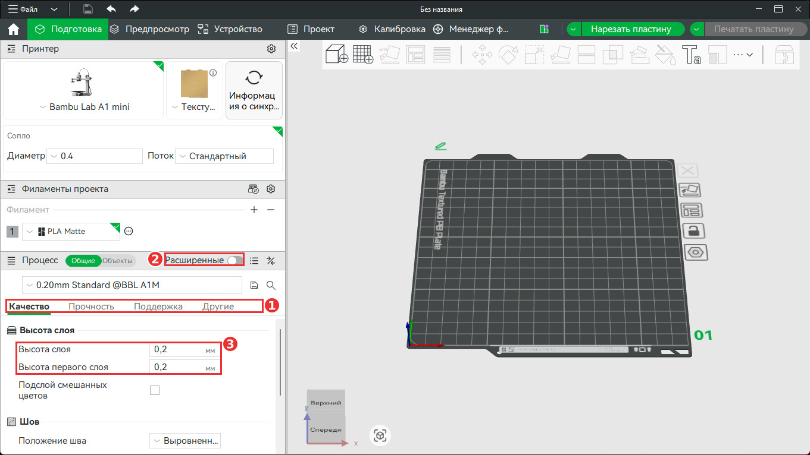
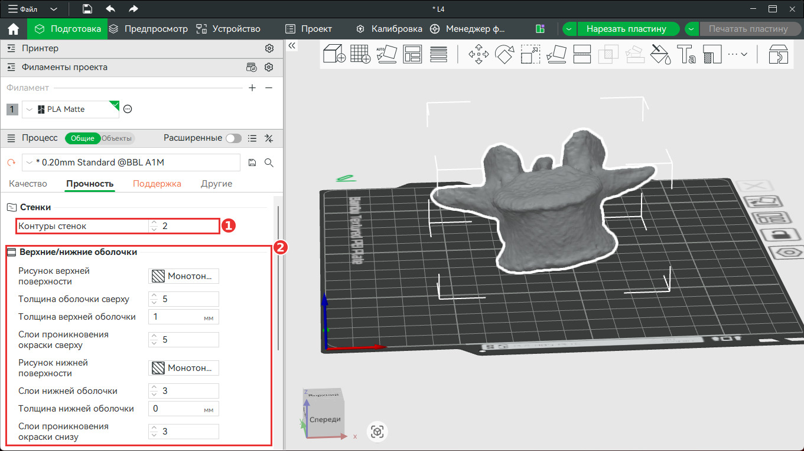
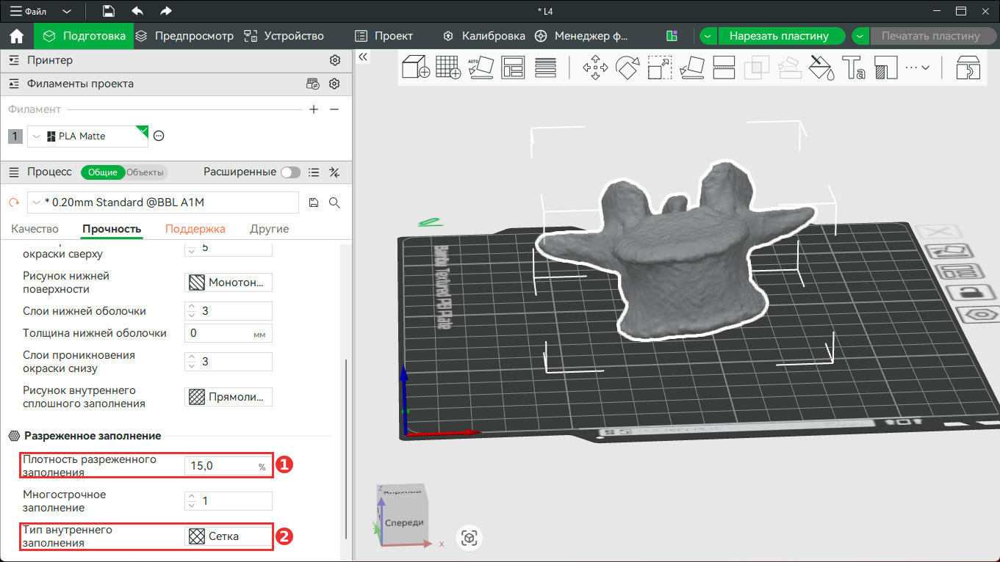
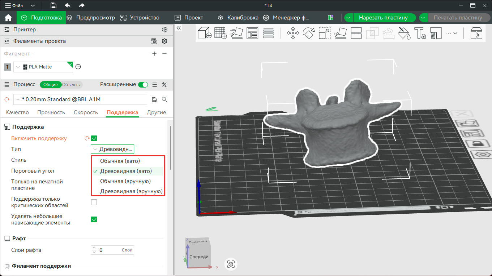
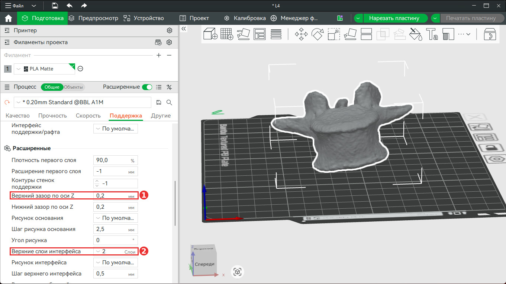
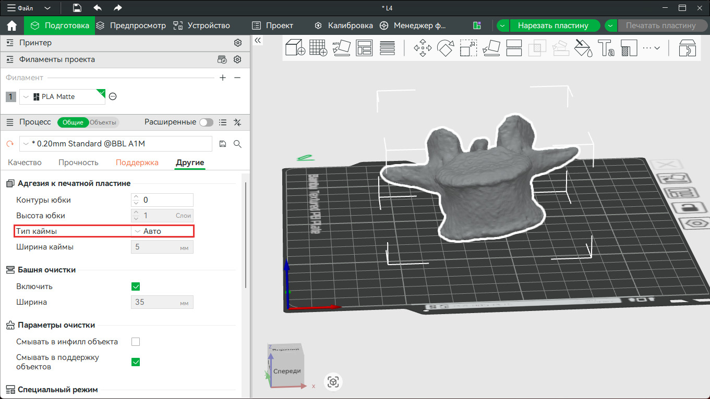
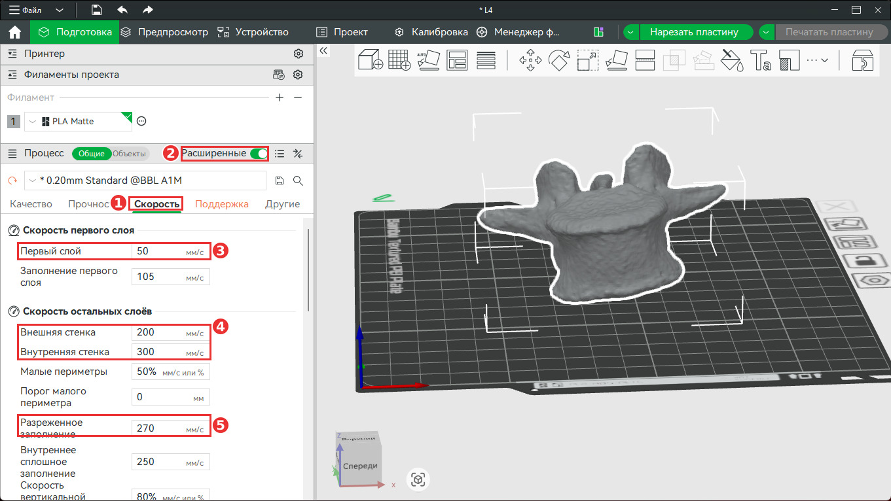
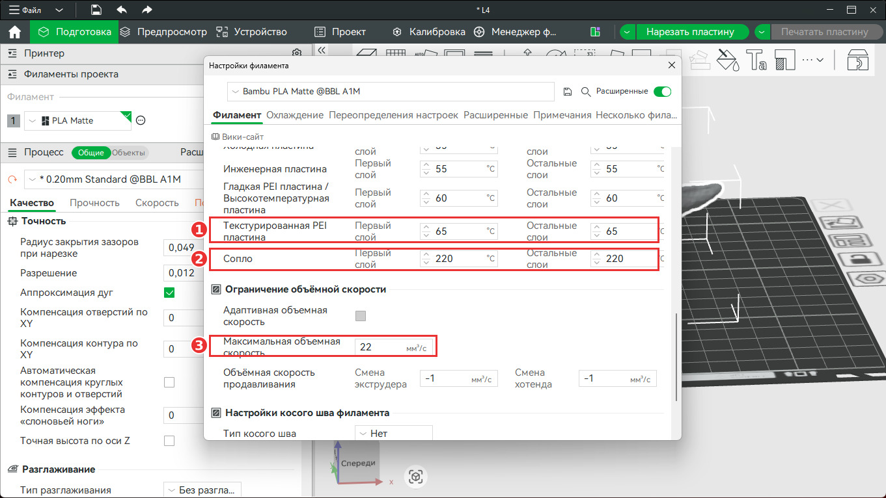



<section class="theory" markdown="1">

## Теоретические сведения
{: .section__title}

На первой практике позвонок нарезан с профилем по умолчанию и с поддержками и отправлен на печать ([task 5-2](task_5-2.html)), а на его копии вы увидели, как три настройки меняют время и массу ([task 5-4](task_5-4.html)). Профиль — набор из нескольких сотен значений, но время печати, расход нити, прочность и вид детали в основном определяют восемь из них. Эта страница объясняет, что делает каждая из восьми настроек, где она находится в Bambu Studio и какое значение стоит в профиле. Большую часть этих понятий вы уже разбирали на практиках 1 и 3 в PrusaSlicer и в собственном генераторе G-кода; здесь они связываются с полями программы и с числами, которые вы получили на [task 5-4](task_5-4.html).

Значения на странице взяты из системных профилей Bambu Studio 2.9.2.62: процесса «0.20mm Standard @BBL A1M», материала «Bambu PLA Matte @BBL A1M» и принтера «Bambu Lab A1 mini 0.4 nozzle». Профили лежат в открытом репозитории программы (раздел «Источники»); там же описания каждого поля, которые программа показывает во всплывающей подсказке.
{: .th-full}

</section>

<section class="goal" markdown="1">

## 🎯 Цель работы
{: .section__title}

- находить настройку процесса по вкладке и группе и читать ее значение в профиле;
- объяснять, как высота слоя, стенки и заполнение меняют время, массу и прочность;
- объяснять назначение порогового угла, типа поддержки и верхнего зазора по оси Z;
- выбирать кайму для узкой или высокой детали;
- рассчитывать объемный расход и объяснять, почему рост скорости в настройках не всегда сокращает время печати;
- объяснять результаты «предскажи и проверь» через устройство траектории.

</section>

<aside class="callout callout--important" markdown="1">

⏱ Время и место выполнения
{: .callout__title}

Страница читается самостоятельно между первой и второй практикой по данной теме, около 35 минут вместе с мини-тестом. Читайте ее с открытой программой и находите каждое поле по ходу чтения (раздел 1); значения в проекте не меняются. В начале второй практики по данной теме преподаватель задает по странице один-два устных вопроса.

</aside>

<!-- ===================== 1 ===================== -->

<section class="subsection" id="s1" markdown="1">

## <span class="subsection__num">1.</span> Где находятся настройки
{: .subsection__title}

Настройки в Bambu Studio делятся на три профиля: принтера («Принтер / Printer»), материала («Филамент / Filament») и процесса печати («Процесс / Process»). Профиль процесса показан в левой панели вкладки «Подготовка / Prepare» и разбит на вкладки «Качество / Quality», «Прочность / Strength», «Поддержка / Support» и «Другие / Others»; вкладка «Скорость / Speed» появляется между «Прочностью» и «Поддержкой» только при включенном переключателе «Расширенные / Advanced». Внутри вкладки поля собраны в группы. Переключатель «Общие / Global» и «Объекты / Objects» над вкладками выбирает, к чему относится значение: ко всему столу или к выбранной модели.

Переключатель «Расширенные / Advanced» стоит в заголовке панели «Процесс», справа от «Общие / Объекты». Часть полей и вся вкладка «Скорость» видны только при включенном переключателе; в таблице ниже такие поля отмечены.

| № | Настройка (в программе) | Вкладка, группа | В профиле | Что меняет | Где разобрано раньше |
|---|---|---|---|---|---|
| 1 | Высота слоя / Layer height | Качество, «Высота слоя» | 0,2 мм | число слоев, время, ступенька на наклонных гранях | [task 3-1](../task_3/task_3-1.html) |
| 2 | Контуры стенок / Wall loops | Прочность, «Стенки» | 2 | толщину стенки, прочность, массу | [task 1-4](../task_1/task_1-4.html) |
| 3 | Плотность разреженного заполнения / Sparse infill density | Прочность, «Разреженное заполнение» | 15 % | массу, время, прочность | [task 1-5](../task_1/task_1-5.html) |
| 4 | Тип внутреннего заполнения / Sparse infill pattern | Прочность, «Разреженное заполнение» | Сетка / Grid | прочность по направлениям, время | [task 1-4](../task_1/task_1-4.html) |
| 5 | Включить поддержку / Enable support; Тип / Type; Пороговый угол / Threshold angle | Поддержка, «Поддержка» | выключено; Древовидная (авто) / tree(auto); 30° | где строятся поддержки и сколько их | [task 3-2](../task_3/task_3-2.html) |
| 6 | Верхний зазор по оси Z / Top Z distance | Поддержка, «Расширенные»; расширенная | 0,2 мм | как легко отделяется поддержка | раздел 3 |
| 7 | Тип каймы / Brim type | Другие, «Адгезия к печатной пластине» | Авто / Auto | удержание детали на столе | раздел 4 |
| 8 | Разреженное заполнение / Sparse infill (скорость) | Скорость, «Скорость остальных слоев»; расширенная | 270 мм/с | время печати, но не выше предела материала | раздел 5 |
{: .table-mid}

Найдите эти поля в программе:

1. Откройте копию проекта `vertebra_5_pp.3mf` ([task 5-4](task_5-4.html)): «Файл» → «Открыть проект…» (Ctrl+O).
1. Включите переключатель «Расширенные» в заголовке панели «Процесс»: появятся вкладка «Скорость» и расширенные поля.
1. Для каждой строки таблицы откройте вкладку и группу, найдите поле и сравните его значение со столбцом «В профиле». В вашей копии флажок «Включить поддержку» стоит: вы поставили его на [task 5-1](task_5-1.html). Значения не меняйте.
1. Наведите курсор на название поля: программа покажет подсказку с описанием настройки.
{: .steps}

<figure class="figure-src">
<a href="../assets/img/task_5/5-3-1.jpg" target="_blank" rel="noopener" aria-label="Открыть снимок в полном размере"></a>
<figcaption class="figure-src__caption">1 — вкладки процесса: при выключенном переключателе «Расширенные» (2) вкладки «Скорость» нет; 3 — «Высота слоя» и «Высота первого слоя» 0,2 мм. Модель: М. А. Головин, ФГБУ ФНОЦ МСЭ и Р им. Г. А. Альбрехта Минтруда России.</figcaption>
</figure>

</section>

<!-- ===================== 2 ===================== -->

<section class="subsection" id="s2" markdown="1">

## <span class="subsection__num">2.</span> Слой, стенки, заполнение
{: .subsection__title}

**Высота слоя.** Позвонок L4 высотой 53,7 мм (габарит по оси Z из таблицы на [task 5](task_5.html)) при слое 0,2 мм режется на 268 слоев (так показывает предпросмотр Bambu Studio 2.9.2.62), при слое 0,1 мм — на 536. Каждый слой сопло обходит целиком, поэтому время печати растет почти так же, как число слоев: в эталонной нарезке копии L4 общее время выросло с 1 ч 45 мин до 3 ч 25 мин, в 1,95 раза. Масса выросла с 29,53 до 31,57 г: тонкий слой дает больше поддержек, 7,18 г вместо 5,09 г. Взамен тонкий слой уменьшает ступеньку на наклонных и скругленных гранях: высота ступеньки *h* = *l* · \|cos θ\| разобрана на [task 3-1](../task_3/task_3-1.html) и на лекции 3 (слайд 74). В профиле 0.20mm Standard первый слой тоже 0,2 мм.

**Контуры стенок.** Стенка — замкнутые дорожки по контуру слоя, у PrusaSlicer они называются периметрами ([task 1-4](../task_1/task_1-4.html); лекция 3, слайд 79). В профиле две стенки: внешняя шириной 0,42 мм и внутренняя 0,45 мм, всего около 0,9 мм.
{: .th-full}

**Заполнение.** Внутри стенок слайсер кладет разреженное заполнение — решетку с плотностью 15 % в профиле. Связь плотности решетки с шагом дорожек вы выводили для скаффолда на [task 1-5](../task_1/task_1-5.html). Redwood et al. (2017, п. 11.3) называют 20 % обычным значением, которого хватает большинству деталей; для деталей под нагрузкой и под винты — до 50 % и выше. Рисунок заполнения задает форму решетки: в профиле «Сетка / Grid», в списке есть также «Гироид / Gyroid», «Кубический / Cubic», «Соты / Honeycomb» и другие. Redwood et al. (2017, п. 11.3) советуют соты или треугольники, когда нужна прочность при небольшой массе.

<figure class="figure-src">
<a href="../assets/img/task_5/5-3-2.jpg" target="_blank" rel="noopener" aria-label="Открыть снимок в полном размере"></a>
<figcaption class="figure-src__caption">Вкладка «Прочность»: 1 — «Контуры стенок» 2; 2 — группа «Верхние/нижние оболочки» (task 5-7, раздел 2). Модель: М. А. Головин, ФГБУ ФНОЦ МСЭ и Р им. Г. А. Альбрехта Минтруда России.</figcaption>
</figure>

<figure class="figure-src">
<a href="../assets/img/task_5/5-3-3.jpg" target="_blank" rel="noopener" aria-label="Открыть снимок в полном размере"></a>
<figcaption class="figure-src__caption">1 — «Плотность разреженного заполнения» 15,0 %; 2 — «Тип внутреннего заполнения» «Сетка». Модель: М. А. Головин, ФГБУ ФНОЦ МСЭ и Р им. Г. А. Альбрехта Минтруда России.</figcaption>
</figure>

</section>

<!-- ===================== 3 ===================== -->

<section class="subsection" id="s3" markdown="1">

## <span class="subsection__num">3.</span> Поддержки: включение, тип, порог, зазор
{: .subsection__title}

**Включение и порог.** В профиле поддержки выключены: слайсер строит их, только если включить «Включить поддержку / Enable support». Поддержка строится под нависаниями, угол которых к горизонтали меньше порогового угла (подсказка поля в программе). В профиле порог 30°. На [task 3-2](../task_3/task_3-2.html) приведены другие числа: в профиле PrusaSlicer практики 1 порог 50°, а Gibson et al. (2021, п. 14.6.13, p. 424) и Redwood et al. (2017, п. 11.1) называют обычной границей 45°. Чем меньше порог, тем меньше поддержек: при 30° грань под углом 40° печатается без поддержки, при 45° — с поддержкой.

**Тип.** «Обычная (авто) / normal(auto)» строит под нависанием сплошные колонны, «Древовидная (авто) / tree(auto)» — ветки от стола к точкам опоры. Redwood et al. (2017, п. 11.1.2) пишут, что древовидная поддержка касается детали меньшей площадью и оставляет лучшую поверхность, но менее устойчива; обычная расходует больше материала.

**Верхний зазор по оси Z.** Между верхним слоем поддержки и нижним слоем детали слайсер оставляет зазор по высоте. В профиле он 0,2 мм, то есть один слой. Значения в списке программы подписаны по назначению: 0 — для растворимой поддержки (soluble), 0,1 — полуотделяемая (semi-detachable), 0,2 — отделяемая (detachable). Верхние слои поддержки под зазором — контактный слой, или интерфейс («Верхние слои интерфейса / Top interface layers», в профиле 2): они уложены плотнее основной поддержки, чтобы нижней поверхности детали было на что лечь.



<figure class="figure-src">
<a href="../assets/img/task_5/5-3-4.jpg" target="_blank" rel="noopener" aria-label="Открыть снимок в полном размере"></a>
<figcaption class="figure-src__caption">Список «Тип»: обычная и древовидная поддержка, каждая в автоматическом и ручном режиме.</figcaption>
</figure>

<figure class="figure-src">
<a href="../assets/img/task_5/5-3-5.jpg" target="_blank" rel="noopener" aria-label="Открыть снимок в полном размере"></a>
<figcaption class="figure-src__caption">Группа «Расширенные» вкладки «Поддержка» (видна при включенном переключателе «Расширенные»): 1 — «Верхний зазор по оси Z» 0,2 мм; 2 — «Верхние слои интерфейса» 2. Модель: М. А. Головин, ФГБУ ФНОЦ МСЭ и Р им. Г. А. Альбрехта Минтруда России.</figcaption>
</figure>

</section>

<!-- ===================== 4 ===================== -->

<section class="subsection" id="s4" markdown="1">

## <span class="subsection__num">4.</span> Кайма
{: .subsection__title}

Кайма (brim) — несколько дорожек первого слоя вокруг детали, соединенных с ней. Она увеличивает площадь касания со столом и удерживает деталь, у которой опора узкая, а высота большая, или углы которой отрываются от стола при остывании. В профиле «Тип каймы / Brim type» стоит «Авто / Auto»: по подсказке программы ширина каймы в этом режиме анализируется и рассчитывается автоматически. Другие значения: «Только внешняя кайма / Outer brim only» с заданной шириной и «Без каймы / No-brim». Кайма отрывается от детали после печати; зазор между каймой и деталью задает поле «Зазор между каймой и объектом / Brim-object gap».

Позвонок касается стола несколькими маленькими площадками, а его высота больше 50 мм: это и есть узкая опора при большой высоте. В эталонной нарезке позвонка L4 с каймой «Авто» опору на первом слое дают круглые основания древовидных поддержек; на [task 5-2](task_5-2.html) вы видели их на первом слое своего позвонка. Кейдж в некоторых положениях тоже стоит на маленькой площади — там кайма может понадобиться ([task 5-6](task_5-6.html)). Подставка из практики 4 на боку опирается на стол всем профилем, и кайма ей, как правило, не нужна.
{: .th-full}

<figure class="figure-src">
<a href="../assets/img/task_5/5-3-6.jpg" target="_blank" rel="noopener" aria-label="Открыть снимок в полном размере"></a>
<figcaption class="figure-src__caption">Вкладка «Другие»: «Тип каймы» — «Авто». Модель: М. А. Головин, ФГБУ ФНОЦ МСЭ и Р им. Г. А. Альбрехта Минтруда России.</figcaption>
</figure>

</section>

<!-- ===================== 5 ===================== -->

<section class="subsection" id="s5" markdown="1">

## <span class="subsection__num">5.</span> Скорость и предел объемной скорости
{: .subsection__title}

На вкладке «Скорость / Speed» скорость задана отдельно для каждого типа линий: внешней стенки (200 мм/с в профиле), внутренней стенки (300 мм/с), разреженного заполнения (270 мм/с), верхней поверхности (200 мм/с), первого слоя (50 мм/с). Но сопло не может расплавить сколько угодно пластика: в профиле материала Bambu PLA Matte стоит «Максимальная объемная скорость / Max volumetric speed» — 22 мм³/с. Какой объем выдавливает сопло за секунду, считается так же, как подача нити на [task 1-2](../task_1/task_1-2.html) (лекция 5, слайды 9 и 11): объем дорожки — площадь сечения на длину. В отличие от практики 1 слайсер считает сечение не прямоугольником *W* × *H*, а прямоугольником со скругленными краями: по бокам дорожки — полукруги диаметром *H*. Так в исходном коде Bambu Studio задано сечение любой дорожки, кроме мостов (мост — дорожка, натянутая над пустотой между двумя опорами).

<div class="formula"><i>Q</i> = <i>A</i> · <i>v</i>,&nbsp;&nbsp;&nbsp;&nbsp;<i>A</i> = <i>H</i> · (<i>W</i> − 0,215 · <i>H</i>),&nbsp;&nbsp;&nbsp;&nbsp;откуда&nbsp;&nbsp;&nbsp;&nbsp;<i>v</i><sub>max</sub> = <i>Q</i><sub>max</sub> / <i>A</i></div>
<dl class="where">
<div><dt>где <i>Q</i></dt><dd>объемный расход, мм³/с</dd></div>
<div><dt><i>A</i></dt><dd>площадь сечения дорожки, мм²; 0,215 = 1 − π/4: на столько полукруги по краям меньше прямоугольных краев</dd></div>
<div><dt><i>W</i></dt><dd>ширина линии, мм: 0,45 у заполнения и внутренней стенки, 0,42 у внешней стенки (вкладка «Качество», группа «Ширина линии»)</dd></div>
<div><dt><i>H</i></dt><dd>высота слоя, мм (раздел 2)</dd></div>
<div><dt><i>v</i></dt><dd>скорость сопла, мм/с</dd></div>
<div><dt><i>Q</i><sub>max</sub></dt><dd>предел объемной скорости материала, 22 мм³/с у Bambu PLA Matte</dd></div>
</dl>

Для заполнения: *A* = 0,2 · (0,45 − 0,215 · 0,2) ≈ 0,0814 мм², *Q* = 0,0814 · 270 ≈ 22,0 мм³/с — ровно на пределе. Предел скорости заполнения *v*<sub>max</sub> = 22 / 0,0814 ≈ 270 мм/с: значение в профиле уже выбрано на пределе материала. Для внешней стенки *A* = 0,2 · (0,42 − 0,043) ≈ 0,0754 мм², *Q* = 0,0754 · 200 ≈ 15,1 мм³/с — меньше предела, скорость не ограничена. Это объясняет третью строку вашей таблицы «предскажи и проверь» ([task 5-4](task_5-4.html)): при заданных 350 мм/с заполнение все равно идет со скоростью около 270 мм/с. Если бы скорость опустили до 150 мм/с, время выросло бы. По той же причине внутренняя стенка печатается не быстрее 270 мм/с, хотя в профиле для нее стоит 300 мм/с: ширина линии у нее та же, 0,45 мм, и сечение то же, 0,0814 мм².

Это видно в G-коде эталонного позвонка L4: при скорости заполнения 350 мм/с строки заполнения записаны с подачей F16213, то есть 270,2 мм/с, а при 270 мм/с — F16200; с подачей F16213 записаны и внутренние стенки. Сопло не набирает заданную скорость мгновенно: на коротких отрезках ее ограничивает ускорение (6000 мм/с² в профиле). Поэтому время печати мелкой детали меньше зависит от скорости в настройках, чем время крупной.
{: .th-full}



<figure class="figure-src">
<a href="../assets/img/task_5/5-3-7.jpg" target="_blank" rel="noopener" aria-label="Открыть снимок в полном размере"></a>
<figcaption class="figure-src__caption">Вкладка «Скорость» (1) видна при включенном переключателе «Расширенные» (2): 3 — первый слой 50 мм/с; 4 — внешняя стенка 200 и внутренняя 300 мм/с; 5 — разреженное заполнение 270 мм/с. Модель: М. А. Головин, ФГБУ ФНОЦ МСЭ и Р им. Г. А. Альбрехта Минтруда России.</figcaption>
</figure>

<figure class="figure-src">
<a href="../assets/img/task_5/5-3-8.jpg" target="_blank" rel="noopener" aria-label="Открыть снимок в полном размере"></a>
<figcaption class="figure-src__caption">«Настройки филамента» Bambu PLA Matte @BBL A1M (значок «…» справа от материала → «Правка»): 1 — стол с текстурированным листом 65 °C; 2 — сопло 220 °C; 3 — «Максимальная объемная скорость» 22 мм³/с. Модель: М. А. Головин, ФГБУ ФНОЦ МСЭ и Р им. Г. А. Альбрехта Минтруда России.</figcaption>
</figure>

</section>

<!-- ===================== 6 ===================== -->

<section class="subsection" id="s6" markdown="1">

## <span class="subsection__num">6.</span> Разбор «предскажи и проверь»
{: .subsection__title}

На [task 5-4](task_5-4.html) вы меняли по одной настройке на копии проекта своего позвонка. Ниже те же три изменения на эталонном позвонке L4 (поддержки «Древовидная (авто)», профиль 0.20mm Standard @BBL A1M), каждое от исходных настроек. Сравните с ними направление и порядок своих чисел и проверьте объяснения в `README.md`: если объяснение расходится с разбором, допишите его. Прогнозы не исправляйте.

| Изменение | Итого, г | Общее время | Разница с исходной нарезкой |
|---|---|---|---|
| исходная нарезка копии | 29,53 | 1 ч 45 мин | — |
| стенок 2 → 4 | 38,05 | 2 ч 6 мин | +8,52 г (+29 %), +21 мин (+20 %) |
| заполнение 15 → 30 % | 37,00 | 1 ч 59 мин | +7,47 г (+25 %), +14 мин (+13 %) |
| скорость заполнения 270 → 350 мм/с | 29,53 | 1 ч 45 мин | 0 г, 0 мин |
{: .table-mid}

**Стенки.** Каждый контур стенки — замкнутая дорожка по всему периметру слоя, в каждом из 268 слоев. У позвонка поверхность большая, а тело внутри неширокое: две дополнительные стенки занимают значительную часть объема, и масса растет почти на треть. Обе добавленные стенки — внутренние. В профиле для них стоит 300 мм/с, но предел объемной скорости срезает это значение до тех же 270 мм/с, что у заполнения (раздел 5). Время растет сильнее, чем при удвоении заполнения, не из-за заданной скорости, а из-за формы пути. Стенка повторяет изогнутый контур кости: в G-коде эталона средний отрезок внутренней стенки — 0,85 мм, и отрезков длиннее 12 мм у нее нет. На каждом повороте принтер притормаживает, а на разгон до 270 мм/с при ускорении 6000 мм/с² нужно около 6 мм прямого пути.

**Заполнение.** Плотность заполнения меняет только решетку внутри стенок. При 30 % решетка вдвое гуще, и масса растет на четверть. Время растет меньше, чем от стенок: решетка состоит из длинных прямых дорожек. В G-коде эталона средний отрезок заполнения — 5 мм, и 59 % пути приходится на отрезки длиннее 12 мм: на них сопло успевает разогнаться.

**Скорость заполнения.** Значение 270 мм/с в профиле уже стоит на пределе объемной скорости (раздел 5). При 350 мм/с слайсер все равно ведет заполнение со скоростью около 270 мм/с, и время не меняется. В G-коде эталона пути при 270 и 350 мм/с совпадают, а подачи различаются на 0,1 %: F16200 и F16213.

**Почему сравнивается копия с копией.** Если сравнить нарезку после повторного открытия с первой нарезкой сразу после импорта, разница 1 ч 49 мин − 1 ч 45 мин = 4 мин покажется действием настройки, хотя настройка тут ни при чем.

</section>

<!-- ===================== 7 ===================== -->

<section class="subsection" id="s7" markdown="1">

## <span class="subsection__num">7.</span> Мини-тест
{: .subsection__title}

<article class="task" id="task-1" markdown="1">

### Задание 1. Мини-тест: настройки и их действие <span class="level level--2">Уровень 2 · понимание</span>
{: .task__title}

<div class="theory" markdown="1">

Теория к вопросам
{: .analysis__title}

**Механизм.** Для каждой настройки нужно знать две вещи: что она меняет в траектории и что из этого следует для времени, массы и качества.

| Настройка | Что меняет в траектории | Следствие |
|---|---|---|
| высота слоя 0,2 → 0,1 мм | слоев вдвое больше: у L4 536 вместо 268 | время почти вдвое больше (у L4 3 ч 25 мин вместо 1 ч 45 мин), ступенька вдвое меньше |
| стенок 2 → 4 | две внутренние замкнутые дорожки в каждом слое, короткие изогнутые отрезки | прочность и масса растут; у L4 +8,52 г и +21 мин |
| заполнение 15 → 30 % | решетка вдвое гуще, длинные прямые дорожки | у L4 +7,47 г и +14 мин: времени добавляется меньше, чем от стенок |
| пороговый угол 30° → 45° | поддержка нужна граням до 45°, а не до 30° | поддержек больше |
| верхний зазор 0,2 → 0,1 мм | поддержка ближе к детали | отделить труднее, нижний слой детали опирается лучше |
| скорость заполнения 270 → 350 мм/с | заданная скорость выше | *Q* = 0,0814 · 350 ≈ 28,5 мм³/с > 22: скорость ограничена пределом ≈ 270 мм/с, время почти не меняется |

Сравнивать нарезки можно только внутри одного проекта: у L4 исходная нарезка копии — 1 ч 45 мин, а нарезка сразу после импорта — 1 ч 49 мин при той же массе.

Типичные ошибки: считать, что скорость в настройках — всегда фактическая скорость; считать, что время пропорционально массе; путать направление порога (поддержка нужна граням, которые положе порога, а не круче); считать, что больший зазор дает лучшую нижнюю поверхность.

</div>

<div class="quiz" data-comment="#">
<p class="quiz__title">Вопросы к странице</p>
<p class="quiz__intro">Ответьте на вопросы; текст теста не сдается.</p>
<div class="quiz__q">
<p>1. Высоту слоя уменьшили с 0,2 до 0,1 мм. Что произойдет с временем печати позвонка L4 высотой 53,7 мм?</p>
<label><input type="radio" data-ok> Вырастет почти вдвое: слоев станет 536 вместо 268, и каждый слой сопло обходит целиком.</label>
<label><input type="radio"> Не изменится: объем пластика тот же.<span class="quiz__why" hidden>Объем действительно почти тот же, но тонкий слой выдавливается медленнее: при той же скорости сопла объемный расход <i>Q</i> = <i>A</i> · <i>v</i> почти вдвое меньше (<i>A</i> ≈ 0,043 мм² вместо 0,081 мм², раздел 5), а путь сопла вдвое длиннее.</span></label>
<label><input type="radio"> Уменьшится: тонкий слой печатается быстрее.<span class="quiz__why" hidden>Один тонкий слой не быстрее толстого: сопло проходит тот же путь. Слоев же становится вдвое больше.</span></label>
<p class="quiz__exp" hidden>53,7 / 0,2 ≈ 268 слоев, а при слое 0,1 мм их 536. Путь сопла по каждому слою почти тот же, поэтому время растет почти вдвое: в эталонной нарезке копии L4 — с 1 ч 45 мин до 3 ч 25 мин.</p>
</div>
<div class="quiz__q">
<p>2. Пороговый угол подняли с 30° до 45°. Нужна ли теперь поддержка грани, которая смотрит вниз под углом 40° к горизонтали?</p>
<label><input type="radio" data-ok> Да: 40° меньше порога 45°, а поддержка строится под нависаниями положе порога.</label>
<label><input type="radio"> Нет: 40° больше 30°.<span class="quiz__why" hidden>Сравнение с 30° было верно до изменения. После него порог 45°, и грань под 40° оказалась положе порога.</span></label>
<label><input type="radio"> Нет: поддержка нужна только горизонтальным граням.<span class="quiz__why" hidden>Горизонтальная грань (0°) требует поддержки при любом пороге, но и наклонные грани положе порога ее требуют.</span></label>
<p class="quiz__exp" hidden>Поддержка строится под нависаниями, угол которых к горизонтали меньше порога. 40° &lt; 45° — грань получит поддержку; при пороге 30° она печаталась бы без нее.</p>
</div>
<div class="quiz__q">
<p>3. Зачем между поддержкой и деталью оставляют верхний зазор по оси Z 0,2 мм?</p>
<label><input type="radio" data-ok> Чтобы поддержка не сплавилась с деталью и ее можно было отделить.</label>
<label><input type="radio"> Чтобы нижняя поверхность детали стала ровнее.<span class="quiz__why" hidden>Зазор работает наоборот: нижний слой детали над ним частично висит, и поверхность получается грубее, чем при меньшем зазоре.</span></label>
<label><input type="radio"> Чтобы сопло не задевало поддержку при перемещениях.<span class="quiz__why" hidden>Сопло поднимается над напечатанным слоем само; зазор нужен для отделения поддержки от детали.</span></label>
<p class="quiz__exp" hidden>Без зазора пластик детали ложится прямо на поддержку и сплавляется с ней. Зазор 0,2 мм в списке программы подписан detachable — отделяемая поддержка.</p>
</div>
<div class="quiz__q">
<p>4. Скорость заполнения подняли с 270 до 350 мм/с. Почему время печати почти не изменилось?</p>
<label><input type="radio" data-ok> Расход 0,0814 · 350 ≈ 28,5 мм³/с выше предела 22 мм³/с, и слайсер ограничивает скорость заполнения примерно 270 мм/с — той же, что и раньше.</label>
<label><input type="radio"> Принтер A1 mini не умеет двигаться быстрее 270 мм/с.<span class="quiz__why" hidden>Внутренняя стенка в том же профиле задана 300 мм/с, перемещения — 700 мм/с. Ограничение дает материал, а не механика.</span></label>
<label><input type="radio"> Заполнение занимает слишком малую часть времени.<span class="quiz__why" hidden>Заполнение — заметная часть пути и у позвонка, и у кейджа. Но 270 мм/с уже на пределе: 0,0814 · 270 ≈ 22,0 мм³/с, быстрее заполнение не пойдет.</span></label>
<p class="quiz__exp" hidden><i>A</i> = 0,2 · (0,45 − 0,215 · 0,2) ≈ 0,0814 мм², <i>v</i><sub>max</sub> = 22 / 0,0814 ≈ 270 мм/с. Скорость 270 мм/с уже на пределе, 350 мм/с выше него, поэтому фактическая скорость заполнения в обоих случаях одна и та же.</p>
</div>
<div class="quiz__q">
<p>5. Узкая высокая деталь отрывается от стола в середине печати. Какую настройку менять первой?</p>
<label><input type="radio" data-ok> Тип каймы: включить внешнюю кайму, чтобы увеличить площадь касания со столом.</label>
<label><input type="radio"> Плотность заполнения: поднять до 100 %.<span class="quiz__why" hidden>Заполнение делает деталь тяжелее и прочнее, но не увеличивает площадь касания первого слоя со столом.</span></label>
<label><input type="radio"> Пороговый угол: поднять до 60°.<span class="quiz__why" hidden>Порог управляет поддержками под нависаниями. Отрыв от стола из-за узкой опоры он не устраняет.</span></label>
<p class="quiz__exp" hidden>Кайма — дорожки первого слоя вокруг детали; она увеличивает площадь касания и удерживает узкую высокую деталь на столе.</p>
</div>
<div class="quiz__q">
<p>6. Две дополнительные стенки добавили позвонку L4 8,52 г, а удвоенное заполнение — 7,47 г. Почему стенки добавили времени заметно больше: +21 мин против +14 мин?</p>
<label><input type="radio" data-ok> Стенка повторяет изогнутый контур слоя и состоит из коротких отрезков, по которым сопло идет медленнее, чем по длинным прямым дорожкам заполнения.</label>
<label><input type="radio"> Стенки тяжелее, а время пропорционально массе.<span class="quiz__why" hidden>Если бы время было пропорционально массе, разница времени была бы 8,52 / 7,47 ≈ 1,14 раза, а не 21 / 14 = 1,5 раза. Время зависит от длины дорожек и от того, с какой скоростью сопло их проходит.</span></label>
<label><input type="radio"> Для внутренней стенки в профиле задана меньшая скорость, чем для заполнения.<span class="quiz__why" hidden>Наоборот: для внутренней стенки задано 300 мм/с, для заполнения — 270 мм/с. Предел объемной скорости срезает оба значения до одних и тех же 270 мм/с; разницу дает форма пути.</span></label>
<p class="quiz__exp" hidden>Масса стенок и заполнения выросла близко, а время — нет. Предел скорости у внутренних стенок и заполнения один, около 270 мм/с, но средний отрезок внутренней стенки в G-коде эталона — 0,85 мм, а заполнения — 5 мм: на коротких изогнутых отрезках сопло не успевает разогнаться.</p>
</div>
<div class="quiz__q">
<p>7. Студент сравнил нарезку копии с 4 стенками (2 ч 6 мин) с первой нарезкой позвонка сразу после импорта (1 ч 49 мин) и записал «+17 мин». Что не так?</p>
<label><input type="radio" data-ok> Сравнивать нужно с исходной нарезкой той же копии: 1 ч 45 мин, разница +21 мин.</label>
<label><input type="radio"> Ничего: обе нарезки сделаны в одной версии программы.<span class="quiz__why" hidden>Версия та же, но нарезка сразу после импорта и нарезка сохраненного проекта дают разное время: у L4 1 ч 49 мин и 1 ч 45 мин при одинаковой массе.</span></label>
<label><input type="radio"> Нужно сравнивать массу, а не время.<span class="quiz__why" hidden>Сравниваются оба числа; ошибка не в выборе числа, а в выборе исходной нарезки.</span></label>
<p class="quiz__exp" hidden>2 ч 6 мин − 1 ч 45 мин = 21 мин. Разница 4 мин между нарезкой сразу после импорта и нарезкой сохраненного проекта к стенкам не относится.</p>
</div>
<div class="quiz__bar"><button type="button" class="tool-btn tool-btn--main quiz__check">Проверить</button><span class="quiz__status"></span></div>
<div class="quiz__result" hidden><p>Результат:</p><pre class="quiz__comment"></pre><div class="quiz__bar"><button type="button" class="tool-btn quiz__copy">Скопировать</button><span class="quiz__copied"></span></div></div>
</div>

</article>

</section>

<section class="then" markdown="1">

## Затем
{: .then__title}

1. Закройте копию проекта, не сохраняя изменений.
1. Если после разбора раздела 6 вы дописали объяснения в `README.md`, добавьте файл в репозиторий.
1. Прочитайте [task 5-5](task_5-5.html) и пройдите ее мини-тест.
{: .steps}

```text
print_5/
├── .gitignore
├── L4.stl
├── README.md
├── vertebra_5.3mf
├── vertebra_5.gcode.3mf
└── vertebra_5_pp.3mf
```
{: .folder-tree}

</section>

<section class="section sources" markdown="1">

## Источники
{: .section__title}

1. Лекция 3 «Цифровой конвейер аддитивного производства», блок 6 (слайды 74 и 79): ступенька, периметры и заполнение.
1. Лекция 5 «Экструзионное аддитивное производство: физика процесса», блок 1 (слайды 9 и 11): сохранение объема, расчет подачи.
1. Gibson I., Rosen D., Stucker B., Khorasani M. Additive Manufacturing Technologies. 3rd ed. Springer, 2021 — п. 14.6.13, p. 424.
1. Redwood B., Schöffer F., Garret B. The 3D Printing Handbook. 3D Hubs, 2017 — п. 11.1 (поддержки, порог 45°, типы поддержек), п. 11.3 (заполнение).
1. Bambu Studio 2.9.2.62, исходный код и профили: [github.com/bambulab/BambuStudio, тег v02.09.02.62](https://github.com/bambulab/BambuStudio/tree/v02.09.02.62) — `resources/profiles/BBL/process/0.20mm Standard @BBL A1M.json` и наследуемые профили, `resources/profiles/BBL/filament/Bambu PLA Matte @BBL A1M.json`, описания полей в `src/libslic3r/PrintConfig.cpp`, вкладки и группы в `src/slic3r/GUI/Tab.cpp`, русские названия в `bbl/i18n/ru/BambuStudio_ru.po`, сечение дорожки — `Flow::mm3_per_mm()` в `src/libslic3r/Flow.cpp`. Проверено на программе 27.11.2026: эталонная нарезка позвонка L4 и ее G-код, эталонные нарезки копии проекта L4 с тремя изменениями, G-код при 270 и 350 мм/с; 28.11.2026: нарезка копии L4 со слоем 0,1 мм.
{: .sources__list}

</section>
