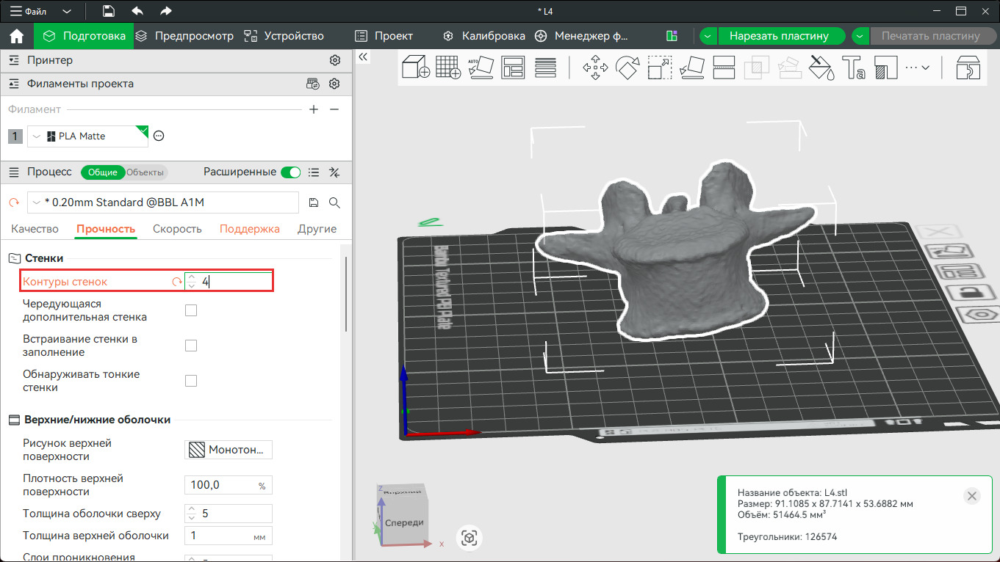

<section class="theory" markdown="1">

## Теоретические сведения
{: .section__title}

Прежде чем менять настройку, полезно оценить, сколько времени и нити она добавит. Эта страница проверяет ваши ожидания на вашем позвонке: перед каждой нарезкой вы записываете прогноз, после — фактические числа, и объясняете расхождение одной фразой. Прогноз записывается до нарезки: после нее любое число выглядит очевидным, и ошибку в рассуждении уже не найти. Опирайтесь на то, что знаете о стенках и заполнении из практики 1 ([task 1-4](../task_1/task_1-4.html), [task 1-5](../task_1/task_1-5.html)). Разбор настроек Bambu Studio и всех трех изменений вы прочитаете после занятия на [task 5-3](task_5-3.html) и сверите с ним свои объяснения.

Меняются три настройки. Число стенок задает, сколько замкнутых дорожек идет по контуру каждого слоя. Плотность заполнения задает, насколько густа решетка внутри стенок. Скорость заполнения задает, как быстро сопло ведет дорожки этой решетки. Какая из трех сильнее меняет время, а какая массу, и проверяется на странице.
{: .th-full}

</section>

<section class="goal" markdown="1">

## 🎯 Цель работы
{: .section__title}

- записывать прогноз изменения времени и массы до нарезки;
- менять по одной настройке и сравнивать результат с нарезкой той же копии без изменений;
- объяснять расхождение прогноза и факта через устройство траектории.

</section>

<aside class="callout callout--important" markdown="1">

⏱ Время и место выполнения
{: .callout__title}

Страница выполняется на первой практике по данной теме, около 20 минут, пока печатается позвонок или пока вы ждете очереди к принтеру: четыре нарезки копии проекта по 20–30 секунд, три прогноза и три объяснения в `README.md`. Копия не печатается. Таблицу проверяет преподаватель: на сайте этой проверки нет, и в счет решенных она не входит.

</aside>

<!-- ===================== 1 ===================== -->

<section class="subsection" id="s1" markdown="1">

## <span class="subsection__num">1.</span> Копия проекта и исходная нарезка
{: .subsection__title}

Программа режет одну и ту же модель немного по-разному сразу после импорта STL и после повторного открытия сохраненного проекта: у позвонка L4 общее время 1 ч 49 мин против 1 ч 45 мин при одинаковой массе. Поэтому все четыре нарезки делаются в одной копии, и сравнивается каждая только с исходной нарезкой этой копии.

1. Откройте проект `vertebra_5.3mf` («Файл» → «Открыть проект…», Ctrl+O).
1. Сохраните копию: «Файл» → «Сохранить проект как…», имя `vertebra_5_pp.3mf`. Имя начинается с `vertebra_5`, поэтому `.gitignore` не пустит копию в репозиторий. Дальше работайте только в копии.
1. Нажмите «Нарезать пластину», не меняя настроек. Запишите общее время и массу «Итого» в строку «Исходная нарезка копии» в `README.md`.
{: .steps}

</section>

<!-- ===================== 2 ===================== -->

<section class="subsection" id="s2" markdown="1">

## <span class="subsection__num">2.</span> Три изменения
{: .subsection__title}

Каждое изменение делается от исходных настроек: после нарезки верните значение назад и только потом меняйте следующее. Все поля — в панели «Процесс», режим «Общие».

| № | Изменение | Где | Исходное → новое |
|---|---|---|---|
| 1 | число стенок | «Прочность» → «Стенки» → «Контуры стенок» | 2 → 4 |
| 2 | плотность заполнения | «Прочность» → «Разреженное заполнение» → «Плотность разреженного заполнения» | 15 % → 30 % |
| 3 | скорость заполнения | «Скорость» → «Скорость остальных слоев» → «Разреженное заполнение»; вкладка «Скорость» видна, только когда включен переключатель «Расширенные» в заголовке панели «Процесс», справа от «Общие / Объекты» | 270 → 350 мм/с |
{: .table-mid}

<article class="task" id="task-1" markdown="1">

### Задание 1. Таблица «предскажи и проверь» <span class="level level--3">Уровень 3 · применение</span>
{: .task__title}

Файл: <span class="task__file">README.md</span>
{: .task__meta}

Для каждой строки таблицы:

1. Запишите в столбец «Прогноз» `README.md`, как изменятся общее время и масса: растут, падают или почти не меняются, и примерно на сколько.
1. Измените одно значение и нажмите Enter: поле станет оранжевым, у названия профиля появится «*».
1. Нажмите «Нарезать пластину» и запишите общее время и массу «Итого».
1. Сравните с прогнозом и запишите одной фразой, почему факт совпал с прогнозом или разошелся с ним.
1. Верните исходное значение: введите его снова или нажмите стрелку сброса слева от поля.
{: .steps}

В конце сохраните копию (Ctrl+S): `vertebra_5_pp.3mf` остается у вас и в репозиторий не попадает. Числа таблицы — в `README.md`.

</article>

<figure class="figure-src">
<a href="../assets/img/task_5/5-4-1.jpg" target="_blank" rel="noopener" aria-label="Открыть снимок в полном размере"></a>
<figcaption class="figure-src__caption">Измененное поле отмечено оранжевым цветом и круглой стрелкой: нажатие ЛКМ по стрелке возвращает значение профиля. Здесь «Контуры стенок» изменены с 2 на 4.</figcaption>
</figure>

</section>

<div class="check" markdown="1">

Проверьте себя
{: .check__title}

Проверяется порядок работы, а не числа: числа у каждого позвонка свои. Разбор трех изменений на эталонном позвонке L4 стоит на [task 5-3](task_5-3.html), раздел 6: откройте его после занятия.

| Показатель | Должно быть | Если не совпало |
|---|---|---|
| Масса «Итого» исходной нарезки копии | как в строке «Нарезка, отправленная на печать» ([task 5-2](task_5-2.html)) | копия сделана не из `vertebra_5.3mf` или в ней уже изменена настройка: верните значения профиля стрелками сброса |
| Общее время исходной нарезки копии | то же, что на [task 5-2](task_5-2.html), или на 2–4 % меньше | это разница нарезки после повторного открытия проекта (раздел 1); при большей разнице проверьте настройки |
| После каждого изменения | поле возвращено к исходному значению: оранжевой отметки нет, у названия профиля нет «*» | нажмите стрелку сброса слева от поля |
| Таблица в `README.md` | три строки, в каждой прогноз, общее время, масса и объяснение | допишите недостающее; прогноз после нарезки не исправляйте |

</div>

<section class="then" markdown="1">

## Затем
{: .then__title}

1. Добавьте `README.md` с таблицей в репозиторий.
1. Между первой и второй практикой по данной теме прочитайте [task 5-3](task_5-3.html): в ее разделе 6 разобраны все три изменения. Сверьте с разбором свои объяснения и, если нужно, допишите их; прогнозы не исправляйте.
1. Затем прочитайте [task 5-5](task_5-5.html) и пройдите мини-тесты обеих страниц.
{: .steps}

```text
print_5/
├── .gitignore
├── L4.stl
├── README.md
├── vertebra_5.3mf
├── vertebra_5.gcode.3mf
└── @@vertebra_5_pp.3mf@@
```
{: .folder-tree}

</section>

<section class="section sources" markdown="1">

## Источники
{: .section__title}

1. Лекция 3 «Цифровой конвейер аддитивного производства», блок 6 (слайд 79): периметры и заполнение.
1. Bambu Studio 2.9.2.62, проверено на программе 27.11.2026: поля «Контуры стенок», «Плотность разреженного заполнения» и «Разреженное заполнение» (скорость), отметка измененного поля и стрелка сброса, разница нарезки сразу после импорта и после повторного открытия проекта.
{: .sources__list}

</section>
