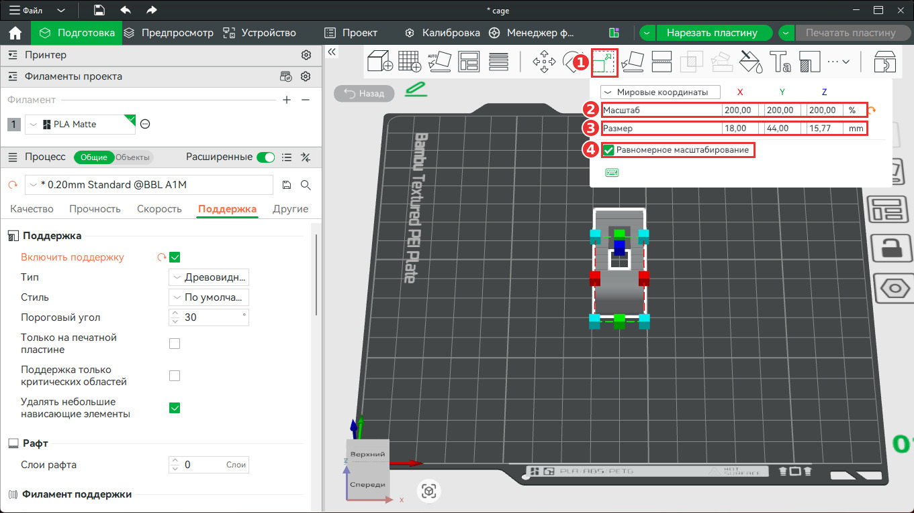
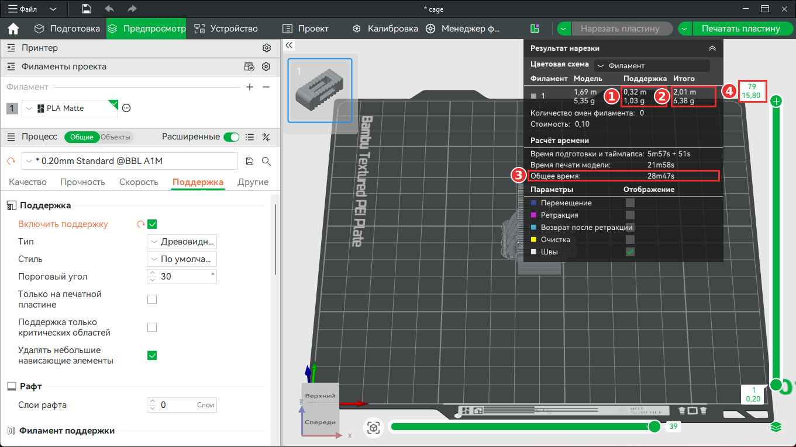
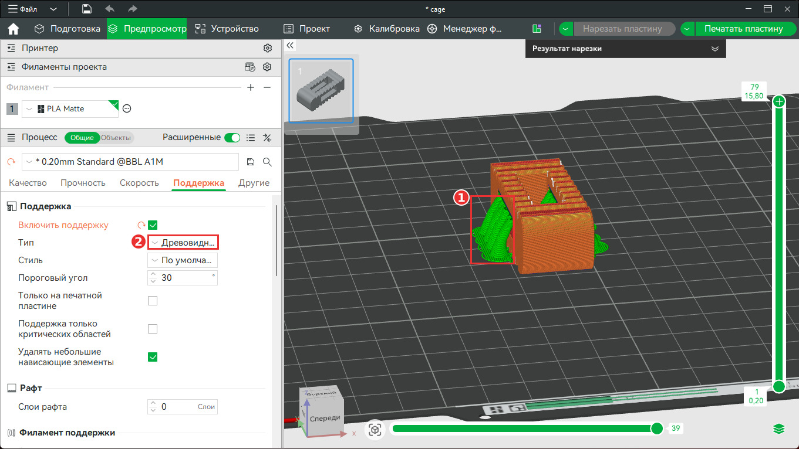
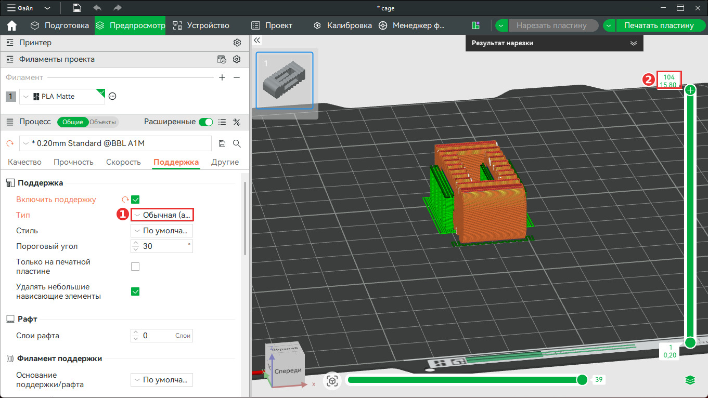
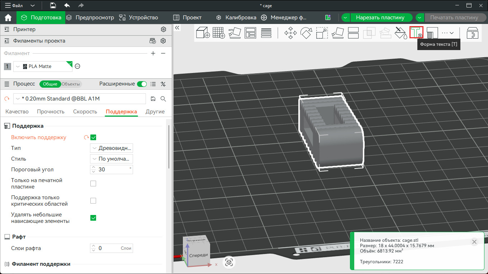
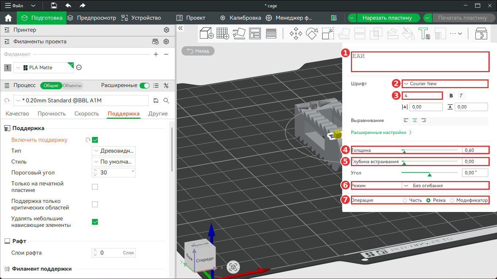
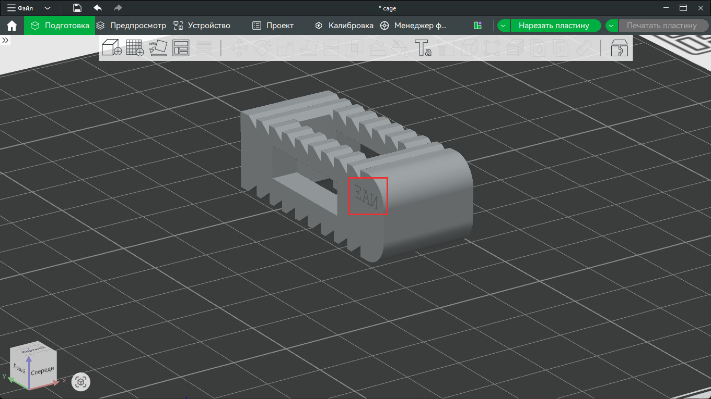
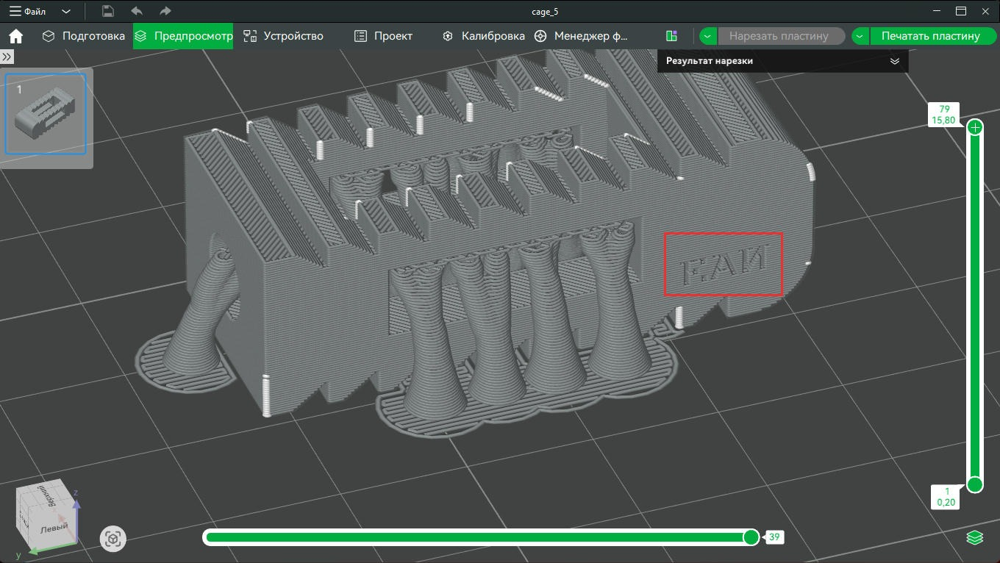

<section class="theory" markdown="1">

## Теоретические сведения
{: .section__title}

Кейдж из практики 4 печатается вдвое больше настоящего: в масштабе 1 : 1 окна шириной 3–4 мм и зубцы с шагом 2 мм принтер с соплом 0,4 мм передал бы грубо. В отличие от позвонка у кейджа есть плоские грани, и поддержки в некоторых положениях почти не нужны. Положение выбирается по трем признакам: масса нити на поддержки, время печати и то, как нагрузка позвоночника ложится на швы между слоями ([task 5-5](task_5-5.html), раздел 4). По третьему признаку ни одно положение не выигрывает при всех видах нагрузки, поэтому выбор обосновывается, а не угадывается.

На позвонке поддержки были неизбежны, и вы сравнивали только их количество. Здесь вы сравните еще и два типа поддержек — древовидную и обычную — и поставите на кейдж свою подпись: инициалы, вырезанные в боковой стенке. По подписи преподаватель узнает вашу деталь в коробке у принтера.
{: .th-full}

</section>

<section class="goal" markdown="1">

## 🎯 Цель работы
{: .section__title}

- масштабировать модель в слайсере и проверять размер;
- сравнивать три положения детали по массе поддержек, времени и направлению слоев относительно нагрузки;
- сравнивать древовидную и обычную поддержку для выбранного положения;
- добавлять утопленную подпись инструментом «Форма текста»;
- выбирать и обосновывать положение и тип поддержки.

</section>

<aside class="callout callout--important" markdown="1">

⏱ Время и место выполнения
{: .callout__title}

Страница выполняется на второй практике по данной теме, около 40 минут: пять нарезок кейджа по 10–15 секунд, подпись, сохранение и отправка на печать. Сравнение положений и выбор проверяет преподаватель по таблице в `README.md`. Перед страницей пройдите мини-тест [task 5-5](task_5-5.html).

</aside>

<!-- ===================== 1 ===================== -->

<section class="subsection" id="s1" markdown="1">

## <span class="subsection__num">1.</span> Импорт и масштаб 2 : 1
{: .subsection__title}

1. Создайте новый проект: «Файл» → «Новый проект» (Ctrl+N).
1. Импортируйте свой кейдж `cage.stl` из папки `cad_4` (Ctrl+I). Если файла нет, возьмите эталон [`cage_ref.stl`](../assets/files/cage_ref.stl). Размер в сообщении справа внизу: 9 × 22,0002 × 7,88394 мм.
1. Включите поддержки: «Процесс», режим «Общие», вкладка «Поддержка» → флажок «Включить поддержку». Тип «Древовидная (авто)» и порог 30 не меняйте.
1. Выберите кейдж ЛКМ и нажмите на панели инструментов «Масштаб [S]». Проверьте, что флажок «Равномерное масштабирование» стоит.
1. Нажмите ЛКМ в поле «Масштаб» по оси X, выделите значение (Ctrl+A), введите `200` и нажмите Enter. Строка «Размер» покажет 18,00 × 44,00 × 15,77 мм.
{: .steps}

Сама модель `cage.stl` остается в реальном размере: масштаб хранится в проекте. Дробные числа в полях программы вводятся с запятой (`0,6`): число с точкой поле может прочитать иначе.
{: .th-full}

<figure class="figure-src">
<a href="../assets/img/task_5/5-6-1.jpg" target="_blank" rel="noopener" aria-label="Открыть снимок в полном размере"></a>
<figcaption class="figure-src__caption">1 — «Масштаб [S]»; 2 — «Масштаб» 200 %; 3 — «Размер» 18,00 × 44,00 × 15,77 мм; 4 — «Равномерное масштабирование».</figcaption>
</figure>

</section>

<!-- ===================== 2 ===================== -->

<section class="subsection" id="s2" markdown="1">

## <span class="subsection__num">2.</span> Три положения
{: .subsection__title}

Положение проверяется по высоте детали в строке «Размер» инструмента «Масштаб [S]» (третье число, Z). Поворот задается инструментом «Вращение [R]»: строка «Вращение (относительное)», угол по оси, Enter. Строке «Вращение (абсолютное)» не доверяйте: после поворота на 90° она может показывать другие углы; положение проверяйте по «Размеру».

| Положение | Как получить из файла | Высота Z, мм |
|---|---|---|
| плашмя | как в файле: зубцы сверху и снизу | 15,77 |
| на боку | «Вращение»: Y — 90 | 18,00 |
| на торце | от положения на боку: X — 90 | 44,00 |
{: .table-mid}

Обратный поворот задается отрицательным углом. Из положения на торце кейдж возвращается в положение плашмя двумя поворотами: X — `-90`, затем Y — `-90`; из положения на боку — одним: Y — `-90`. После возврата высота снова 15,77 мм.

Для каждого положения:

1. Поверните кейдж и проверьте высоту.
1. Нажмите «Нарезать пластину» и впишите в таблицу «Сравнение положений» `README.md` массу поддержек, массу «Итого» и общее время.
1. В последний столбец впишите, как идут слои относительно оси позвоночника и какую нагрузку несут швы ([task 5-5](task_5-5.html), раздел 4).
1. Вернитесь на «Подготовку».
{: .steps}

Если ваш кейдж в файле лежит иначе, ориентируйтесь по высоте: 15,77 мм — плашмя, 18,00 мм — на боку, 44,00 мм — на торце.

<figure class="figure-src">
<a href="../assets/img/task_5/5-6-2.jpg" target="_blank" rel="noopener" aria-label="Открыть снимок в полном размере"></a>
<figcaption class="figure-src__caption">Кейдж плашмя, «Древовидная (авто)»: 1 — поддержка 1,03 г; 2 — итого 6,38 г; 3 — общее время 28 мин 47 с; 4 — число слоев 79.</figcaption>
</figure>

</section>

<!-- ===================== 3 ===================== -->

<section class="subsection" id="s3" markdown="1">

## <span class="subsection__num">3.</span> Два типа поддержек
{: .subsection__title}

1. Выберите положение по таблице «Сравнение положений»: сравните массу поддержек, общее время и нагрузку на швы. Единственно верного ответа нет; как взвесить третий признак, сказано в «Теории к вопросам» в конце страницы.
1. Поверните кейдж в выбранное положение: после раздела 2 он стоит на торце, обратные повороты описаны под таблицей раздела 2. Проверьте высоту в строке «Размер».
1. Нарежьте его с поддержкой «Древовидная (авто)» и запишите числа во вторую таблицу `README.md` (если это положение уже нарезано в разделе 2, перенесите числа оттуда).
1. Смените тип: вкладка «Поддержка» → «Тип» → «Обычная (авто)». Нарежьте и запишите числа.
1. Выберите тип поддержки. Если выбрали древовидную, верните ее в поле «Тип».
{: .steps}

Кроме массы и времени посмотрите на ползунок слоев. С обычной поддержкой слоев больше: у эталона плашмя 104 против 79. Обычная поддержка подгоняет свой верх под каждую наклонную нижнюю грань (скос носа, зубцы), чтобы зазор между ней и деталью был ровно 0,2 мм, и для этого программа вставляет тонкие промежуточные слои: на высотах 0,65; 0,9; 1,15 мм и т. д. У древовидной поддержки таких слоев нет.
{: .th-full}

<figure class="figure-src">
<a href="../assets/img/task_5/5-6-3.jpg" target="_blank" rel="noopener" aria-label="Открыть снимок в полном размере"></a>
<figcaption class="figure-src__caption">Цветовая схема «Тип линии» (список в панели «Результат нарезки»): 1 — древовидная поддержка (зеленая) под носом; 2 — поле «Тип».</figcaption>
</figure>

<figure class="figure-src">
<a href="../assets/img/task_5/5-6-4.jpg" target="_blank" rel="noopener" aria-label="Открыть снимок в полном размере"></a>
<figcaption class="figure-src__caption">1 — «Обычная (авто)»: колонны под носом; 2 — число слоев 104 вместо 79.</figcaption>
</figure>

</section>

<!-- ===================== 4 ===================== -->

<section class="subsection" id="s4" markdown="1">

## <span class="subsection__num">4.</span> Подпись
{: .subsection__title}

Подпись вырезается на боковой стенке у носа, рядом с боковым окном. Верх и низ кейджа заняты зубцами, торцы — носом и отверстием под инструмент, а опорная грань не годится: буквы испортили бы первый слой. Если кейдж лежит на боку, одна боковая стенка стоит на столе: подпись ставится на другую, верхнюю.

1. Выберите кейдж и нажмите на панели инструментов «Форма текста [T]». Если окно узкое и кнопки нет на панели, нажмите «…» справа на панели: часть кнопок уходит во второй ряд.
1. В поле текста введите свои инициалы: три буквы кириллицей. На снимках стоит `ЕАИ` — это пример, впишите свои буквы.
1. Задайте: «Шрифт» — Courier New; размер — 4; «Толщина» — `0,6`; «Глубина встраивания» — 0; «Режим» — «Без огибания»; «Операция» — «Резка».
1. Текст ляжет на ту грань кейджа, на которую смотрит вид, или рядом с кейджем, и тогда под настройками появится предупреждение, что текст не прилегает к поверхности. Поверните вид перетаскиванием ЛКМ по пустому месту так, чтобы видеть свободную боковую стенку (для кейджа плашмя подходит и кубик видов → «Левый»), и перетащите ЛКМ желтый квадрат текста на стенку у носа, рядом с боковым окном. Если настройки текста закрывают кейдж, сверните левую панель кнопкой с двойной стрелкой влево над левым краем стола.
1. Нажмите «Нарезать пластину» и найдите буквы в предпросмотре: они вырезаны в стенке. Буквы мелкие: приблизьте вид колесом мыши, наведя курсор на подпись.
{: .steps}

Операция «Резка» вычитает буквы из стенки, «Часть» добавляет их поверх стенки, «Модификатор» меняет настройки печати внутри букв. Буквы получаются высотой около 2,3 мм: это предел для сопла 0,4 мм. Если на напечатанной детали они не читаются, кейдж подписывают маркером ([task 5-9](task_5-9.html), раздел 3). Вырезанная подпись не меняет габариты кейджа. Самопроверка находит ее в проекте как вырезающую часть с текстом и проверяет, что эта часть лежит на кейдже, а не рядом с ним.
{: .th-full}

<figure class="figure-src">
<a href="../assets/img/task_5/5-6-5.jpg" target="_blank" rel="noopener" aria-label="Открыть снимок в полном размере"></a>
<figcaption class="figure-src__caption">Кнопка «Форма текста [T]» на панели инструментов (рамка).</figcaption>
</figure>

<figure class="figure-src">
<a href="../assets/img/task_5/5-6-6.jpg" target="_blank" rel="noopener" aria-label="Открыть снимок в полном размере"></a>
<figcaption class="figure-src__caption">1 — текст; 2 — «Шрифт» Courier New; 3 — размер 4; 4 — «Толщина» 0,60; 5 — «Глубина встраивания» 0,00; 6 — «Режим» «Без огибания»; 7 — «Операция» «Резка».</figcaption>
</figure>

<figure class="figure-src">
<a href="../assets/img/task_5/5-6-7.jpg" target="_blank" rel="noopener" aria-label="Открыть снимок в полном размере"></a>
<figcaption class="figure-src__caption">Подпись на боковой стенке у носа, справа от бокового окна (левая панель свернута кнопкой с двойной стрелкой над столом).</figcaption>
</figure>

<figure class="figure-src">
<a href="../assets/img/task_5/5-6-8.jpg" target="_blank" rel="noopener" aria-label="Открыть снимок в полном размере"></a>
<figcaption class="figure-src__caption">Предпросмотр, вид приближен колесом мыши: буквы вырезаны в боковой стенке у носа (рамка).</figcaption>
</figure>

</section>

<!-- ===================== 5 ===================== -->

<section class="subsection" id="s5" markdown="1">

## <span class="subsection__num">5.</span> Выбор, сохранение и печать
{: .subsection__title}

<article class="task" id="task-1" markdown="1">

### Задание 1. Положение, поддержка и файлы кейджа <span class="level level--3">Уровень 3 · применение</span>
{: .task__title}

Файлы: <span class="task__file">README.md</span>, <span class="task__file">cage\_5.3mf</span>, <span class="task__file">cage\_5.gcode.3mf</span>
{: .task__meta}

1. Запишите под таблицами `README.md` выбранное положение и тип поддержки и обоснуйте выбор одной-двумя фразами по трем признакам: масса поддержек, время, нагрузка на швы. Назовите нагрузку, которую считаете основной, и то, в чем выбранное положение уступает другим.
1. Проверьте, что кейдж стоит в выбранном положении с выбранным типом поддержки и с подписью, и нажмите «Нарезать пластину».
1. Сохраните проект: «Файл» → «Сохранить проект как…», папка `print_5`, имя `cage_5.3mf`.
1. Сохраните нарезанный файл: «Файл» → «Экспорт» → «Экспортировать нарезанный файл пластины…» (Ctrl+G), имя `cage_5.gcode.3mf`.
1. Проверьте оба файла на странице [проверки файлов Bambu Studio](../bambu-check.html#cage).
1. Отправьте кейдж на печать по правилам [task 5-2](task_5-2.html), разделы 3 и 4; к имени задания допишите фамилию, например `cage_5_Ivanov`.
{: .steps}

</article>

<div class="check" markdown="1">

Проверьте себя
{: .check__title}

Числа эталонных нарезок: кейдж сразу после импорта, масштаб 2 : 1, профиль 0.20mm Standard @BBL A1M. Ваш кейдж из практики 4 может немного отличаться от эталона; разница до 4 % дает и повторное открытие проекта. Время и масса на оценку не влияют.

| Положение, поддержка | Поддержка, г | Итого, г | Общее время | Слоев |
|---|---|---|---|---|
| плашмя, древовидная | 1,03 | 6,38 | 28 мин 47 с | 79 |
| на боку, древовидная | 1,08 | 6,72 | 30 мин 49 с | 90 |
| на торце, древовидная | 1,34 | 7,15 | 38 мин 40 с | 220 |
| плашмя, обычная | 1,33 | 6,68 | 26 мин 56 с | 104 |
| плашмя, древовидная, с подписью | 1,03 | 6,39 | 28 мин 53 с | 79 |

Если высота не 15,77 / 18,00 / 44,00 мм, масштаб не 2 : 1 или кейдж повернут не на 90°. Если масса поддержек 0, флажок «Включить поддержку» снят.

</div>

</section>

<article class="task" id="task-2" markdown="1">

### Задание 2. Вопросы к странице <span class="level level--2">Уровень 2 · понимание</span>
{: .task__title}

<div class="theory" markdown="1">

Теория к вопросам
{: .analysis__title}

**Слои и нагрузка.** В позвоночнике кейдж сжат по высоте, от верхних зубцов к нижним; при движениях добавляются сдвиг и кручение ([task 5-5](task_5-5.html), раздел 3). Плашмя слои лежат поперек этой оси: сжатие прижимает их друг к другу, и при сжатии слабость швов не проявляется; зато сдвиг в любую сторону и кручение идут вдоль швов. На боку и на торце слои идут вдоль оси: сжатие передается по слоям, а швы нагружает сдвиг только в одном направлении — по ширине кейджа на боку, по длине на торце — и отчасти кручение ([task 5-5](task_5-5.html), раздел 4). Положения, которое выигрывает при всех трех видах нагрузки, нет.

**Признаки у эталона.** Плашмя — меньше всего нити (6,38 г) и времени (28 мин 47 с). На торце — 220 слоев против 79, больше поддержек и почти на 10 минут дольше. По массе и времени плашмя выигрывает. По нагрузке это компромисс: плашмя лучше при осевом сжатии и хуже при сдвиге и кручении. Обоснование выбора поэтому называет нагрузку, которую вы считаете основной (у межтелового кейджа это осевое сжатие), и оговаривает, в чем положение уступает. Засчитывается любое положение, если обоснование следует из ваших чисел и из таблицы [task 5-5](task_5-5.html), раздел 4.

**Обычная и древовидная поддержка.** Обычная поддержка плашмя на треть тяжелее (1,33 г против 1,03 г) и почти на 2 минуты быстрее. Ветви древовидной поддержки касаются детали меньшей площадью, поэтому их легче отделить от зубцов и окон. Лишние слои обычной поддержки (104 против 79) — тонкие промежуточные слои под наклонными гранями.

**Место подписи.** Плашмя на столе лежат нижние зубцы, сверху — верхние: буквы там не поместятся и испортят зубцы. Торцы заняты носом и отверстием. Остаются боковые стенки, и у носа, рядом с окном, есть плоский участок для трех букв: при размере шрифта 4 буквы получаются высотой около 2,3 мм.

</div>

<div class="quiz" data-comment="#">
<p class="quiz__title">Вопросы к странице</p>
<p class="quiz__intro">Ответьте на вопросы; текст теста не сдается.</p>
<div class="quiz__q">
<p>1. Кейдж напечатан плашмя. При какой нагрузке швы между его слоями защищены, а при какой нагружены?</p>
<label><input type="radio" data-ok> Защищены при осевом сжатии: оно прижимает слои друг к другу. Нагружены при сдвиге и кручении: они идут вдоль швов.</label>
<label><input type="radio"> Защищены при любой нагрузке: плашмя слоев меньше всего, значит, меньше и швов.<span class="quiz__why" hidden>Слоев действительно меньше (79 против 220 на торце), но прочность определяет не число швов, а направление нагрузки относительно них. Сдвиг и кручение плашмя идут вдоль швов.</span></label>
<label><input type="radio"> Нагружены при осевом сжатии: оно раскрывает швы.<span class="quiz__why" hidden>Сжатие поперек слоев прижимает их друг к другу и швы не раскрывает (task 5-5, раздел 2).</span></label>
<p class="quiz__exp" hidden>Плашмя слои лежат поперек оси позвоночника. Осевое сжатие закрывает швы, а сдвиг и кручение действуют в плоскости швов. Поэтому выбор положения плашмя обосновывают тем, что основная нагрузка на кейдж — сжатие, и оговаривают сдвиг и кручение.</p>
</div>
<div class="quiz__q">
<p>2. С обычной поддержкой у кейджа плашмя 104 слоя, с древовидной — 79, хотя высота та же. Откуда лишние слои?</p>
<label><input type="radio" data-ok> Обычная поддержка вставляет тонкие промежуточные слои, чтобы ее верх шел на 0,2 мм ниже каждой наклонной нижней грани.</label>
<label><input type="radio"> Обычная поддержка печатается слоем 0,1 мм.<span class="quiz__why" hidden>Тогда слоев было бы около 158. Лишних слоев 25, и шаг по высоте у них разный: от 0,02 до 0,18 мм.</span></label>
<label><input type="radio"> Обычная поддержка поднимает деталь над столом.<span class="quiz__why" hidden>Высота последнего слоя в обоих случаях 15,80 мм: деталь не поднята.</span></label>
<p class="quiz__exp" hidden>Нижние грани скоса и зубцов лежат не на кратной 0,2 мм высоте. Чтобы выдержать верхний зазор 0,2 мм, программа добавляет слои на высотах 0,65; 0,9; 1,15 мм и т. д.</p>
</div>
<div class="quiz__q">
<p>3. Почему подпись ставят на боковую стенку, а не на верхнюю грань кейджа, лежащего плашмя?</p>
<label><input type="radio" data-ok> Верхнюю и нижнюю грани занимают зубцы: буквы испортят их и не поместятся.</label>
<label><input type="radio"> Программа не умеет ставить текст на горизонтальные грани.<span class="quiz__why" hidden>Инструмент «Форма текста» ставит текст на любую грань; ограничение дает форма кейджа, а не программа.</span></label>
<label><input type="radio"> На боковой стенке подпись не попадет в нарезку.<span class="quiz__why" hidden>Подпись попадает в нарезку на любой грани; в предпросмотре буквы видны вырезанными в стенке.</span></label>
<p class="quiz__exp" hidden>Свободный плоский участок есть только на боковых стенках у носа, рядом с боковым окном.</p>
</div>
<div class="quiz__bar"><button type="button" class="tool-btn tool-btn--main quiz__check">Проверить</button><span class="quiz__status"></span></div>
<div class="quiz__result" hidden><p>Результат:</p><pre class="quiz__comment"></pre><div class="quiz__bar"><button type="button" class="tool-btn quiz__copy">Скопировать</button><span class="quiz__copied"></span></div></div>
</div>

</article>

<section class="then" markdown="1">

## Затем
{: .then__title}

1. Пока печатается кейдж, перейдите к [task 5-7](task_5-7.html): настройки, которые часто меняют.
{: .steps}

```text
print_5/
├── .gitignore
├── @@cage_5.3mf@@
├── @@cage_5.gcode.3mf@@
├── L4.stl
├── README.md
├── task_5-5_test.txt
├── vertebra_5.3mf
├── vertebra_5.gcode.3mf
└── vertebra_5_pp.3mf
```
{: .folder-tree}

</section>

<section class="section sources" markdown="1">

## Источники
{: .section__title}

1. Лекция 3 «Цифровой конвейер аддитивного производства», блок 6 (слайды 74–75): ориентация детали, поддержки, ступенька.
1. Redwood B., Schöffer F., Garret B. The 3D Printing Handbook. 3D Hubs, 2017 — п. 11.1 (типы поддержек: древовидная касается детали меньшей площадью).
1. Ahn S.-H. et al. Anisotropic material properties of fused deposition modeling ABS. Rapid Prototyping Journal, 2002, 8(4), p. 248–257 — p. 255, 257: прочность при сжатии мало зависит от направления построения.
1. ASTM F2077-18. Test Methods for Intervertebral Body Fusion Devices. ASTM International, 2018 — п. 1.1, 1.3: испытания на сжатие, сжатие со сдвигом и кручение ([task 5-5](task_5-5.html), раздел 3).
1. Bambu Studio 2.9.2.62, проверено на программе 27.11.2026: «Масштаб [S]», «Вращение [R]», типы поддержки, «Форма текста [T]» с операцией «Резка» и кириллицей; эталонные нарезки кейджа в трех положениях и с двумя типами поддержек, G-код с промежуточными слоями поддержки.
{: .sources__list}

</section>
