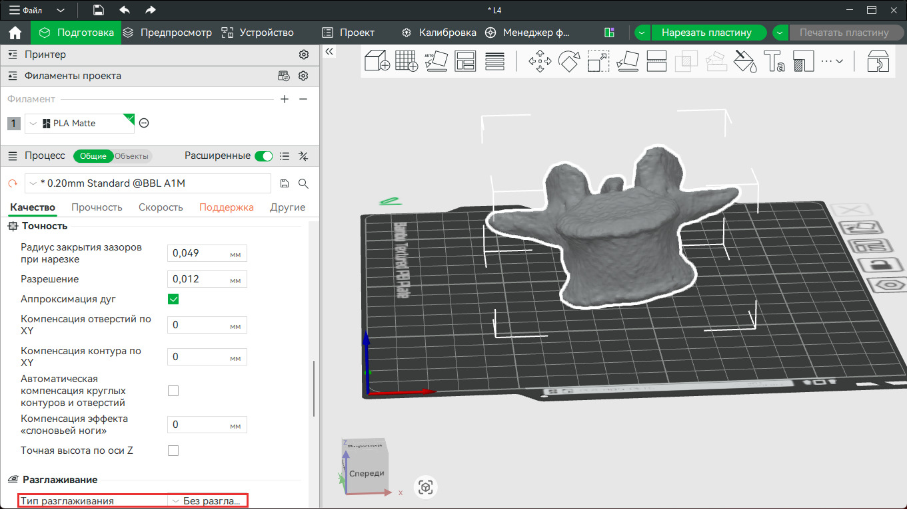
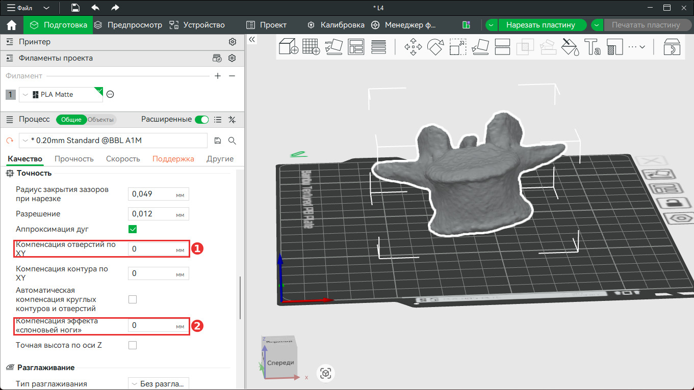
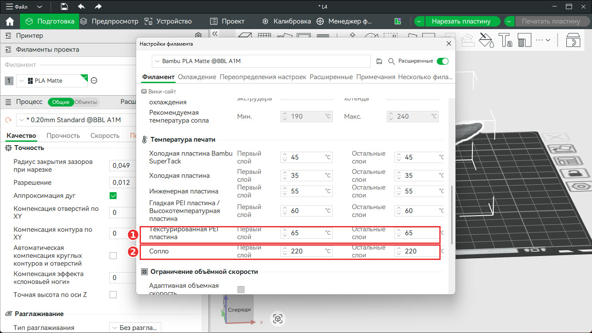
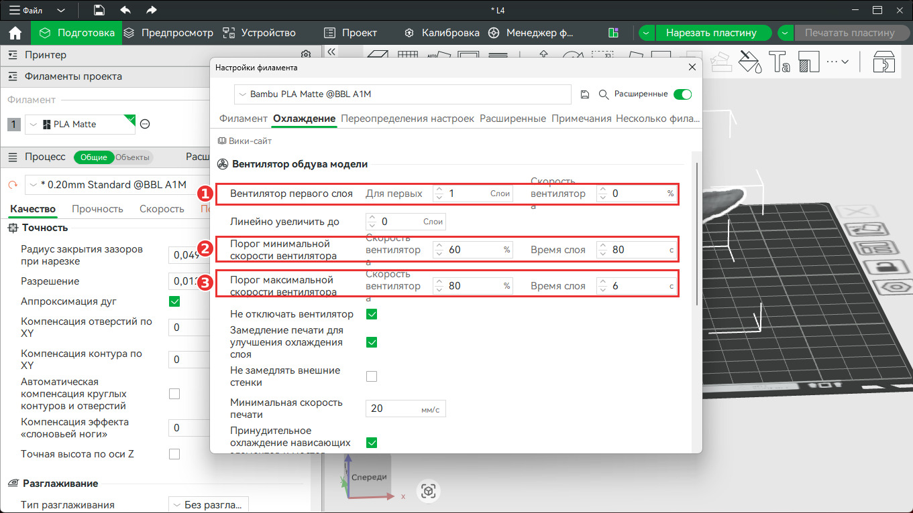

<section class="theory" markdown="1">

## Теоретические сведения
{: .section__title}

Восемь основных настроек [task 5-3](task_5-3.html) определяют время, массу и прочность. Есть еще настройки, которые в профиле по умолчанию подходят большинству деталей, но для конкретной детали их меняют часто: чтобы закрыть верхнюю поверхность, спрятать шов, не строить поддержки на самой детали, выровнять верх, получить точный диаметр отверстия, подобрать температуру и обдув. Эта страница разбирает восемь таких настроек: для каждой — что она делает, где находится, значение в профиле и пример, когда ее меняют.

Пять из восьми настроек лежат в профиле процесса, а температуры и обдув — в профиле материала: их меняют в настройках филамента, а не на вкладках процесса. Значения взяты из профилей Bambu Studio 2.9.2.62 «0.20mm Standard @BBL A1M» и «Bambu PLA Matte @BBL A1M».
{: .th-full}

</section>

<section class="goal" markdown="1">

## 🎯 Цель работы
{: .section__title}

- находить настройки процесса и материала и различать, в каком профиле лежит каждая;
- объяснять, как число верхних слоев и толщина оболочки связаны с высотой слоя;
- выбирать положение шва, поддержки только от стола и разглаживание по назначению детали;
- объяснять, зачем нужны компенсация отверстий и «слоновьей ноги»;
- объяснять, как обдув и время слоя влияют на печать мелких деталей и мостов.

</section>

<aside class="callout callout--important" markdown="1">

⏱ Время и место выполнения
{: .callout__title}

Страница выполняется на второй практике по данной теме, около 20 минут, пока печатается кейдж ([task 5-6](task_5-6.html)). Настройки на этой странице в проекте кейджа не меняются: их назначение проверяет мини-тест.

</aside>

<!-- ===================== 1 ===================== -->

<section class="subsection" id="s1" markdown="1">

## <span class="subsection__num">1.</span> Восемь настроек
{: .subsection__title}

Номера продолжают таблицу [task 5-3](task_5-3.html). Поля, отмеченные «расширенная», видны при включенном показе расширенных настроек.

| № | Настройка (в программе) | Профиль, вкладка, группа | В профиле | Когда меняют |
|---|---|---|---|---|
| 9 | Толщина оболочки сверху / Top shell layers; Слои нижней оболочки / Bottom shell layers; Толщина верхней оболочки / Top shell thickness | процесс, Прочность, «Верхние/нижние оболочки» | 5; 3; 1,0 мм | сквозь верх просвечивает заполнение; тонкий слой |
| 10 | Положение шва / Seam position | процесс, Качество, «Шов» | Выровненное / Aligned | шов должен быть на невидимой стороне |
| 11 | Только на печатной пластине / On build plate only | процесс, Поддержка, «Поддержка» | выключено | поддержки на детали трудно удалить |
| 12 | Верхние слои интерфейса / Top interface layers | процесс, Поддержка, «Расширенные»; расширенная | 2 | нижняя поверхность над поддержкой должна быть ровнее |
| 13 | Тип разглаживания / Ironing Type | процесс, Качество, «Разглаживание»; расширенная | Без разглаживания / No ironing | нужна гладкая плоская верхняя поверхность |
| 14 | Компенсация отверстий по XY / X-Y hole compensation; Компенсация эффекта «слоновьей ноги» / Elephant foot compensation | процесс, Качество, «Точность»; расширенные | 0 мм; 0 мм | отверстие или первый слой не совпадают с размером модели |
| 15 | Температура сопла / Nozzle temperature; температура стола для текстурированной PEI пластины | материал, «Филамент» | 220 °C; 65 °C | другой материал или пластик другого производителя |
| 16 | Скорость вентилятора / Fan speed; Скорость вентилятора для нависающих элементов / Fan speed for overhang; Мост / Bridge (скорость) | материал, «Охлаждение»; процесс, Скорость | 60–80 %; 100 %; 50 мм/с | провисают мосты и нависания, плывут мелкие детали |
{: .table-mid}

</section>

<!-- ===================== 2 ===================== -->

<section class="subsection" id="s2" markdown="1">

## <span class="subsection__num">2.</span> Верхние и нижние оболочки
{: .subsection__title}

Сверху и снизу детали заполнение закрывают сплошные слои — оболочка. В профиле сверху 5 сплошных слоев, снизу 3. Поле «Толщина верхней оболочки / Top shell thickness» (1,0 мм) задает нижнюю границу: если число слоев, умноженное на высоту слоя, дает меньше, слайсер добавляет слои (подсказка поля в программе). При слое 0,2 мм пять слоев дают ровно 1,0 мм. При слое 0,1 мм пять слоев дают 0,5 мм, и слайсер печатает 10 верхних слоев. Если сквозь верхнюю поверхность просвечивает решетка заполнения, верхних слоев мало.

Русское название поля «Top shell layers» в программе — «Толщина оболочки сверху», хотя это число слоев, а не толщина. Ориентируйтесь на единицу измерения рядом с полем: у числа слоев ее нет, у толщины — мм.
{: .th-full}

</section>

<!-- ===================== 3 ===================== -->

<section class="subsection" id="s3" markdown="1">

## <span class="subsection__num">3.</span> Шов
{: .subsection__title}

Каждая замкнутая стенка где-то начинается и заканчивается; в этом месте остается шов — небольшой бугорок или впадина ([task 1-3](../task_1/task_1-3.html), раздел 2). Поле «Положение шва / Seam position» задает, где слайсер начинает внешнюю стенку: «Выровненное / Aligned» (в профиле) ставит швы всех слоев в одну линию, «Ближайшее / Nearest» — в точку, ближайшую к предыдущему положению сопла, «Сзади / Back» — на заднюю сторону детали, «Случайное / Random» рассыпает швы по поверхности. Шов в одну линию легко найти и спрятать на невидимой стороне; случайный шов не дает линии, но оставляет точки по всей поверхности.

</section>

<!-- ===================== 4 ===================== -->

<section class="subsection" id="s4" markdown="1">

## <span class="subsection__num">4.</span> Поддержки только от стола и контактный слой
{: .subsection__title}

По умолчанию поддержка может стоять и на столе, и на поверхности самой детали, если под нависанием есть другая часть детали. Поле «Только на печатной пластине / On build plate only» запрещает поддержки, стоящие на детали (подсказка поля). Это нужно, когда поддержку на детали не удалить — например, внутри окна кейджа; цена — нависания, под которыми стола нет, останутся без поддержки.

«Верхние слои интерфейса / Top interface layers» — число плотных слоев на вершине поддержки, на которые ложится деталь ([task 5-3](task_5-3.html), раздел 3). Больше слоев интерфейса — ровнее нижняя поверхность детали над поддержкой и больше материала поддержки.

</section>

<!-- ===================== 5 ===================== -->

<section class="subsection" id="s5" markdown="1">

## <span class="subsection__num">5.</span> Разглаживание
{: .subsection__title}

Разглаживание (ironing) — повторный проход горячего сопла по уже напечатанной верхней поверхности на той же высоте с очень малой подачей: сопло заглаживает бороздки между дорожками (подсказка поля «Тип разглаживания / Ironing Type»). Варианты: «Верхние поверхности / Top surfaces», «Самая верхняя поверхность / Topmost surface», «Все сплошные слои / All solid layer». Разглаживание имеет смысл для плоского верха, на который смотрят; оно добавляет время на каждый разглаживаемый слой. У позвонка плоского верха нет, и разглаживать нечего.

<figure class="figure-src">
<a href="../assets/img/task_5/5-7-2.jpg" target="_blank" rel="noopener" aria-label="Открыть снимок в полном размере"></a>
<figcaption class="figure-src__caption">«Тип разглаживания» — «Без разглаживания». Модель: М. А. Головин, ФГБУ ФНОЦ МСЭ и Р им. Г. А. Альбрехта Минтруда России.</figcaption>
</figure>

</section>

<!-- ===================== 6 ===================== -->

<section class="subsection" id="s6" markdown="1">

## <span class="subsection__num">6.</span> Точность: отверстия и первый слой
{: .subsection__title}

Отверстия с вертикальной осью на экструзионном принтере обычно получаются меньше, чем в модели: сопло прижимает дорожку стенки отверстия, и материал выдавливается внутрь (Redwood et al., 2017, п. 11.4). «Компенсация отверстий по XY / X-Y hole compensation» расширяет (положительное значение) или сужает (отрицательное) отверстия модели на заданную величину; подсказка программы называет ее средством подгонки размера, когда деталь не собирается. Ось отверстия под инструмент на торце кейджа горизонтальна при печати плашмя и вертикальна при печати на торце ([task 5-5](task_5-5.html), раздел 4), поэтому компенсация действует на него не во всех положениях.

Первый слой прижимают к столу сильнее остальных, и его контур выходит шире модели — «слоновья нога». «Компенсация эффекта «слоновьей ноги» / Elephant foot compensation» сужает первый слой на заданную величину (подсказка поля). В профиле обе компенсации равны 0; их подбирают по измерениям напечатанной детали, а не заранее.

<figure class="figure-src">
<a href="../assets/img/task_5/5-7-1.jpg" target="_blank" rel="noopener" aria-label="Открыть снимок в полном размере"></a>
<figcaption class="figure-src__caption">Группа «Точность»: 1 — «Компенсация отверстий по XY» 0; 2 — «Компенсация эффекта «слоновьей ноги»» 0. Модель: М. А. Головин, ФГБУ ФНОЦ МСЭ и Р им. Г. А. Альбрехта Минтруда России.</figcaption>
</figure>

</section>

<!-- ===================== 7 ===================== -->

<section class="subsection" id="s7" markdown="1">

## <span class="subsection__num">7.</span> Температура и обдув
{: .subsection__title}

Температуры лежат в профиле материала. У Bambu PLA Matte сопло 220 °C на первом и остальных слоях, стол с текстурированной PEI пластиной — 65 °C. Значения подобраны производителем для своего материала; их меняют, когда печатают пластиком другого производителя или другого вида: у PLA в справочнике Prusa сопло 215 °C, стол 60 °C (практика 1).

Обдув детали в профиле материала включается не сразу: на первом слое вентилятор выключен, чтобы деталь лучше прилипла к столу (подсказка поля «Для первых / For the first»). Дальше скорость вентилятора меняется от 60 до 80 %: чем короче время печати слоя, тем сильнее обдув; слой короче 80 с обдувается (поле «Время слоя / Layer time»). Если слой печатается быстрее 6 с, слайсер еще и замедляет печать, чтобы слой успел остыть (там же). Это касается мелких деталей, таких как кейдж: их время зависит от охлаждения больше, чем от скорости в настройках.
{: .th-full}

Мосты и сильные нависания печатаются с обдувом 100 % и медленнее, 50 мм/с (поля «Скорость вентилятора для нависающих элементов / Fan speed for overhang» и «Мост / Bridge» на вкладке «Скорость»): быстро остывшая дорожка меньше провисает. Redwood et al. (2017, п. 11.1.1, 11.1.3) приводят ориентиры для экструзии: мост короче 10 мм печатается без поддержки, консоль — свободно висящий выступ — без поддержки допустима, если она короче 3 мм. Ребра подставки из практики 4 выступают на 1,5 мм, поэтому подставка печатается на боку без поддержек (задание по желанию на [task 5-2](task_5-2.html)).

<figure class="figure-src">
<a href="../assets/img/task_5/5-7-3.jpg" target="_blank" rel="noopener" aria-label="Открыть снимок в полном размере"></a>
<figcaption class="figure-src__caption">«Настройки филамента», вкладка «Филамент»: 1 — текстурированная PEI пластина 65 °C; 2 — сопло 220 °C на первом и остальных слоях. Модель: М. А. Головин, ФГБУ ФНОЦ МСЭ и Р им. Г. А. Альбрехта Минтруда России.</figcaption>
</figure>

<figure class="figure-src">
<a href="../assets/img/task_5/5-7-4.jpg" target="_blank" rel="noopener" aria-label="Открыть снимок в полном размере"></a>
<figcaption class="figure-src__caption">Вкладка «Охлаждение»: 1 — «Вентилятор первого слоя»: на первом слое 0 %; 2 — порог минимальной скорости: 60 %, время слоя 80 с; 3 — порог максимальной скорости: 80 %, время слоя 6 с. Модель: М. А. Головин, ФГБУ ФНОЦ МСЭ и Р им. Г. А. Альбрехта Минтруда России.</figcaption>
</figure>

</section>

<!-- ===================== 8 ===================== -->

<section class="subsection" id="s8" markdown="1">

## <span class="subsection__num">8.</span> Мини-тест
{: .subsection__title}

<article class="task" id="task-1" markdown="1">

### Задание 1. Мини-тест: настройки, которые часто меняют <span class="level level--2">Уровень 2 · понимание</span>
{: .task__title}

<div class="theory" markdown="1">

Теория к вопросам
{: .analysis__title}

**Механизм.** Сначала определите, что не так с деталью, затем — какая настройка управляет этим местом траектории, и только потом — в каком профиле она лежит.

| Что не так | Какое место траектории | Настройка | Профиль |
|---|---|---|---|
| сквозь верх видна решетка | сплошные верхние слои | верхние слои, толщина оболочки | процесс |
| линия шва на лицевой стороне | начало внешней стенки | положение шва | процесс |
| поддержку внутри окна не удалить | поддержка на поверхности детали | только на печатной пластине | процесс |
| отверстие меньше модели на 0,2 мм | стенка отверстия | компенсация отверстий по XY | процесс |
| первый слой шире модели | первый слой | компенсация «слоновьей ноги» | процесс |
| провисает мост | мост, нависание | обдув нависаний, скорость моста | материал; процесс |

Пример расчета толщины оболочки: при слое 0,1 мм пять верхних слоев дают 5 · 0,1 = 0,5 мм &lt; 1,0 мм, поэтому слайсер ставит 1,0 / 0,1 = 10 слоев.

Типичные ошибки: искать температуру на вкладках процесса; путать знак компенсации отверстий; считать, что «только на печатной пластине» уменьшает поддержки без последствий.

</div>

<div class="quiz" data-comment="#">
<p class="quiz__title">Вопросы к странице</p>
<p class="quiz__intro">Ответьте на вопросы; текст теста не сдается.</p>
<div class="quiz__q">
<p>1. Высоту слоя уменьшили до 0,1 мм, верхних слоев 5, толщина верхней оболочки 1,0 мм. Сколько сплошных слоев будет сверху?</p>
<label><input type="radio" data-ok> 10: пять слоев дают 0,5 мм, это меньше 1,0 мм, и слайсер добавляет слои.</label>
<label><input type="radio"> 5: число слоев задано явно.<span class="quiz__why" hidden>Число слоев — нижняя граница вместе с толщиной. Если 5 · 0,1 = 0,5 мм меньше 1,0 мм, слайсер увеличивает число слоев.</span></label>
<label><input type="radio"> 3: при тонком слое оболочка меньше.<span class="quiz__why" hidden>Три — число нижних слоев. Сверху их не меньше пяти и не тоньше 1,0 мм.</span></label>
<p class="quiz__exp" hidden>5 · 0,1 = 0,5 мм &lt; 1,0 мм, поэтому слоев 1,0 / 0,1 = 10.</p>
</div>
<div class="quiz__q">
<p>2. Отверстие напечаталось диаметром 7,8 мм вместо 8,0 мм. Какое значение компенсации отверстий по XY нужно задать?</p>
<label><input type="radio" data-ok> Положительное: оно расширяет отверстия.</label>
<label><input type="radio"> Отрицательное: оно расширяет отверстия.<span class="quiz__why" hidden>По подсказке программы отрицательное значение делает отверстия меньше, положительное — больше.</span></label>
<label><input type="radio"> Компенсацию «слоновьей ноги»: она отвечает за размер.<span class="quiz__why" hidden>Компенсация «слоновьей ноги» сужает только первый слой и не меняет отверстия выше него.</span></label>
<p class="quiz__exp" hidden>Положительное значение компенсации расширяет отверстия; отверстие на 0,2 мм меньше модели — его нужно расширить.</p>
</div>
<div class="quiz__q">
<p>3. Внутри окна кейджа слайсер поставил поддержку, которая стоит на нижней стенке окна. Что даст включение «Только на печатной пластине»?</p>
<label><input type="radio" data-ok> Эта поддержка исчезнет, но верх окна останется без опоры, если под ним нет стола.</label>
<label><input type="radio"> Поддержка останется, но станет древовидной.<span class="quiz__why" hidden>Тип поддержки задает другое поле. «Только на печатной пластине» запрещает поддержки, стоящие на детали.</span></label>
<label><input type="radio"> Поддержки исчезнут совсем, включая те, что стоят на столе.<span class="quiz__why" hidden>Поддержки от стола остаются; убираются только стоящие на поверхности детали.</span></label>
<p class="quiz__exp" hidden>Поле запрещает поддержки на поверхности модели и оставляет только стоящие на столе. Нависание внутри окна над стенкой детали останется без опоры.</p>
</div>
<div class="quiz__q">
<p>4. Где меняют температуру сопла для Bambu PLA Matte?</p>
<label><input type="radio" data-ok> В профиле материала (филамента): температуры лежат там.</label>
<label><input type="radio"> На вкладке «Качество» профиля процесса.<span class="quiz__why" hidden>На вкладках процесса — высота слоя, стенки, поддержки, скорости. Температуры зависят от материала и лежат в его профиле.</span></label>
<label><input type="radio"> В профиле принтера.<span class="quiz__why" hidden>Профиль принтера описывает размеры стола и сопло. Температура подбирается под материал.</span></label>
<p class="quiz__exp" hidden>Температура сопла (220 °C) и стола (65 °C для текстурированной PEI пластины) — поля профиля материала Bambu PLA Matte.</p>
</div>
<div class="quiz__q">
<p>5. Слой маленького кейджа печатается 4 с. Что сделает слайсер по профилю Bambu PLA Matte?</p>
<label><input type="radio" data-ok> Замедлит печать слоя, чтобы он успел остыть: слой короче 6 с.</label>
<label><input type="radio"> Выключит вентилятор, чтобы слой лучше прилип.<span class="quiz__why" hidden>Вентилятор выключен только на первом слое. Короткий слой, наоборот, обдувается сильнее.</span></label>
<label><input type="radio"> Напечатает слой с заданной скоростью: время слоя на скорость не влияет.<span class="quiz__why" hidden>В профиле материала задано «Время слоя» 6 с: более короткие слои слайсер замедляет.</span></label>
<p class="quiz__exp" hidden>Если расчетное время слоя меньше 6 с, скорость в G-коде снижается, чтобы слой успел остыть; поэтому время печати мелкой детали мало зависит от скорости в настройках.</p>
</div>
<div class="quiz__bar"><button type="button" class="tool-btn tool-btn--main quiz__check">Проверить</button><span class="quiz__status"></span></div>
<div class="quiz__result" hidden><p>Результат:</p><pre class="quiz__comment"></pre><div class="quiz__bar"><button type="button" class="tool-btn quiz__copy">Скопировать</button><span class="quiz__copied"></span></div></div>
</div>

</article>

</section>

<section class="then" markdown="1">

## Затем
{: .then__title}

1. Проверьте, что кейдж отправлен на печать ([task 5-6](task_5-6.html)), и перейдите к сдаче на [task 5-8](task_5-8.html).
{: .steps}

```text
print_5/
├── .gitignore
├── cage_5.3mf
├── cage_5.gcode.3mf
├── L4.stl
├── README.md
├── task_5-5_test.txt
├── vertebra_5.3mf
├── vertebra_5.gcode.3mf
└── vertebra_5_pp.3mf
```
{: .folder-tree}

</section>

<section class="section sources" markdown="1">

## Источники
{: .section__title}

1. Лекция 3 «Цифровой конвейер аддитивного производства», блок 6 (слайды 75 и 79): поддержки, периметры и заполнение.
1. Redwood B., Schöffer F., Garret B. The 3D Printing Handbook. 3D Hubs, 2017 — п. 11.1.1 (консоли), п. 11.1.3 (мосты), п. 11.4 (отверстия).
1. Bambu Studio 2.9.2.62, исходный код и профили: [github.com/bambulab/BambuStudio, тег v02.09.02.62](https://github.com/bambulab/BambuStudio/tree/v02.09.02.62) — `resources/profiles/BBL/process/0.20mm Standard @BBL A1M.json`, `resources/profiles/BBL/filament/Bambu PLA Matte @BBL A1M.json` и наследуемые профили; подсказки полей в `src/libslic3r/PrintConfig.cpp`; вкладки и группы в `src/slic3r/GUI/Tab.cpp`; русские названия в `bbl/i18n/ru/BambuStudio_ru.po`.
1. Prusa Knowledge Base, PLA: температуры 215 / 60 °C (практика 1).
{: .sources__list}

</section>
